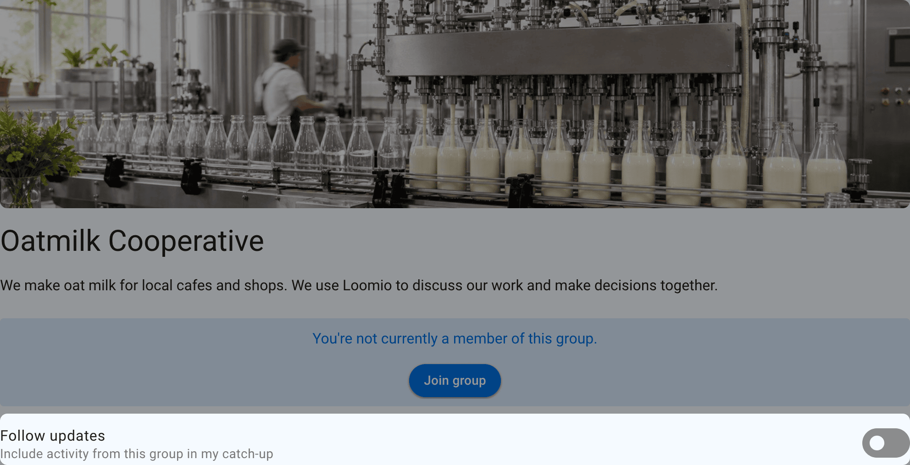

<!-- translation-section: introduction -->

# Group privacy

Privacy controls who can find a group and who can read its content. Open **Edit group settings** from the group page, then select **Privacy**.

Changing privacy affects existing content. Making a parent group private also makes its public subgroups **Visible to parent group** and their threads private.

<!-- translation-section: open -->

## Open

Open groups are public spaces. Anyone can find the group and read its discussions, polls, and files. The member list remains visible only to members.

<!-- translation-section: follow-an-open-group -->

### Follow an Open group

People can stay up to date with an Open group without joining. Following adds unread group activity to their catch-up email so they can review it in their own time. Followers do not become members, receive member voting rights, or receive immediate notifications just because they follow the group.

Turn on **Follow updates** on the group page to include its unread discussions, comments, polls, and other thread activity in your catch-up. Turn the setting off to stop including the group.

<!-- translation-section: closed -->

## Closed

Anyone can find a Closed group and read its name and description. Discussions, polls, files, and the member list are private to members and invited guests.

<!-- translation-section: visible-to-parent-group -->

## Visible to parent group

Parent group members and subgroup members can find the subgroup. Its threads are private to subgroup members and invited guests.

<!-- translation-section: secret -->

## Secret

Secret groups and their content are visible only to people who have been invited or added. Secret groups do not appear in the public group directory.

<!-- translation-section: how-people-join -->

## How people join

Under **How do people join?**, choose from the available options:

| Joining option | How it works |
| --- | --- |
| Without approval | People can join themselves |
| Approval required | People request to join and wait for approval |
| Invitation only | People need an invitation to join |

When approval is required, people select **Join group**, answer the group's joining prompt, and send a request to join. See [Inviting people](/en/user_manual/groups/inviting_people#request-to-join-group) for instructions on configuring the prompt, reviewing requests, and inviting people directly.

<!-- translation-section: group-directory -->

## Group directory

Open and Closed parent groups can be listed in the public group directory so people can discover them. Subgroups and Secret groups cannot be listed.
