<!-- translation-section: introduction -->

# Comments

Comments are the main way people participate in a discussion. Anyone with access to the thread can read them.

<!-- translation-section: reading-comments -->

## Reading comments

Threads open at the discussion context. In the right sidebar under **Jump to**, select **New to you** to go to unread activity, or **Latest** to jump to the newest items.

Unread comments show a blue **new** label beside their posting time.

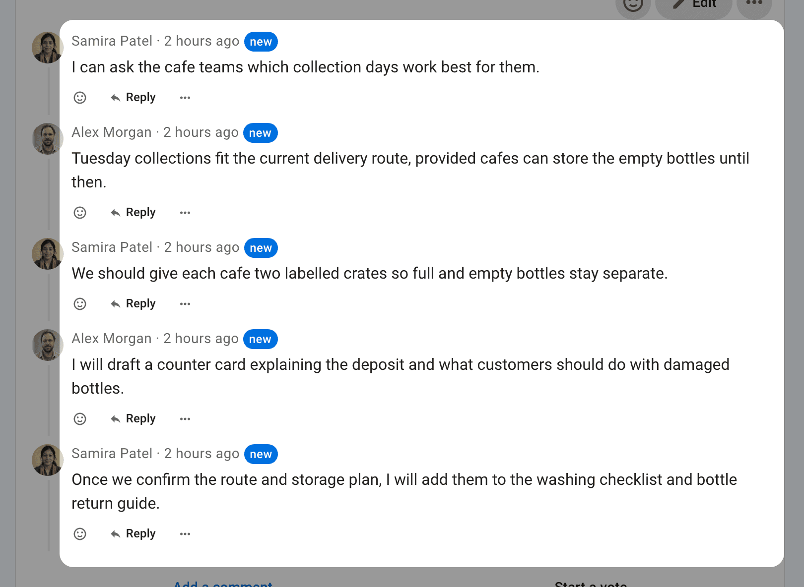

<!-- translation-section: writing-a-comment -->

## Writing a comment

Write a comment to join the conversation. Other participants can reply, react, or add their own comments.

Select **Post Comment** to publish it.

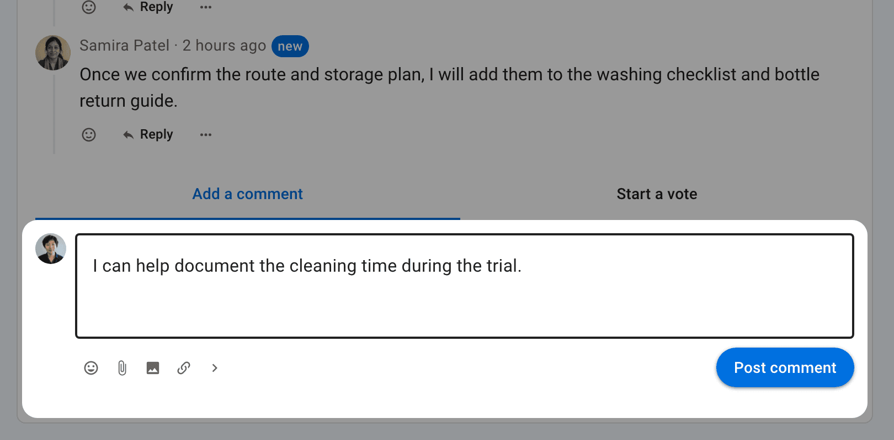

All tools in [Format text and attach files](/en/user_manual/discussions/formatting/) are available when writing comments.

<!-- translation-section: mentioning-people -->

## Mentioning people

Type **@**, start typing a person's name, and select them from the list. Mentioning someone notifies them immediately to ask for their attention or reply.

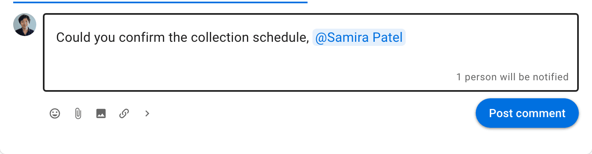

To notify everyone in the group, type **@**, start typing the group name, and select it from the list.

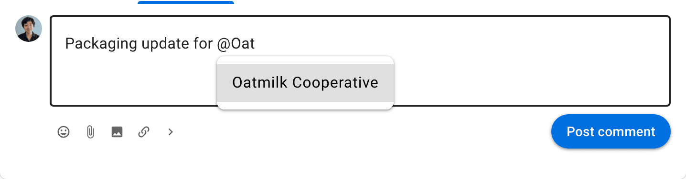

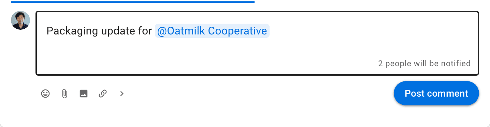

Mentioning someone does not give them access to the thread. Use **Invite people** in the thread sidebar if they are not already a thread member.

<!-- translation-section: replying-to-a-comment -->

## Replying to a comment

Select **Reply** below a comment to respond to it. Loomio prefills an @mention of the comment author so they are notified when you post. Remove the mention if you do not want to notify them.

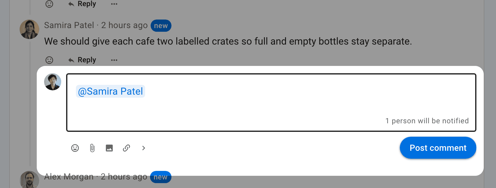

You can also reply to your own comment to nest a follow-up beneath it.

If a Loomio email says you can reply by email, your emailed reply appears in the thread.

<!-- translation-section: reactions -->

## Reactions

Select the smiley icon to react with an emoji. Reactions notify the comment author in Loomio without sending an email.

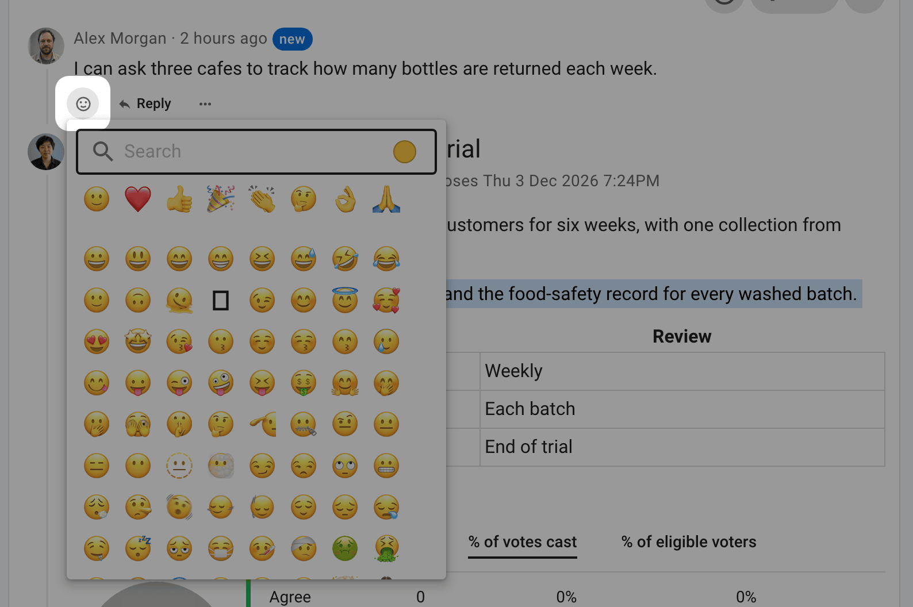

<!-- translation-section: translating-comments -->

## Translating comments

When a comment is written in a different language from yours, a **Translate** button appears below it.

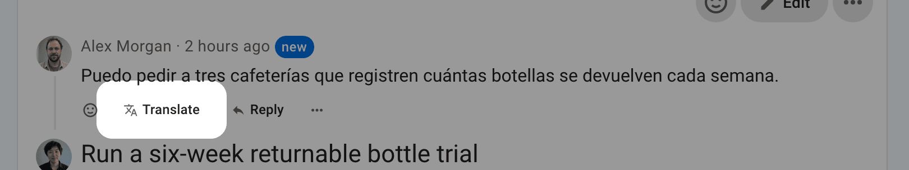

Select **Translate** to read the comment in your language.

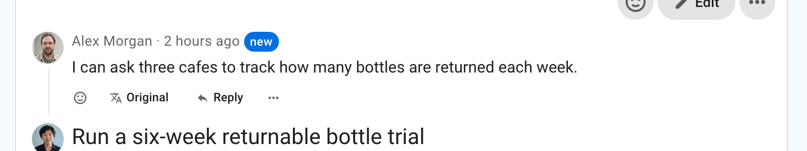

<!-- translation-section: comment-actions -->

## Comment actions

Common actions appear directly below a comment. More actions are in the three-dot menu (**⋯**).

<!-- translation-section: add-a-comment-to-jump-to -->

### Add a comment to Jump to

Select **Add to timeline** to add a comment to the thread's **Jump to** list.

You cannot edit the label directly in **Jump to**. To change the link text, select **Remove from timeline** and add the comment again.

>[!Tip]
>Highlight the words you want as the link text before selecting **Add to timeline**.

Select **Remove from timeline** to remove the item from **Jump to**.

<!-- translation-section: edit-a-comment-and-view-changes -->

### Edit a comment and view changes

You can edit a comment when:

- you wrote it and the group allows members to edit their own comments; or
- you are a group admin and **Admins can edit members' comments** is enabled in [Group permissions](/en/user_manual/groups/settings/permissions).

Select **Edit** below a comment to update it.

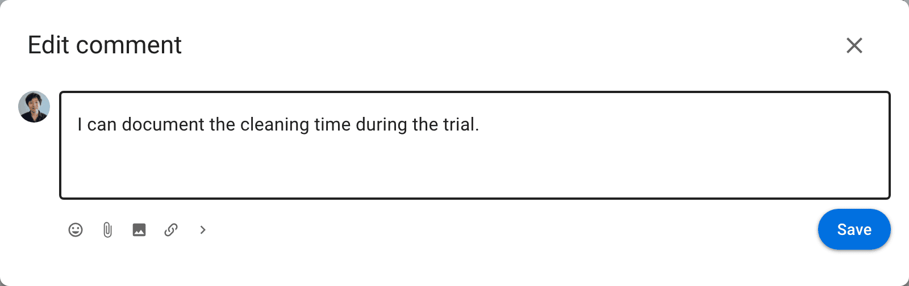

Edited comments show an **Edited** link below them.

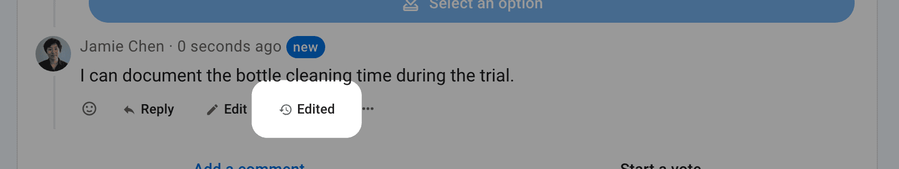

Select **Edited** to view the edit history. Red highlights show removed text, and green highlights show added text. Loomio records who made each edit and when.

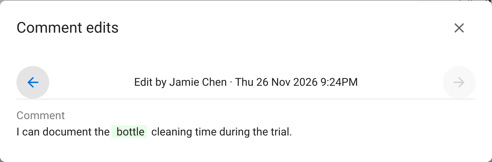

<!-- translation-section: copy-a-comment-link -->

### Copy a comment link

Select **Copy link** to copy the comment's direct URL so you can link to it elsewhere.

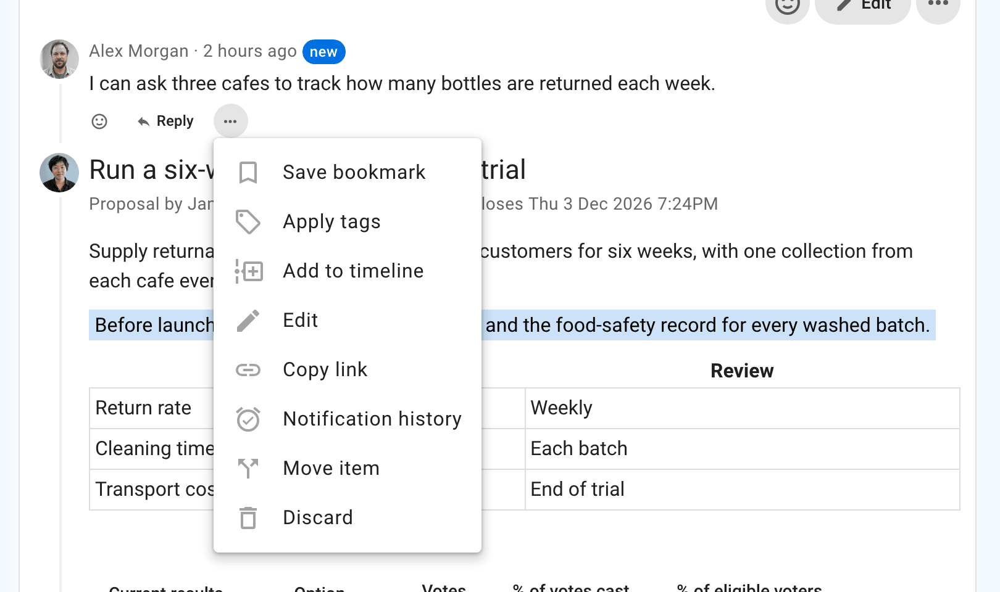

<!-- translation-section: view-notification-history -->

### View notification history

Open the three-dot menu (**⋯**) beside a comment and select **Notification history**.

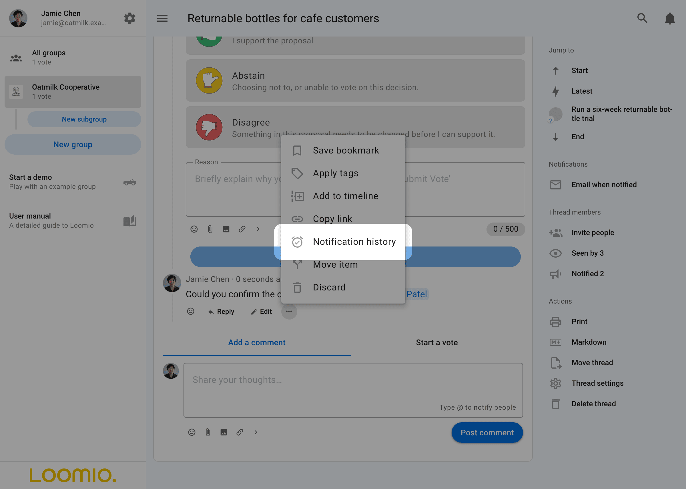

Notification history shows who was notified about the comment, when each notification was sent, and whether it was read when that information is available.

<!-- translation-section: discard-restore-or-delete-a-comment -->

### Discard, restore, or delete a comment

Discarding a comment hides its content from the thread while leaving a placeholder so it can be restored later. You can discard your own comments from the three-dot menu (**⋯**) by selecting **Discard**. Group admins can discard any comment.

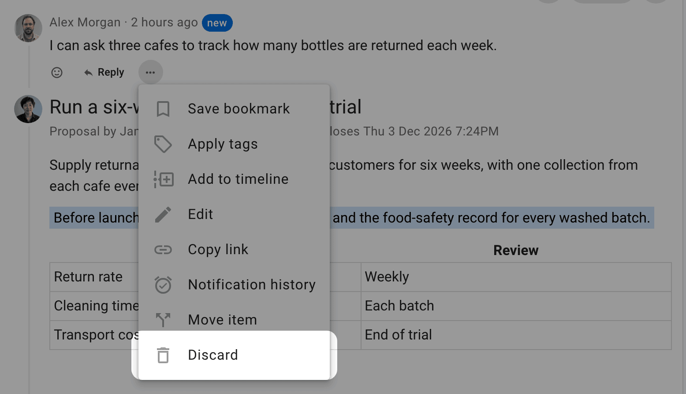

**Restore a comment**

A discarded comment appears as **Item removed**. Open its three-dot menu (**⋯**) and select **Restore** to bring it back.

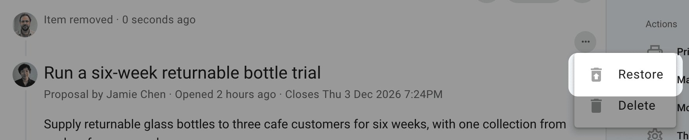

**Delete a comment**

Deleting a comment removes it permanently and cannot be undone.

Group admins can delete any discarded comment. Members can permanently delete their own discarded comments when **Members can delete their own comments** is enabled in [Group permissions](/en/user_manual/groups/settings/permissions).

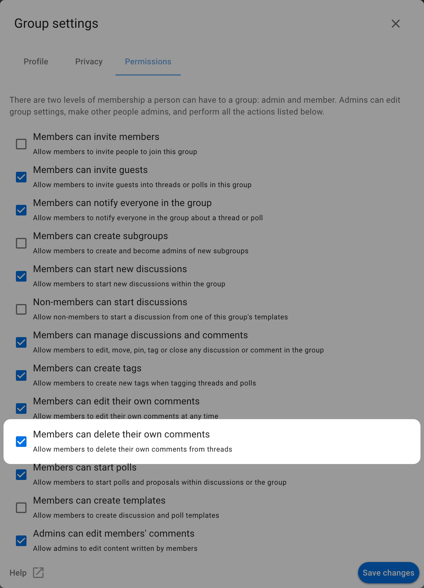

Open the three-dot menu (**⋯**) on an **Item removed** entry and select **Delete**.

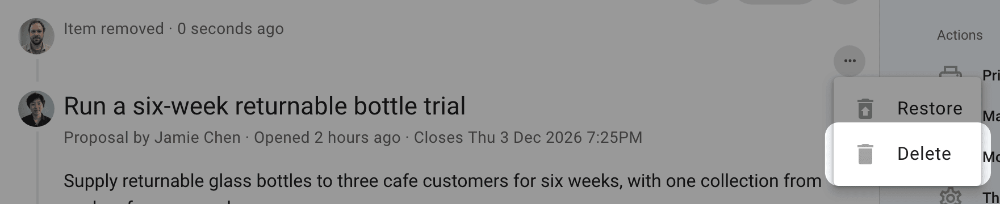

Confirm the permanent deletion in the prompt.

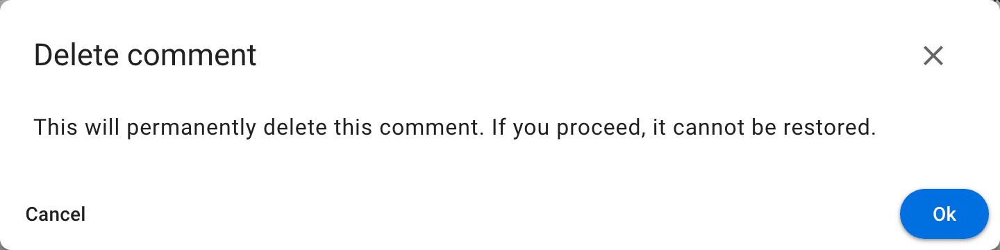
