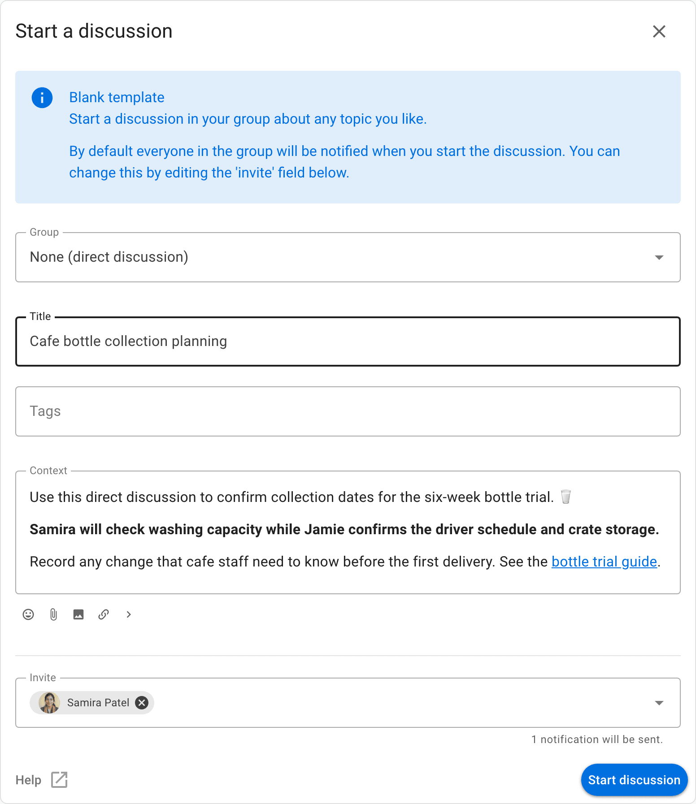
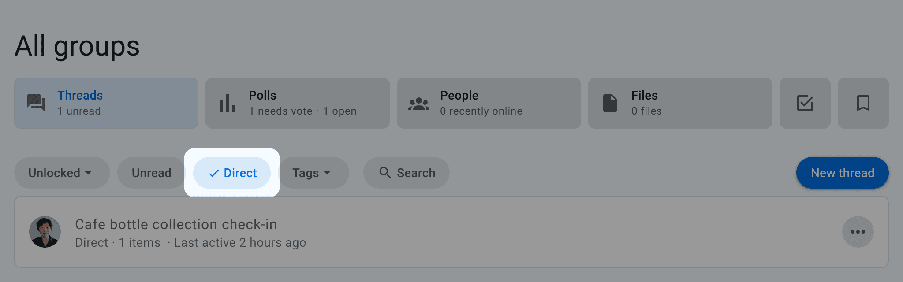

<!-- translation-section: introduction -->

# Direct discussions

A direct discussion is a private thread for specific people. It does not belong to a group, and invited people do not need to belong to any Loomio group.

Add people or email addresses to the **Invite** field to choose who can see and participate.

Direct discussions support the same comments, polls, and formatting tools as group discussions. They work well for private conversations or drafts when a subgroup is unnecessary.

Open **All groups** and select **Direct** on **Threads** (or select the direct count on the **Threads** card) to see your direct discussions. From there, select **New thread** to start a direct discussion. You can also open **People** on **All groups** and select **Direct thread** beside someone's name.

A direct poll is visible only to the people you invite. After creating it, use [Manage voters](/en/user_manual/polls/manage_voters) to invite people or email addresses.

<!-- translation-section: contacting-someone-via-a-direct-discussion -->

## Move a direct discussion into a group

If a private conversation or draft grows into a group topic, you can move it into a group or subgroup later. See [Move a thread](/en/user_manual/discussions/using_discussions/#move-a-thread).
