<!-- translation-section: introduction -->

# Format text and attach files

The formatting bar appears below the text field whenever you start or edit a discussion, create a poll, or write a comment. Select the arrow at the end of the bar to show or hide all tools.

Hover over any icon to see its name.

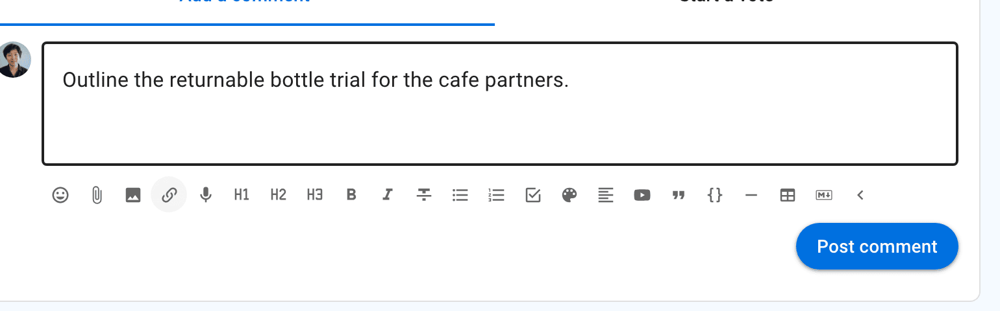

<!-- translation-section: attach-file -->

## Attach file

Select the paper clip icon below the text field to attach files from your device.

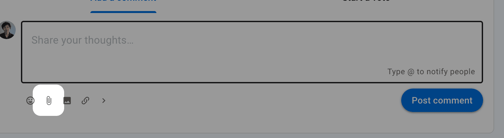

<!-- translation-section: remove-attachments -->

### Remove attachments

While editing, select **×** beside a file name to remove it.

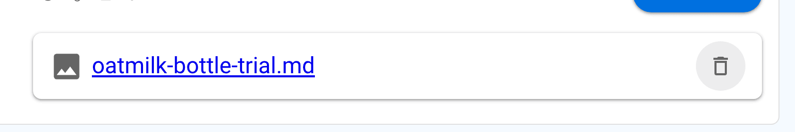

<!-- translation-section: insert-image -->

## Insert image

Select **Insert image** to upload an image, or paste one directly into the editor. The image appears inline in your discussion, poll, or comment.

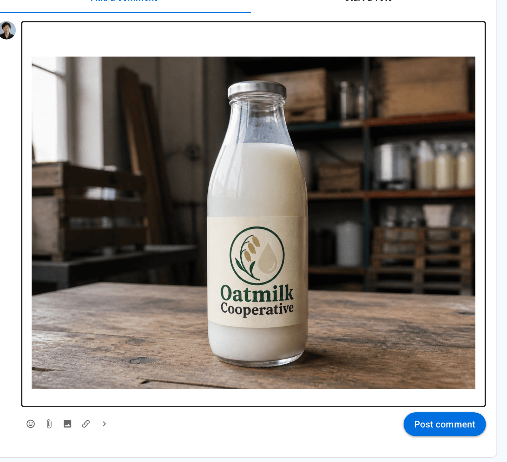

<!-- translation-section: insert-link -->

## Insert link

You can link to any webpage or online document:

1. Highlight the text you want to turn into a link.
2. Select the link icon.
3. Paste the URL into **Insert link** and select **Apply**.

Check the sharing permissions of any external document so participants can open it. If a link preview appears below your text, you can remove it.

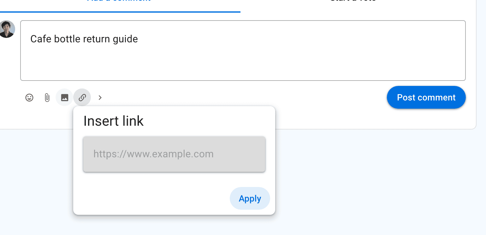

<!-- translation-section: insert-emoji -->

## Insert emoji

Select the smiley icon to pick an emoji.

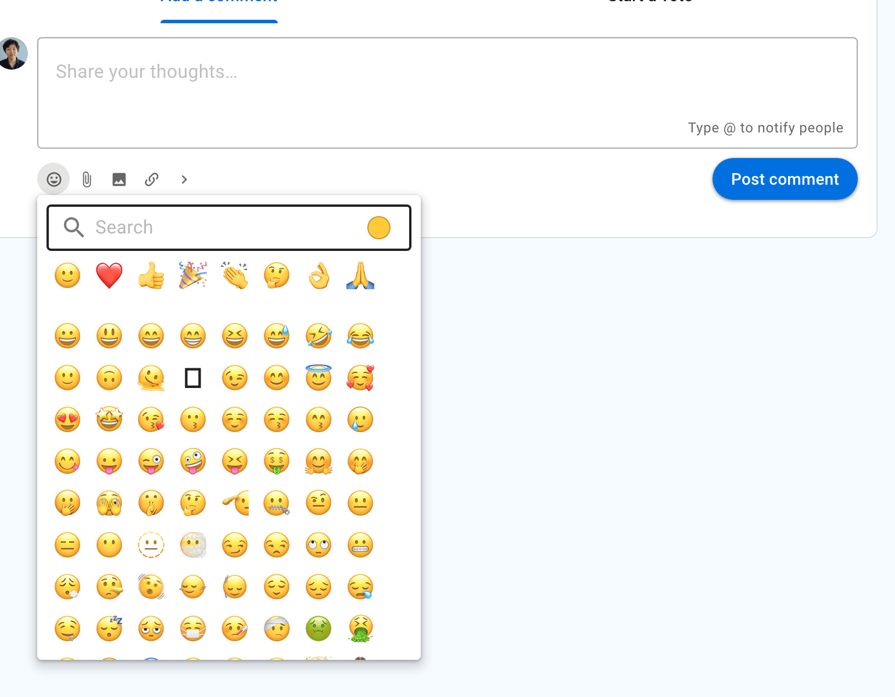

<!-- translation-section: headings -->

## Headings

Use **Heading 1**, **Heading 2**, and **Heading 3** to structure long discussions or comments.

Comments that include a **Heading 2** or **Heading 3** are automatically added to the thread's **Jump to** list.

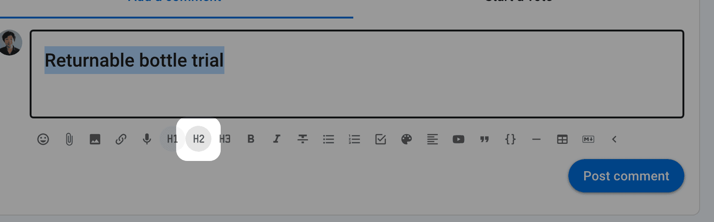

<!-- translation-section: bold-italicize-strikethrough -->

## Bold, italic, and strikethrough

Highlight text and select bold, italic, or strikethrough to emphasize or strike through words.

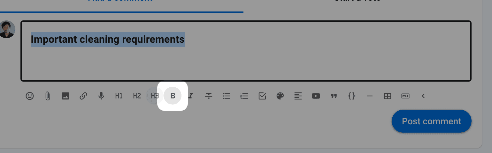

<!-- translation-section: list -->

## List

Use **List** to create bullet points.

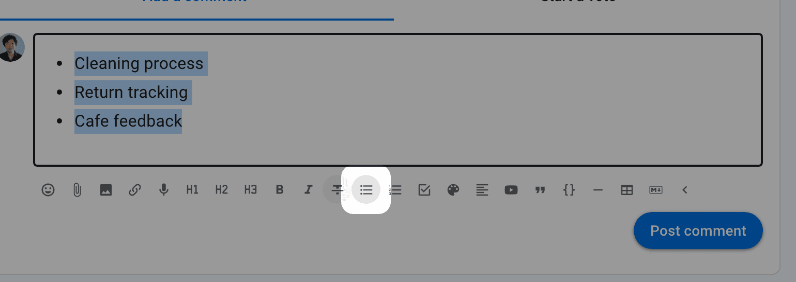

<!-- translation-section: numbered-list -->

## Numbered list

Use **Numbered list** for ordered steps or items.

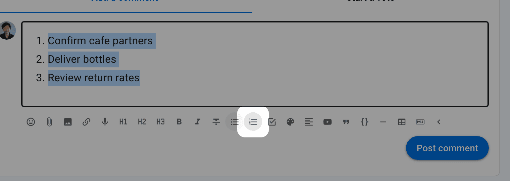

<!-- translation-section: task-list -->

## Task list

Use **Task list** to add checkboxes. Type an @mention while writing a task to assign it to a group member, then select **Add due date** to set a due date and reminder.

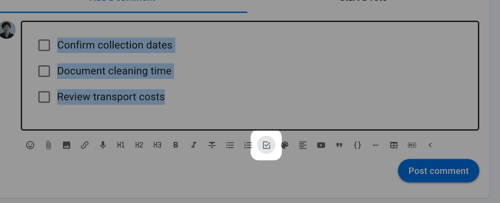

See [Assign and track tasks](/en/user_manual/discussions/tasks/) for details.

<!-- translation-section: colors -->

## Colors

Use **Colors** to highlight selected text.

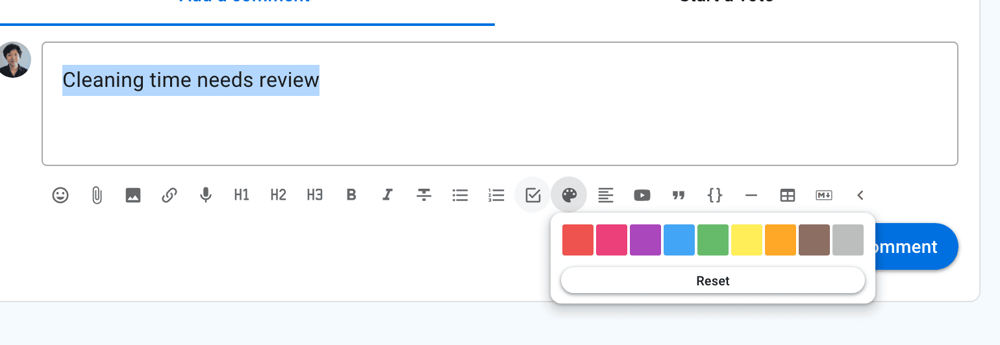

<!-- translation-section: align -->

## Align

Align text to the left, center, or right.

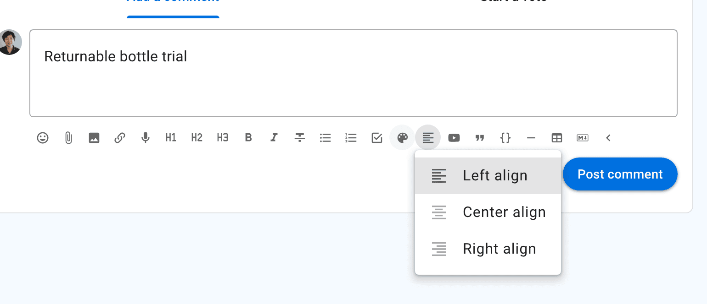

<!-- translation-section: embed-videos-and-webpages -->

## Embed videos and webpages

You can embed supported videos and webpages anywhere the formatting bar appears:

1. Copy the URL of the video or webpage.
2. Select **Embed video**, paste the URL, and select **Apply**.

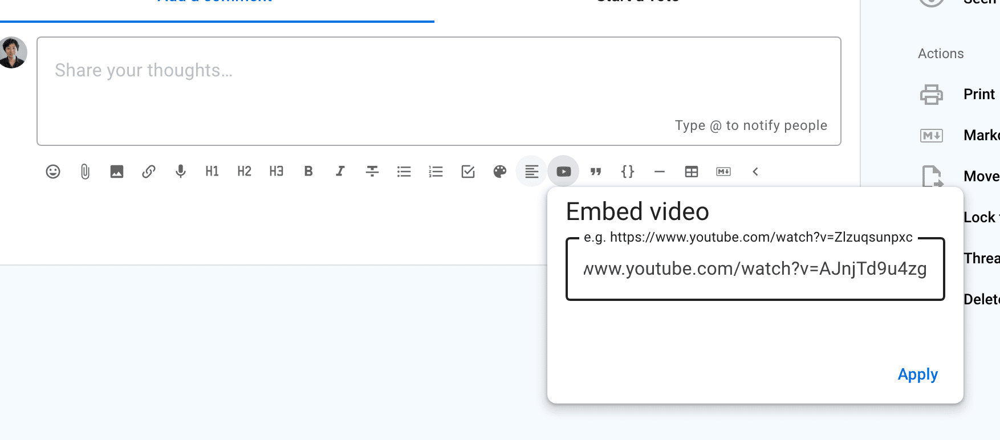

<iframe width="100%" height="380px" src="https://www.youtube-nocookie.com/embed/AJnjTd9u4zg" frameborder="0" allowfullscreen></iframe>

>[!Tip]
>Make sure everyone in the discussion can view the video. An unlisted video works well when you do not want it in public search results.

<!-- translation-section: quote -->

## Quote

Use **Quote** to set apart a quotation or call attention to key text.

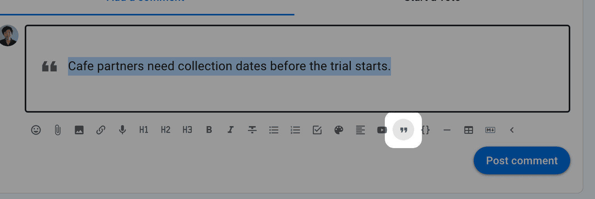

<!-- translation-section: code-block -->

## Code block

Use **Code block** to display code or preformatted text.

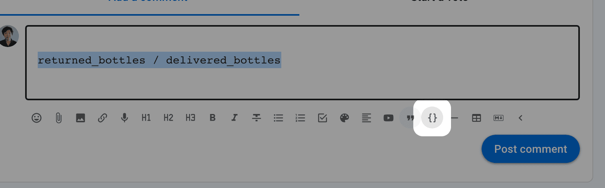

<!-- translation-section: divider -->

## Divider

Use **Divider** to insert a horizontal line between sections.

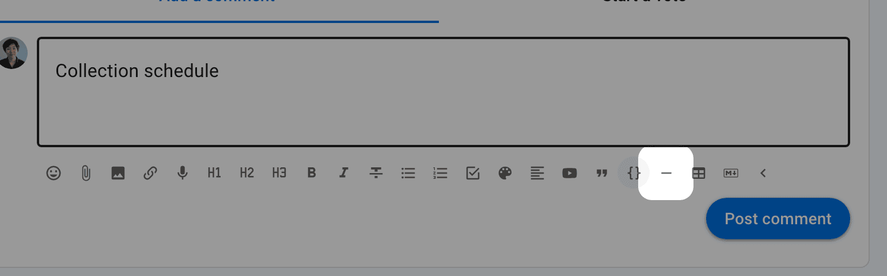

<!-- translation-section: add-table -->

## Add table

Insert a table and use the table controls to add or remove rows and columns.

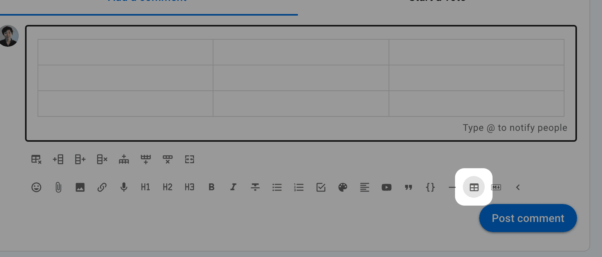

<!-- translation-section: markdown -->

## Markdown

Select **Edit Markdown** to write in Markdown.

Converting to Markdown keeps headings, bold and italic text, lists, basic tables, checked tasks, images, links, and @mentions. Videos, audio, and embedded content become links.

Text colors, highlights, underlining, alignment, and custom table layouts may be lost. Task due dates and reminders are removed; switching back to rich text creates new tasks with the same text and checked state.

<!-- translation-section: rich-text -->

### Rich text

Select **Edit rich text** to return to the formatting toolbar and convert supported Markdown into formatted text.

Select **Preview** to see how your Markdown will look without converting it.
