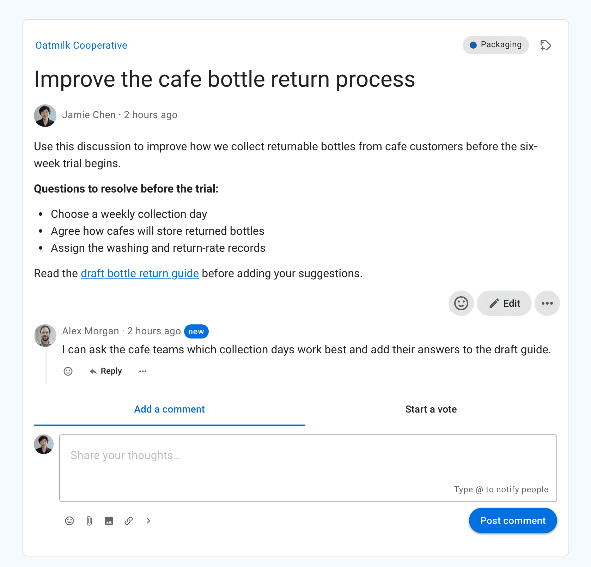

<!-- translation-section: introduction -->

# Intro to Discussions

Loomio discussions let your group share information, talk through topics, and make decisions together. People participate by posting comments, replies, polls, and proposals.

- Keep all information about a topic in one place.
- Reply by email and have your comments appear in the thread.
- See who has read the discussion and who needs a reminder.
- Keep a searchable record of every discussion and decision.

You can use discussions for anything from general updates to structured workflows and [decision-making processes](/en/user_manual/polls/intro_to_decisions/). For example, you can introduce a topic, gather ideas and supporting documents, and run a [consent](/en/user_manual/polls/proposals/consent/) or [advice](/en/user_manual/polls/proposals/advice/) process to reach an outcome.

As people comment and vote, the thread builds a record of milestones you can jump to at any time. To get started, see [Start a discussion](/en/user_manual/discussions/starting_a_discussion/) and [Using threads](/en/user_manual/discussions/using_discussions/).

<!-- translation-section: common-uses -->

## Common uses

Here are some common ways groups use discussions:

<!-- translation-section: boards-and-governance -->

### Boards and governance

- **Prepare for a meeting** — Build an agenda, share board papers, and handle administrative items so everyone arrives prepared.
- **Pass a resolution** — Share background information, answer questions, and raise a proposal to record the decision.
- **Discuss an agenda item on Loomio** — Start discussing an item before a meeting, or move it to Loomio if you run out of time.
- **Approve minutes and track actions** — Post minutes, assign tasks, and use a poll to approve the minutes.

<!-- translation-section: member-participation -->

### Member participation

- **Share news** — Post updates for members and invite comments instead of using a mailing list.
- **Organize an event** — Plan the details with your organizing team in one thread, then announce the event to the wider membership.
- **Develop a policy** — Post a draft, gather feedback, revise it, and ratify the final policy.
- **Run a General Assembly** — Share papers in advance so all members can deliberate and vote on strategic decisions.

<!-- translation-section: self-organizing-working-teams -->

### Self-organizing working teams

- **Share information** — Post updates and reports for your team and invite questions or comments.
- **Progress work** — Outline a task and gather advice or feedback from teammates as you complete it.
- **Keep meeting notes and actions** — Post meeting notes as a shared record and track follow-up tasks.
- **Explore ideas** — Raise a concern or suggest an improvement and invite discussion.
- **Run collaborative decision processes** — Prepare, propose, clarify, respond to objections, agree, and implement in one thread.
