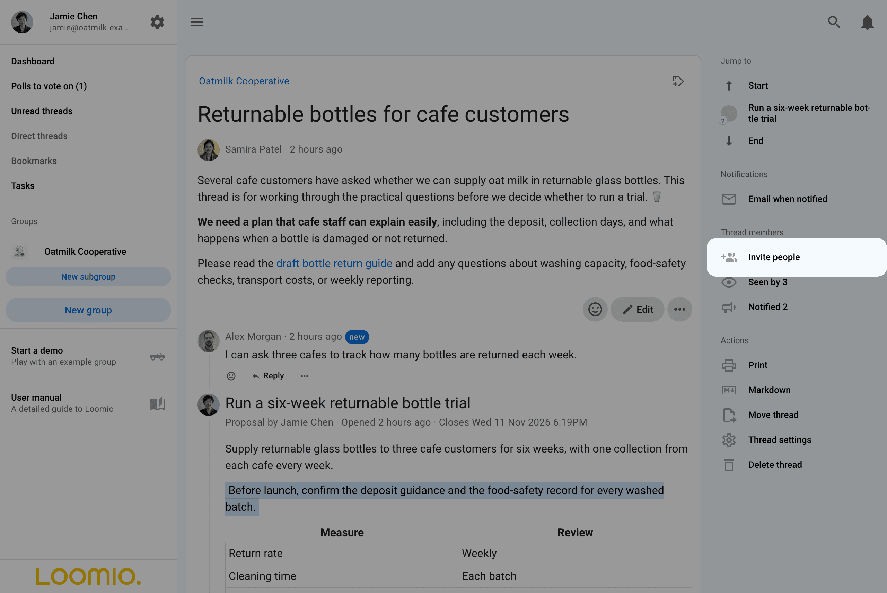
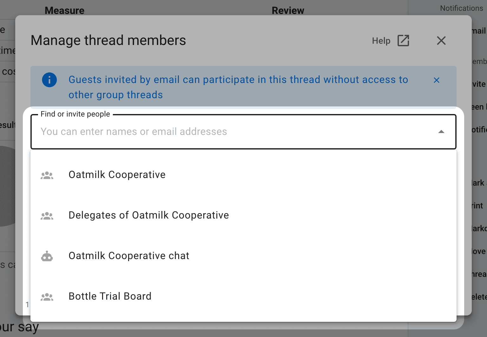
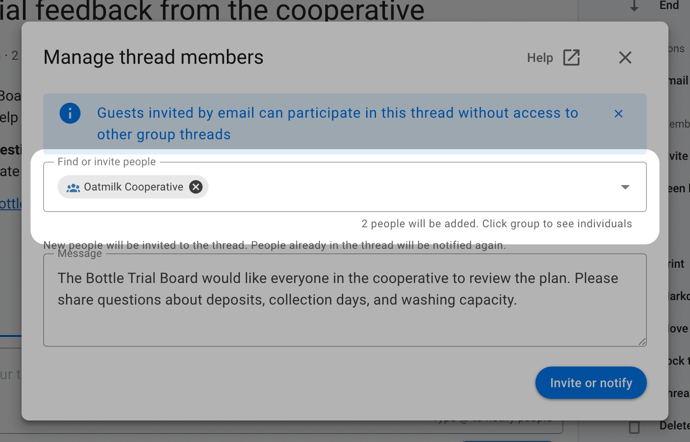
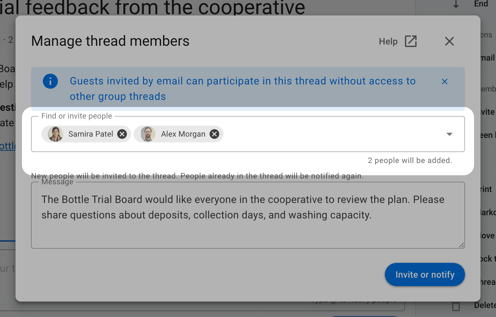
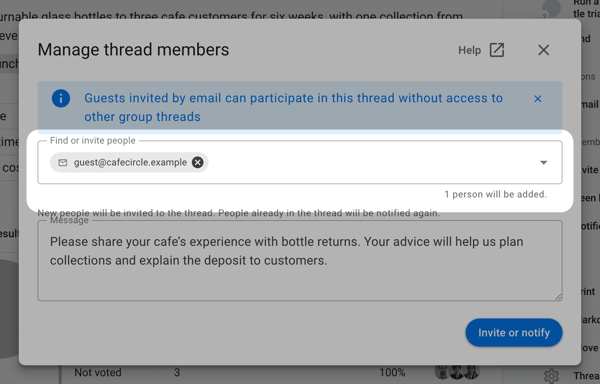

<!-- translation-section: introduction -->

# Inviting people to a discussion

Invite people to bring a discussion to their attention or give guests access to a particular thread. You can invite your group, a subgroup, the parent group, or individual people, and post invitations to connected chat rooms.

<!-- translation-section: open-invite-people -->

## Open Invite people

Select **Invite people** in the thread's right sidebar to open **Manage thread members**.

<!-- translation-section: choose-an-audience -->

## Choose an audience

Click the empty **Find or invite people** field to see the audiences available to you. Suggestions include:

- the group the discussion belongs to
- **Delegates of** a group, if it has [delegated voters](/en/user_manual/groups/delegated_voters)
- connected chat rooms, such as Slack or Microsoft Teams
- subgroups and the parent group

### Invite your group

Select your group's name to notify its members about the discussion. They already have access through their group membership.

### Invite a subgroup or the parent group

Selecting another group invites its members to this discussion. Anyone who does not belong to the discussion's own group is added as a guest: they can read and participate in this thread without joining the group or gaining access to its other private discussions.

For example, the **Bottle Trial Board** subgroup can invite its parent group, **Oatmilk Cooperative**, to discuss the bottle trial. Cooperative members outside the board join that discussion as guests. They can read and comment in it without joining the board or gaining access to its other private discussions.

### Invite delegates

Select **Delegates of** a group to invite just its delegated voters. This can be useful when asking the people responsible for a decision to discuss it first.

### Post to a chat room

Select a connected chat room to post the invitation there through its chatbot. Posting to a chat room does not give its members access to a private discussion; invite those people as guests if they need access. See [Chat integrations](/en/user_manual/integrations/chatbots).

<!-- translation-section: check-your-recipients -->

## Check who is included

After selecting an audience, check the recipient count beneath the field. Click the audience name to expand it into individual people, then select the **×** beside anyone you want to leave out of this invitation. This does not remove them from their group or take away access they already have.

<!-- translation-section: invite-by-name-or-email -->

## Invite people by name or email

Type a person's name and select them from the suggestions, or enter an email address to invite someone new. You can include several people in the same invitation.

<!-- translation-section: guest-access -->

## What guests can do

Guests can read the discussion, including its earlier comments, and add comments and replies. Inviting someone to a thread does not make them a group member or give them access to the group's other private discussions.

Guests can vote in the thread's polls that allow **Anyone in the thread**. For polls set to **Selected people only**, add them separately through [Manage voters](/en/user_manual/polls/manage_voters).

Group admins can invite guests when the group's plan supports guest access. Group members can also invite guests if the group allows it. See [Group permissions](/en/user_manual/groups/settings/permissions).

<!-- translation-section: send-invitations-and-notifications -->

## Send invitations and notifications

Add an optional message explaining why you are inviting people, then select **Invite or notify**. New people receive an invitation to the thread; people who already have access receive another notification with your message.

Recipients receive a notification in Loomio. Email and push delivery depend on their [notification settings](/en/user_manual/users/email_settings). Inviting people does not subscribe them to email for every subsequent comment; they can choose their own notification setting for the thread.

Open **Notified** in the thread sidebar to see who was notified and whether the notification has been read or its email opened, when that information is available. **Seen by** shows who has opened the discussion. See [Notifications and members](/en/user_manual/discussions/using_discussions#notifications-and-members).

<!-- translation-section: manage-thread-members -->

## Find or remove a thread member

The **Find or invite people** field also filters the list of people already in the thread. Clear the field to show the list again, and use the page controls to browse a longer list. Selecting recipients replaces the list with the invitation message until you send or clear the selection.

Thread admins and group admins can remove a guest through the three-dot menu (**⋯**) beside their name: select **Remove from discussion**. Group members retain access through their group membership.
