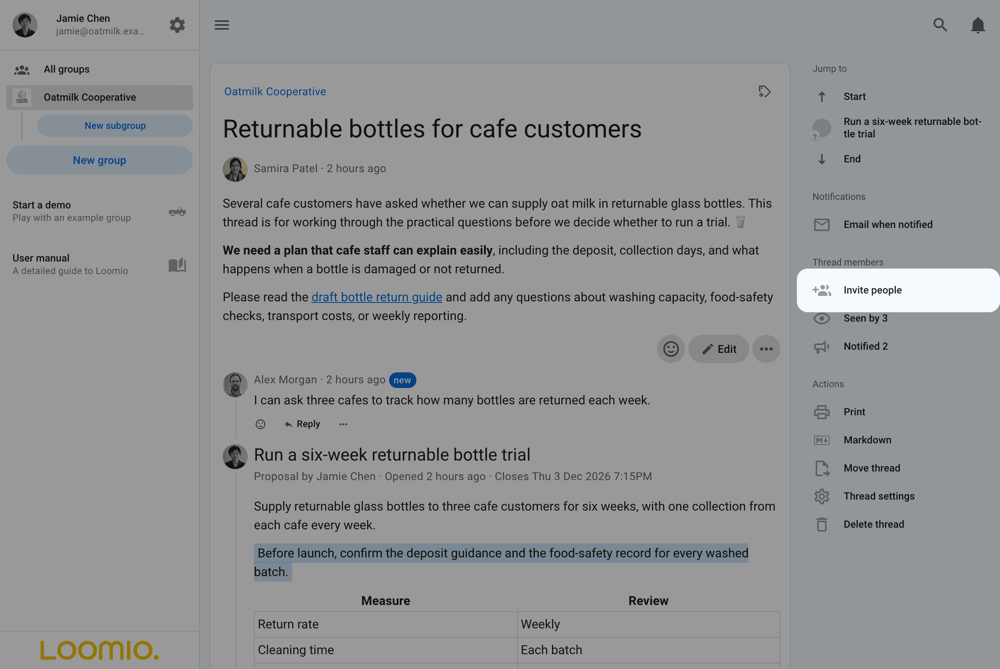
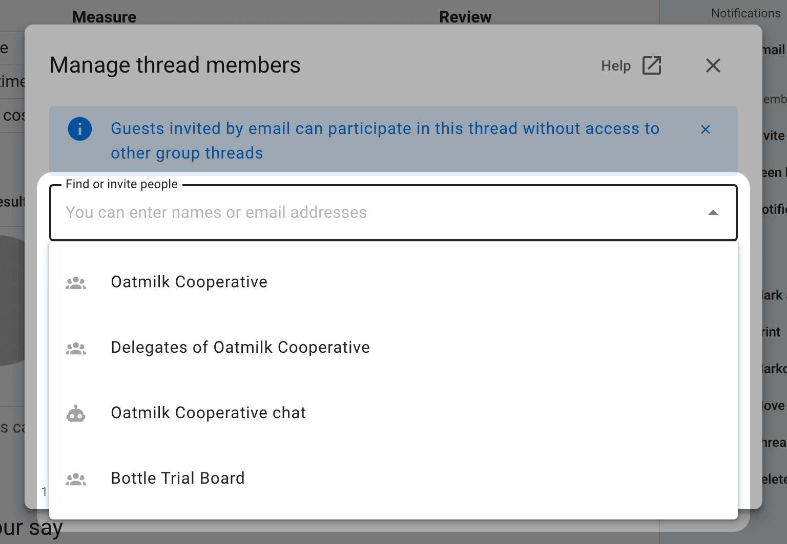
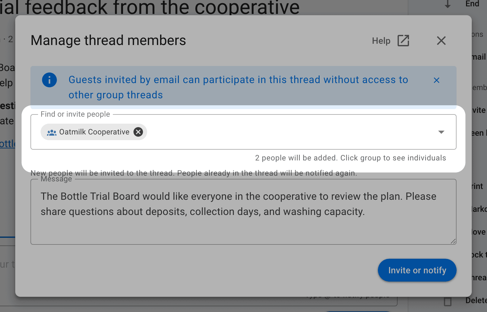
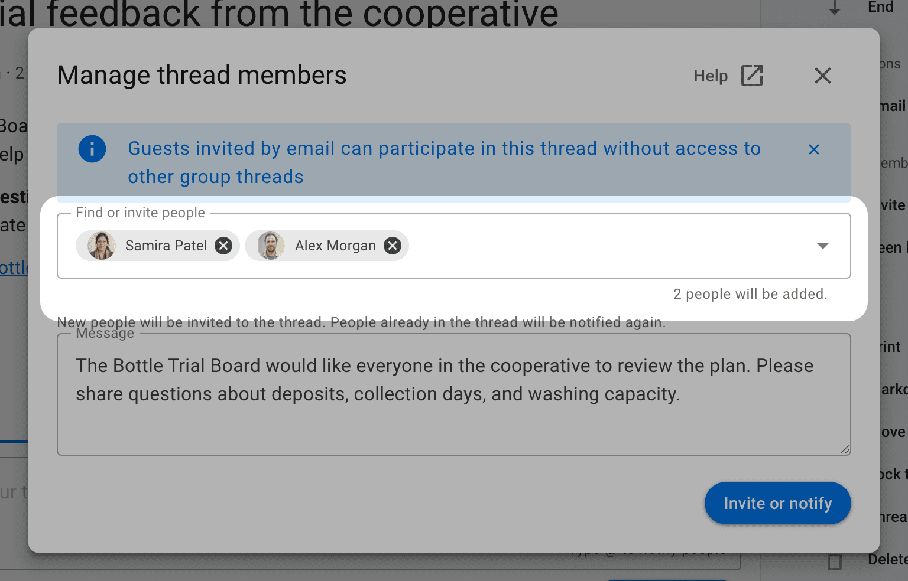
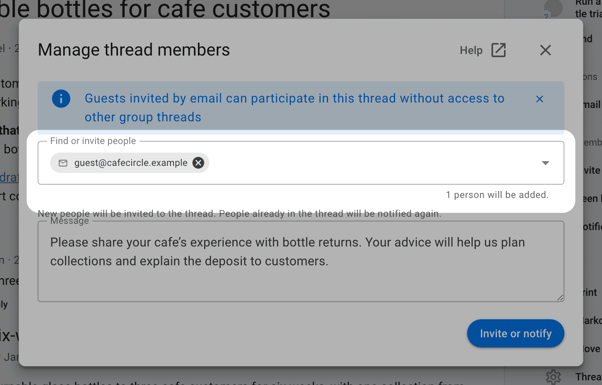

<!-- translation-section: introduction -->

# Inviting people to a discussion

Invite people to bring a discussion to their attention or give guests access to a specific thread. You can invite your group, a subgroup, the parent group, or individual people, and you can post invitations to connected chat rooms.

<!-- translation-section: open-invite-people -->

## Open Invite people

Select **Invite people** in the thread's right sidebar to open **Manage thread members**.

<!-- translation-section: choose-an-audience -->

## Choose an audience

Select the empty **Find or invite people** field to see available groups and channels:

- the group the discussion belongs to
- **Delegates of** a group, if it has [delegated voters](/en/user_manual/groups/delegated_voters)
- connected chat rooms, such as Slack or Microsoft Teams
- subgroups and the parent group

### Invite your group

Select your group's name to notify its members about the discussion. They already have access through their group membership.

### Invite a subgroup or the parent group

Selecting another group invites its members to this discussion. Anyone who does not belong to the discussion's own group joins as a guest: they can read and participate in this thread without joining the group or seeing its other private discussions.

For example, the **Bottle Trial Board** subgroup can invite its parent group, **Oatmilk Cooperative**, to discuss the bottle trial. Cooperative members outside the board join as guests for that thread only.

### Invite delegates

Select **Delegates of** a group to invite only its delegated voters. This helps when asking the people responsible for a decision to discuss it first.

### Post to a chat room

Select a connected chat room to post the invitation through its chatbot. Posting to a chat room does not give its members access to a private discussion; invite them as guests if they need access. See [Chat integrations](/en/user_manual/integrations/chatbots).

<!-- translation-section: check-your-recipients -->

## Check who is included

After choosing a group or channel, check the recipient count beneath the field. Select the group name to expand it into individual people, then select **×** beside anyone you want to leave out. This does not remove them from their group or take away access they already have.

<!-- translation-section: invite-by-name-or-email -->

## Invite people by name or email

Type a person's name and select them from the list, or enter an email address to invite someone new. You can include several people in the same invitation.

<!-- translation-section: guest-access -->

## What guests can do

Guests can read the thread, including earlier comments, and post comments and replies. Inviting someone to a thread does not make them a group member or give them access to other private discussions in the group.

Guests can vote in polls set to **Anyone in the thread**. For polls set to **Selected people only**, add them separately through [Manage voters](/en/user_manual/polls/manage_voters).

Group admins can invite guests when the group's plan supports guest access. Group members can also invite guests if the group allows it. See [Group permissions](/en/user_manual/groups/settings/permissions).

<!-- translation-section: send-invitations-and-notifications -->

## Send invitations and notifications

Add an optional message explaining why you are inviting people, then select **Invite or notify**. New people receive an invitation; people who already have access receive a notification with your message.

Recipients receive a notification in Loomio, and email or push delivery depends on their [notification settings](/en/user_manual/users/email_settings). Inviting people does not subscribe them to emails for every later comment; they can choose their own notification setting for the thread.

Open **Notified** in the thread sidebar to see who was notified and whether each notification was read or opened when available. **Seen by** shows who has opened the thread. See [Notifications and members](/en/user_manual/discussions/using_discussions#notifications-and-members).

<!-- translation-section: manage-thread-members -->

## Find or remove a thread member

Use **Find or invite people** to filter the list of current thread members. Clear the field to show the full list again, and use the page controls for longer lists. Selecting recipients temporarily replaces the member list with the invitation message until you send or clear the selection.

Thread admins and group admins can remove a guest by opening the three-dot menu (**⋯**) beside their name and selecting **Remove from discussion**. Group members keep access through their group membership.
