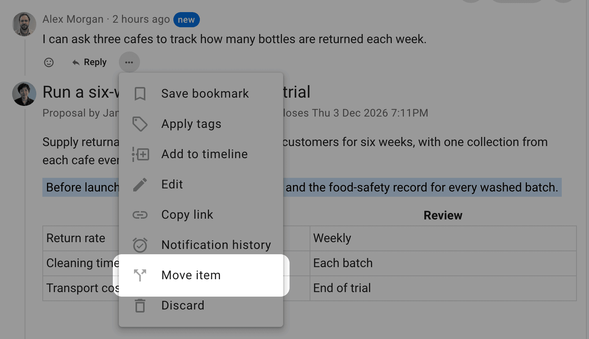
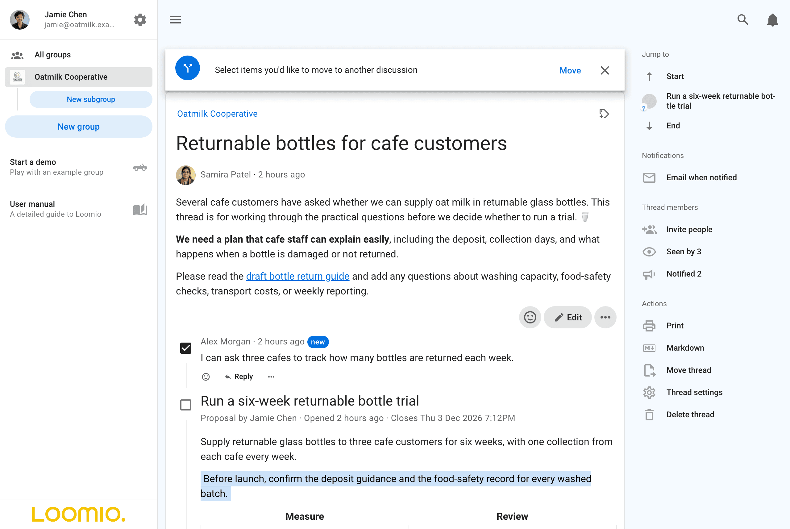
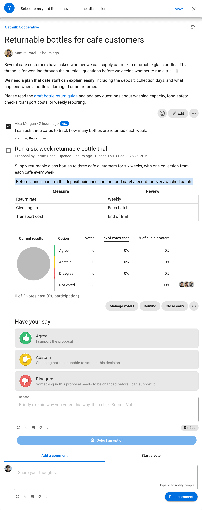
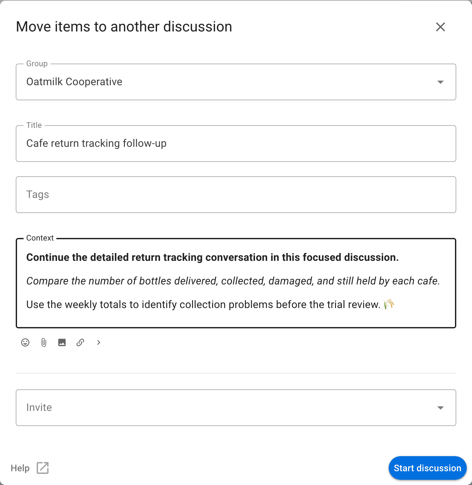
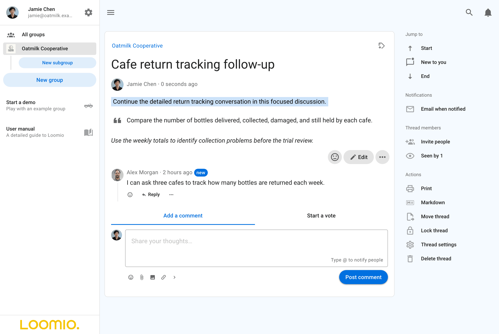

<!-- translation-section: introduction -->

# Moving items between threads

Move comments or polls when a conversation belongs in another thread, when one discussion splits into separate topics, or when you want to combine related threads.

Group admins can move items. Members can also move items when **Members can manage discussions and comments** is enabled in [Group permissions](/en/user_manual/groups/settings/permissions).

1. Open the three-dot menu (**⋯**) on an item and select **Move item**.

2. Use the checkboxes to select the items you want to move, then select **Move** in the banner at the top of the thread.

3. Choose the destination group or subgroup, then search for an existing discussion. To create a new discussion instead, select **New discussion**, add a title and context, and select **Start discussion**.

The selected items move from the original thread into the destination thread.

If the original thread is no longer needed, you can [lock it](/en/user_manual/discussions/using_discussions/#lock-or-unlock-a-thread). Delete it only if you are sure you will not need it again.
