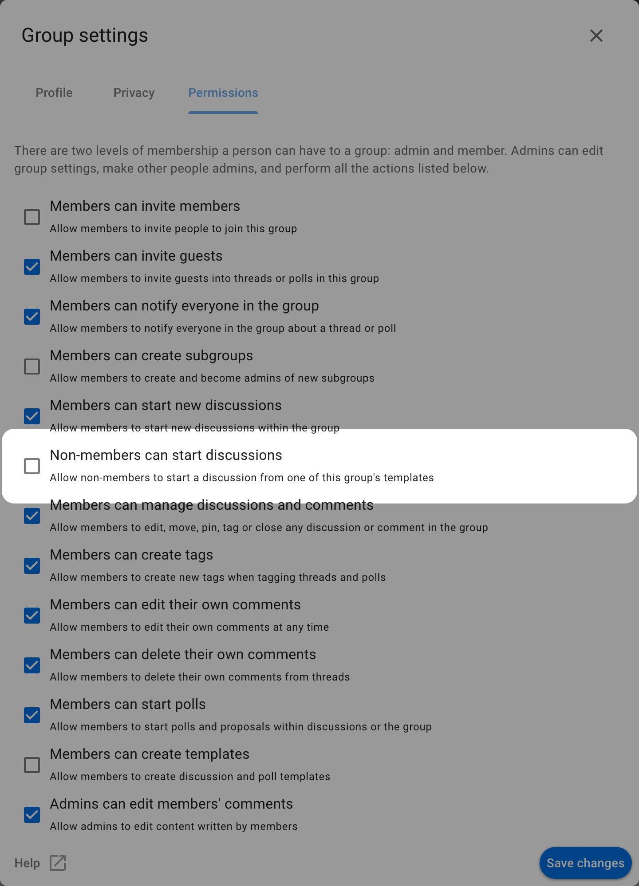

<!-- translation-section: introduction -->

# Collect private submissions

Use a Closed group to collect private submissions from people outside the group. Each submission becomes a separate discussion where the submitter and the review team can exchange information, ask questions, and record a decision. Submitters cannot see other private discussions or submissions in the group.

This works well for nominations when candidate details or the nominee list must stay private during selection. A person can nominate themselves or someone else for an election, committee, or board role, while the selection panel reviews each nomination in its own thread.

Other common uses include:

- Complaints, safeguarding reports, safety concerns, and incident reports
- Appeals and requests to reconsider a decision about an individual case
- Requests for mediation, conflict resolution, or personal support
- Applications with personal, financial, or eligibility details, such as hardship grants or scholarships
- Sealed bids or tender responses that must stay private during assessment

This workflow is private between submitters, but it is not anonymous. Submitters need a user account, and every member of the Closed group can see every submission. Review who belongs to the group before using it for sensitive information.

<!-- translation-section: enable-private-submissions -->

## Enable private submissions

You must be a group admin of the group or subgroup where you want to collect submissions.

1. Open the group.
2. Open **Settings**, then select **Edit group settings**.
3. Open **Permissions**.
4. Enable **Non-members can start discussions**.
5. Save the group settings.

This option appears only for **Open** and **Closed** groups—not **Secret** groups. If you cannot see it, open **Privacy** in group settings, set **Group privacy** to **Closed** (recommended for private submissions) or **Open**, and return to **Permissions**.

Enabling this permission does not make the group's discussions public. A non-member can start a discussion and access that thread as a guest, but cannot see other private discussions in the group.

<!-- translation-section: set-up-a-private-submission-process -->

## Set up a private submission process

1. Create a dedicated subgroup for submissions and set its privacy to **Closed**. A subgroup keeps submissions separate from the parent group's other work.
2. Add the review team or selection panel as subgroup members. Every subgroup member can see every submission, so add only people who need access.
3. Create one or more [discussion templates](/en/user_manual/discussions/templates) in the subgroup with the questions and details submitters should provide.
4. Set membership to **Invitation only** if submitters should not request to join the subgroup.
5. [Enable private submissions](#enable-private-submissions) in the subgroup's permissions.
6. Test the flow with an account that is not a member of the subgroup.
7. Share the subgroup page with submitters. They must sign in to a user account before submitting.

<!-- translation-section: make-a-submission -->

## Make a submission

The submitter opens the subgroup and selects **New thread**. Loomio shows the subgroup's discussion templates. The submitter chooses the right template, answers its questions, and starts the discussion.

The discussion belongs to the subgroup, and Loomio adds the submitter as a guest on that thread—not as a subgroup member. They can participate in their own thread with the review team, but cannot see other private discussions or submissions in the subgroup.

<!-- translation-section: review-submissions -->

## Review submissions

Subgroup members can see every submission thread in the subgroup. They can ask follow-up questions and use comments, polls, or other tools to complete the review.

If someone else needs to weigh in, a subgroup member with permission can invite them to that thread. For example, after a nominator submits a nomination, the panel can invite the nominee to the thread. The invited person joins as a guest without gaining access to other private discussions in the subgroup.

When submissions close, disable **Non-members can start discussions**. Existing submission threads and guest access stay unchanged.
