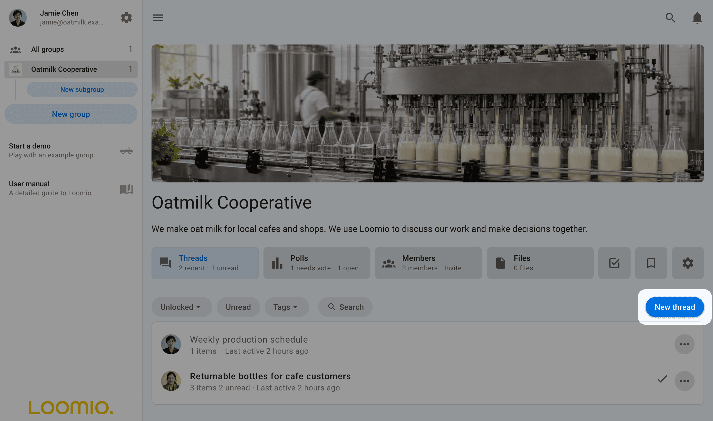
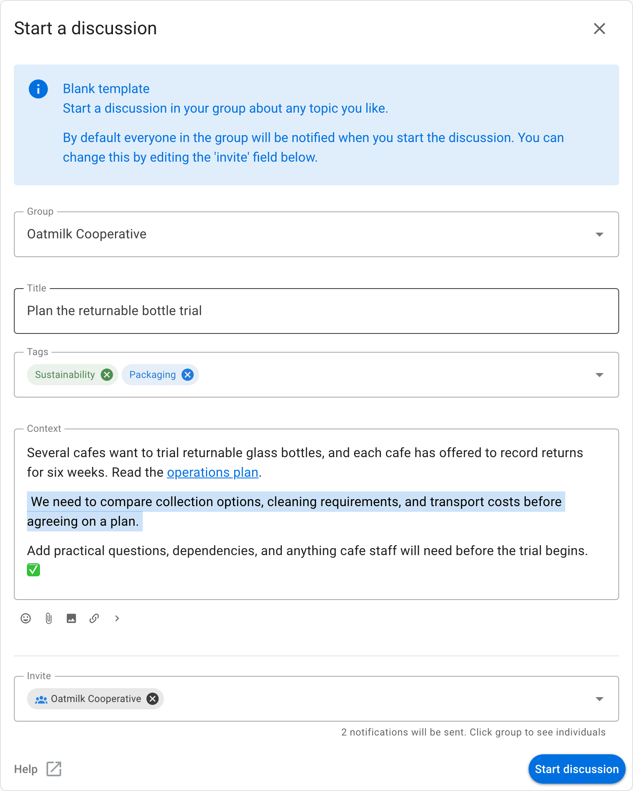
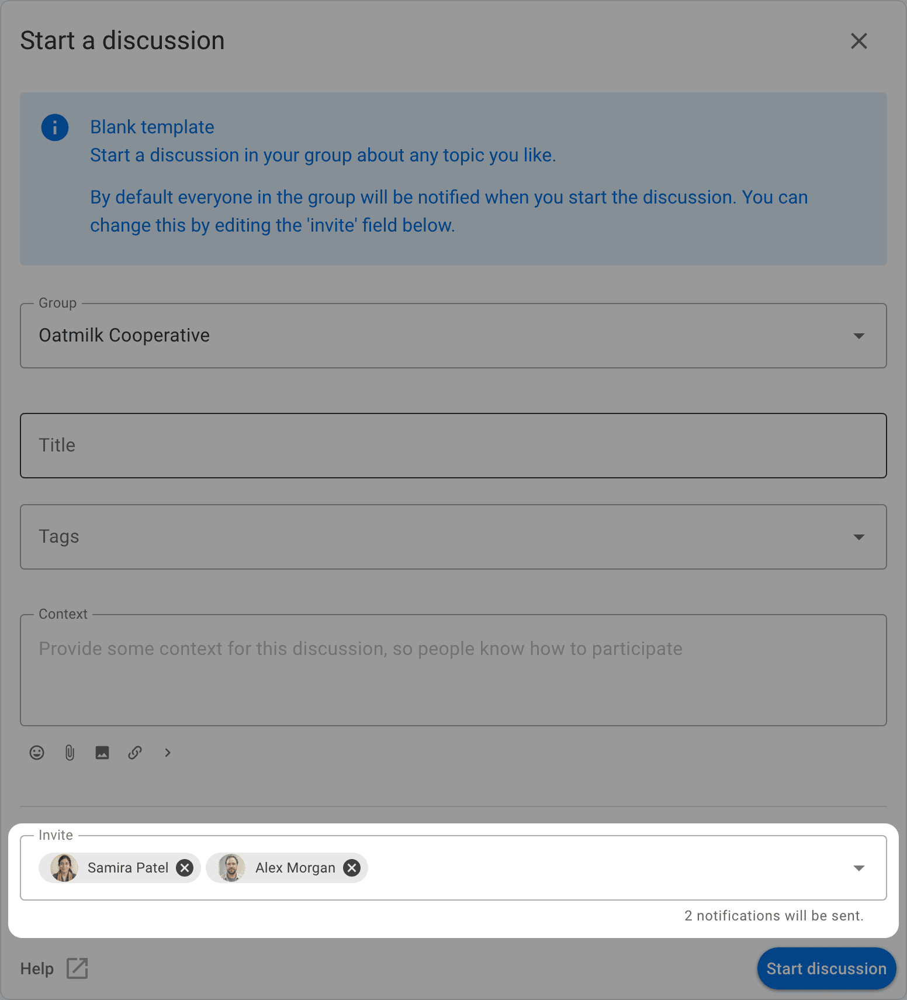
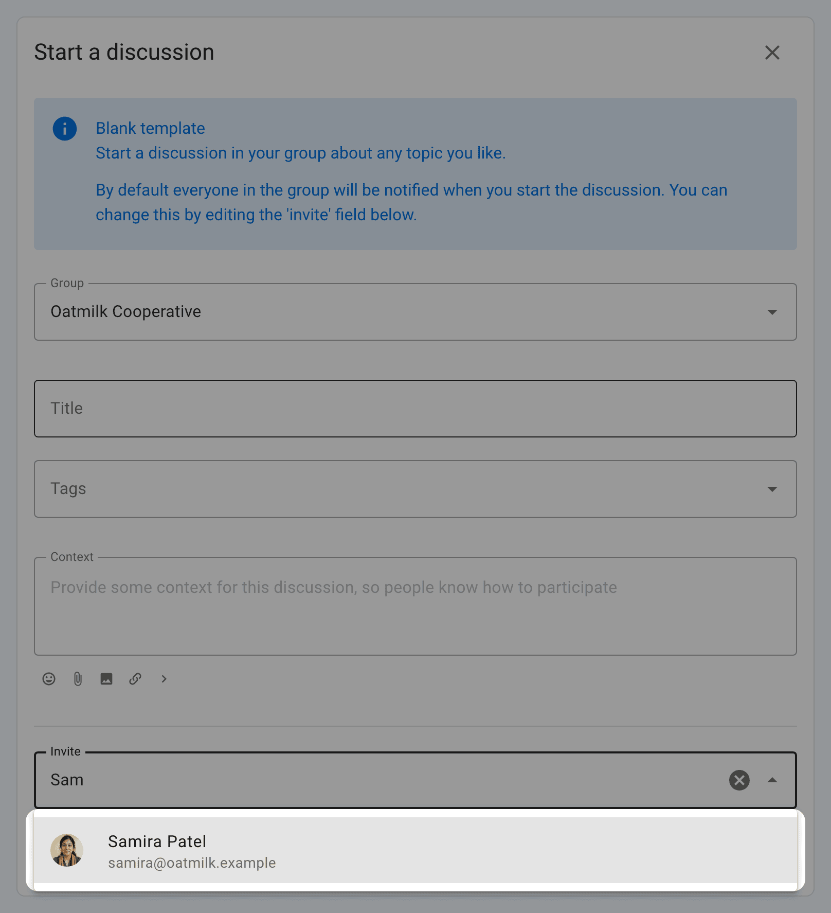
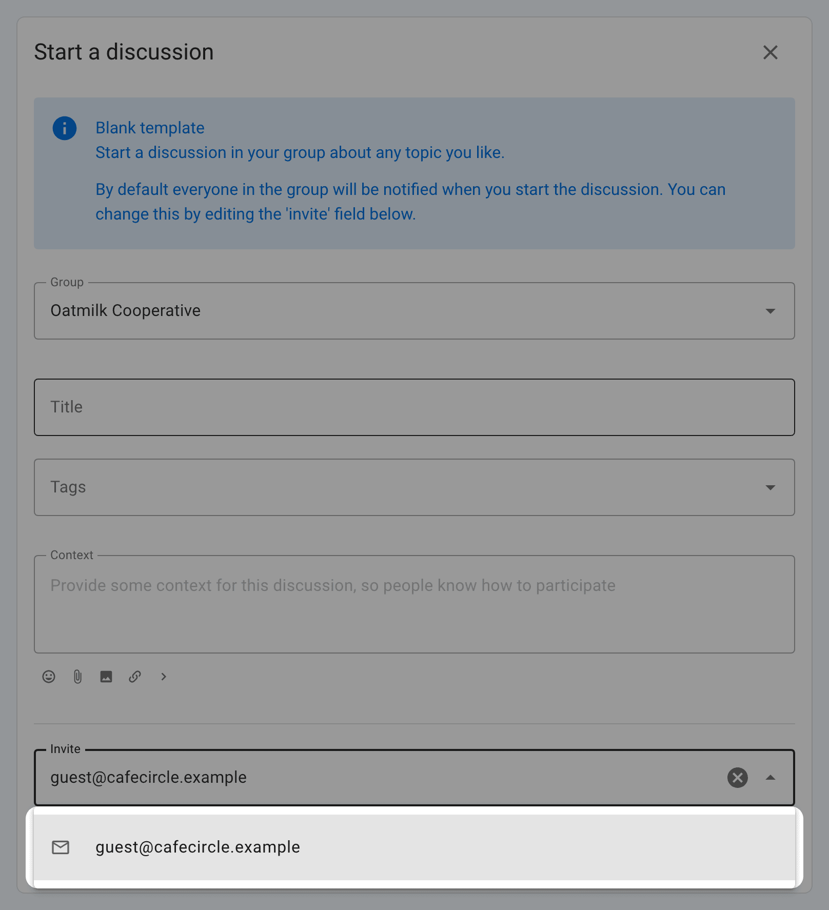

<!-- translation-section: introduction -->

# Start a discussion

Starting a Loomio discussion works much like sending an email. The title is like a subject line, the context introduces the topic, and the invite list chooses who gets notified.

You can ask a simple question or share a detailed brief with links and attached files. People can also reply by email, and their replies appear in the discussion.

<!-- translation-section: new-discussion -->

## Start a new discussion

Select **Start discussion** on your group page or any subgroup page.

Loomio shows your group's [discussion templates](/en/user_manual/discussions/templates/). Choose a template—or **Blank template**—to open the discussion form.

<!-- translation-section: group -->

### Group

Check that the right group or subgroup is selected. Anyone in that group can see the discussion. You can also start the discussion in another group or as a [direct discussion](/en/user_manual/discussions/direct_discussions/) with no group.

>[!Tip]
>If you are not ready to share a discussion with your group, start it as a direct discussion. You can move it to your group later.

<!-- translation-section: invite-and-notify -->

### Invite and notify

The **Invite** field controls who is notified immediately when you start the discussion.

Group members can see a discussion in their group even if you do not notify them. Adding a group member to **Invite** sends them a notification in Loomio and by email.

Select a group to notify everyone in it, or expand the group to choose individual members. Select **×** beside a name to leave that person out.

Start typing a member's name and select them from the list.

Enter an email address to invite a guest. A guest can see and participate in this thread, but cannot see other private discussions in the group unless invited.

You can also start a discussion without notifying anyone. Group members can still find it in Loomio and may see it in their catch-up email, depending on their notification settings.

<!-- translation-section: tags -->

### Tags

Add one or more tags so people can filter and search for your discussion later. Members can create new tags by default unless a group admin disables that permission. See [Category tags](/en/user_manual/discussions/tags/).

<!-- translation-section: title -->

### Title

Add a clear, specific title that tells people what the discussion is about.

<!-- translation-section: context -->

### Context

The context introduces the topic and frames the conversation or decision. You can format text, attach files, link to documents, and embed videos.

The context stays at the top of the thread, and you can update it as the discussion progresses. When the discussion wraps up, you can also add the outcome to the context so latecomers see the result right away.
