<!-- translation-section: introduction -->

# Category tags

Category tags help you find discussions, polls, outcomes, and comments about a particular type of work or topic.

Tags belong to the whole organization. A tag used in a parent group is the same tag in its subgroups, making it possible to organize related work across the organization. Loomio displays tag names alphabetically and shows their colors as dots beside the names.

On your group page, click **Tags** above the thread list. Select a tag to show threads containing at least one contribution with that tag. Use the filter textbox to search a long list.

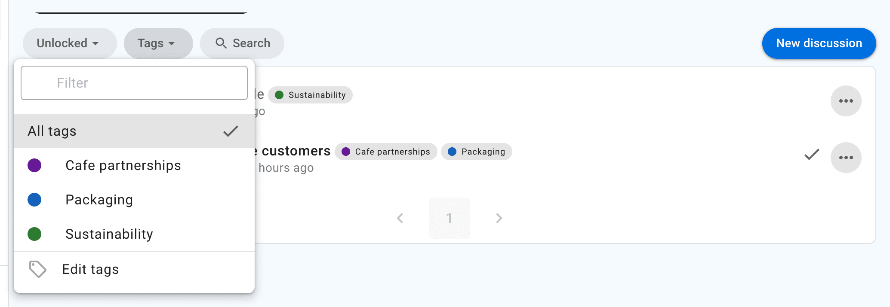

<!-- translation-section: apply-tags -->

## Apply tags

You can tag your own discussions, polls, outcomes, and comments. Group admins, thread admins, and people with permission to edit the discussion context can tag any contribution in an unlocked thread. In direct threads, all participants can tag any contribution.

When you start a thread or poll, click the **Tags** field and select one or more tags.

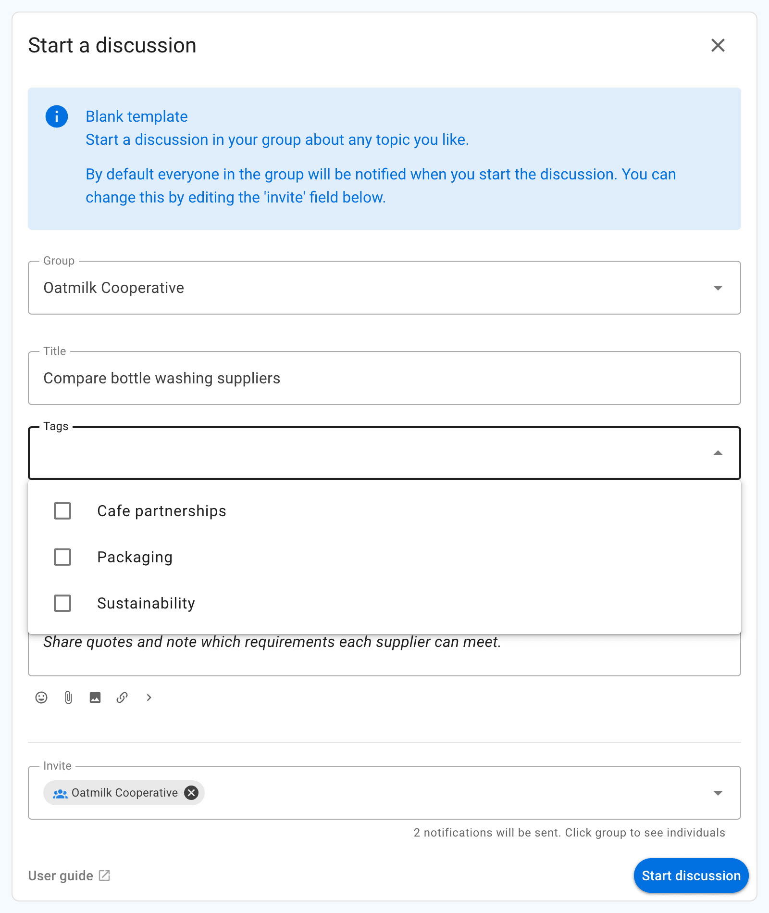

Start typing to filter the list. Select a tag again, or click the × on its chip, to remove it.

<!-- translation-section: create-tags -->

## Create tags

Parent-group admins can always create tags for the parent group and its subgroups. Subgroup admins can create tags while tagging content in their subgroup. The **Members can create tags** group permission, enabled by default, allows other members who can tag content to create new tag names. If the permission is disabled, members can use the organization's existing tags and tag names prescribed by templates in the destination group.

To create a tag while starting a thread or poll, type its name in the **Tags** field and press Enter.

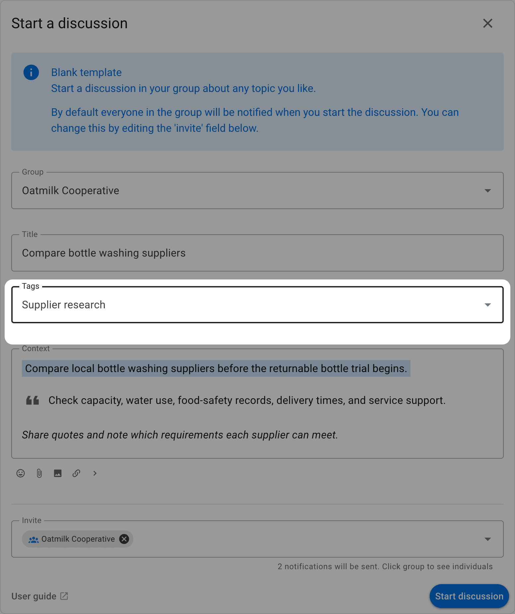

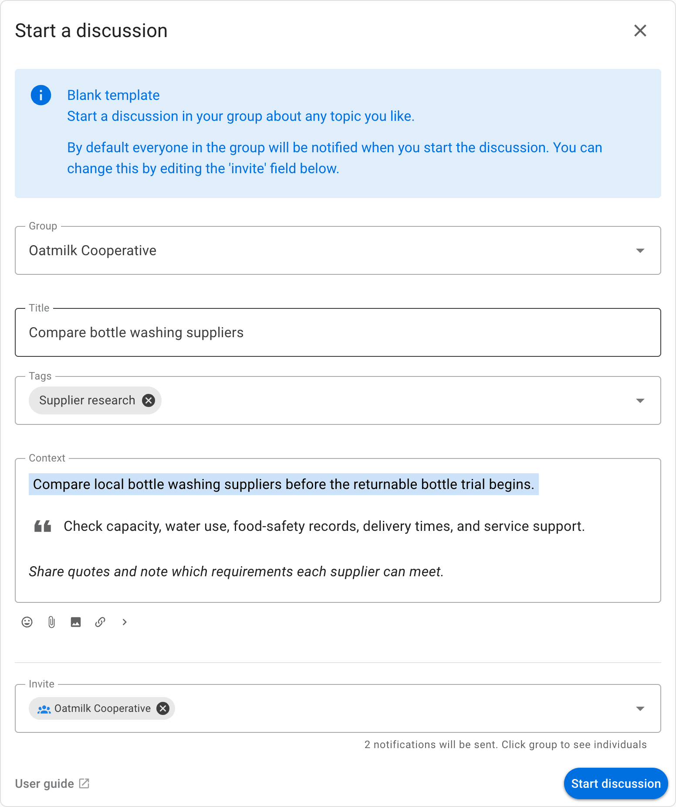

Use short, familiar names that group members will recognize, such as Finance, Governance, Packaging, or Cafe partnerships.

<!-- translation-section: template-tags -->

## Tags in templates

Discussion and poll templates store tag names as defaults. Anyone who can create or edit a template can freely change its tag names. Saving or browsing a template does not add these names to the organization's tag list. Renaming or deleting an organization tag does not change template defaults.

When a discussion or poll uses those defaults, Loomio applies an existing organization tag or creates it if allowed. A member without permission to create tags can still use names prescribed by available templates in the destination group. A template from another group grants no extra tag creation permission: its defaults are kept only if the destination organization already has those tags or a template in the destination group prescribes those names. Other names are dropped. Members who can create tags can keep all of the template's defaults.

<!-- translation-section: edit-tags -->

## Edit tags

Only parent-group admins can rename, recolor, merge, or delete tags. These changes apply to every assignment throughout the organization, including its subgroups.

On the group page, open **Tags** and select **Edit tags**.

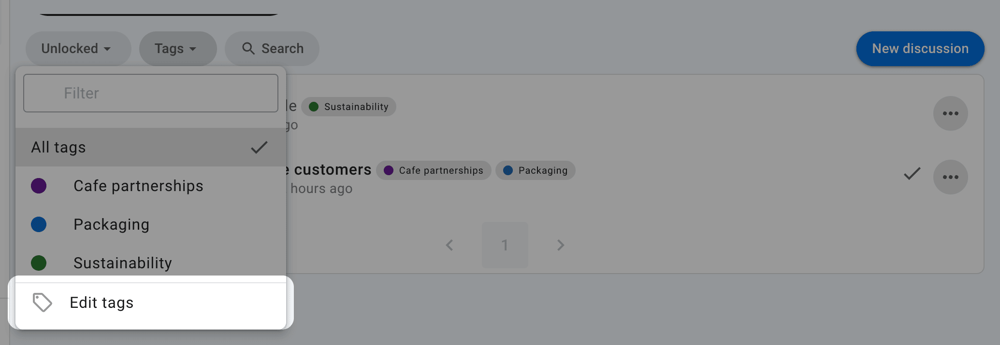

Select the pencil icon beside a tag.

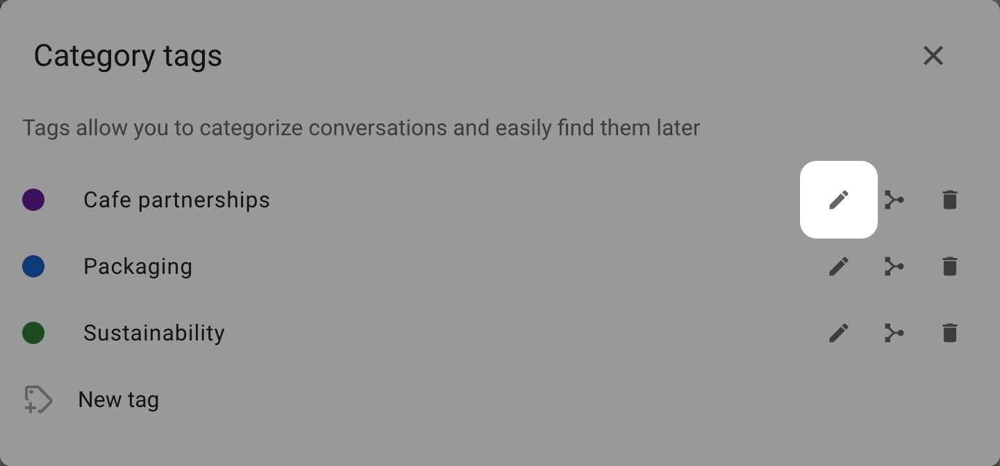

Edit the tag name or choose a color, then click **Save**.

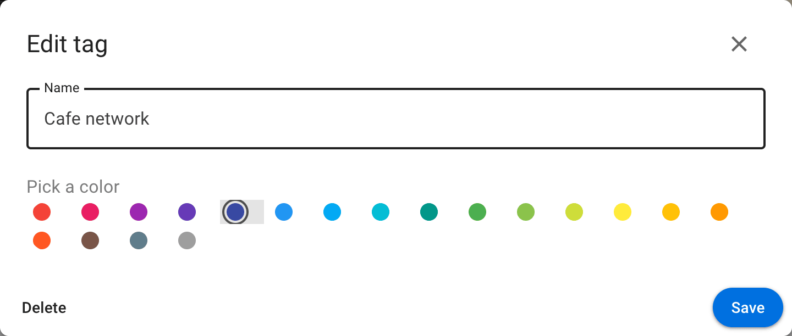

Click **Delete** to remove the tag from discussions, polls, outcomes, and comments throughout the organization.

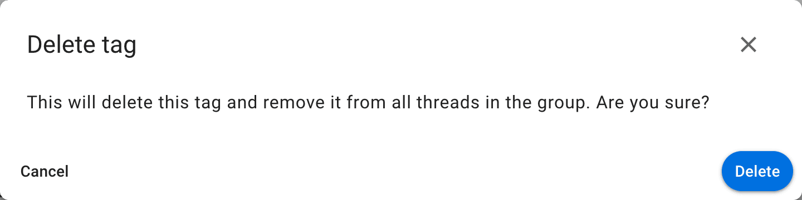

<!-- translation-section: edit-tag-in-thread-or-poll -->

### Edit tag in thread or poll

To change the tags on an existing thread or poll, open it and click the tag button beside its current tags near the title.

Select tags to add or remove them. Changes are saved immediately.

The picker shows tags used in the current group, unused organization tags, and the contribution's selected tags. When additional tags are used only in other groups, choose **Show tags from other groups** to include tags from the parent group and its subgroups within the same organization. Choose **Show tags used in this group** to return to the shorter list. An organization with only one group has no expansion option.

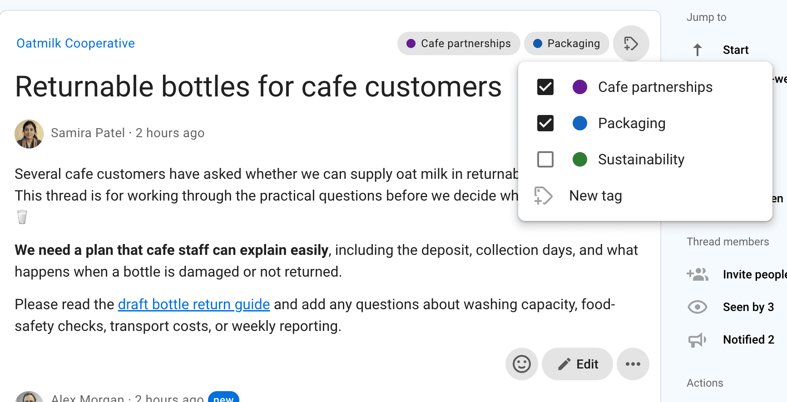

<!-- translation-section: tag-contributions -->

## Tag contributions

Open a poll, outcome, or comment's action menu and select **Apply tags**. The same picker used beside the discussion title lets you add or remove tags. Changes save immediately. When a contribution has tags, its chips and tag button appear on the right of its author and timestamp line.

Tags apply to the contribution you select. Votes and ballots cannot be tagged.

<!-- translation-section: find-tagged-contributions -->

## Find tagged contributions

The **Tags** section appears in the thread sidebar once a contribution beyond the opening discussion or poll has tags. It collects tags from the opening item and all other tagged contributions. Select a tag to show matching contributions with their parent context. A toolbar stays visible above the thread while the filter is active. Close it with the × button on the right, select the tag again, or choose **Clear** in the sidebar to return to the usual thread view. On mobile, open the thread navigation drawer to use the same filter.

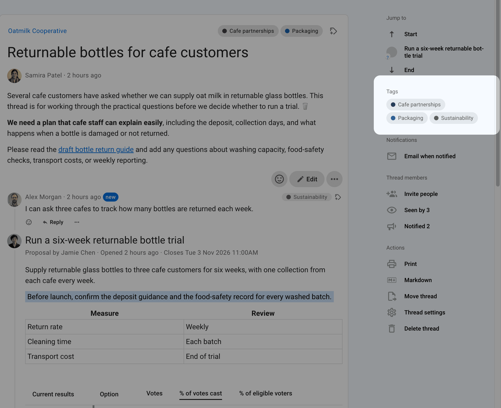

<!-- translation-section: global-search -->

## Search by tag

Open **Search** from the top navigation and select your parent group to show the tag menu. Choose a tag to find discussions, polls, outcomes, and comments carrying that tag.

Leave the search field empty to browse by tag, or enter a word or phrase to search within the tagged contributions. Select **Any tag** to clear the tag filter.

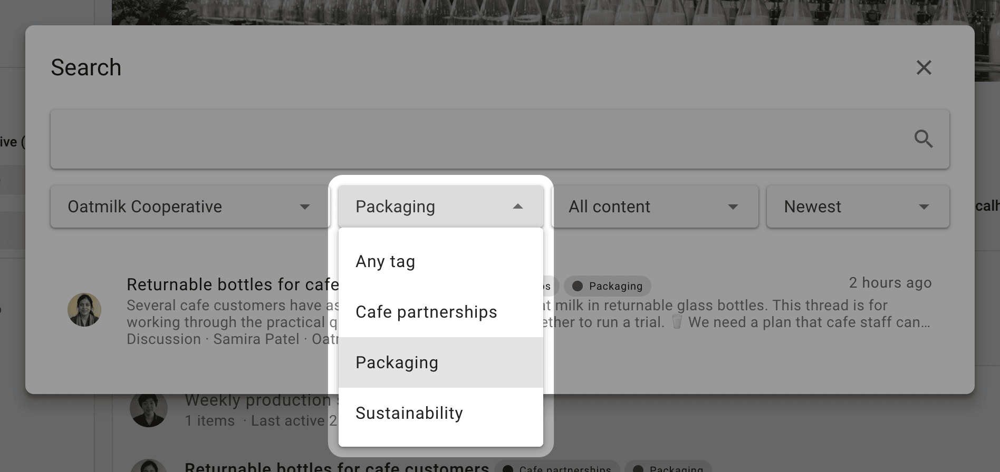
