<!-- translation-section: introduction -->

# Category tags

Category tags help you find discussions, polls, outcomes, and comments about a topic or area of work.

Tags belong to the whole organization. A tag created in a parent group is shared with its subgroups, so you can track related work across groups. Loomio lists tags alphabetically with a colored dot beside each name.

On your group page, select **Tags** above the thread list and choose a tag to show threads that contain at least one item with that tag. Type in the filter box to search a long list.

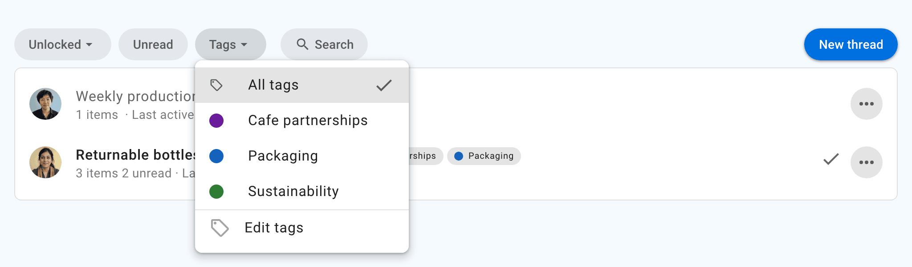

<!-- translation-section: apply-tags -->

## Apply tags

You can tag your own discussions, polls, outcomes, and comments. Group admins, thread admins, and people with permission to edit the discussion context can tag any item in an unlocked thread. In direct threads, all participants can tag any item.

When starting a thread or poll, select the **Tags** field and choose one or more tags.

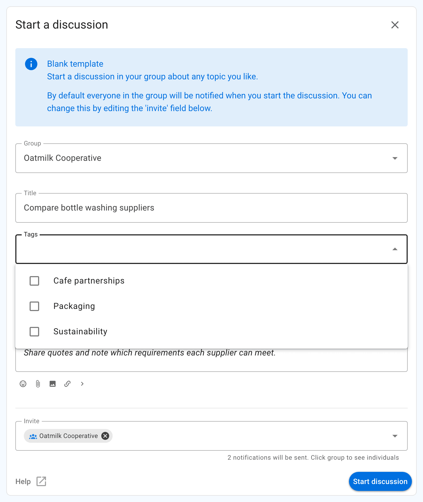

Start typing to filter the list. Select a tag again, or select **×** on the tag, to remove it.

<!-- translation-section: create-tags -->

## Create tags

Who can create tags depends on group roles and permissions:

- **Parent-group admins** can always create tags for the parent group and its subgroups.
- **Subgroup admins** can create tags when tagging content in their subgroup.
- **Group members** who can tag content can also create tags while **Members can create tags** is enabled (on by default). If a group admin disables it, members can only use existing organization tags and default tags from templates in that group.

To create a tag while starting a thread or poll, type its name in the **Tags** field and press Enter.

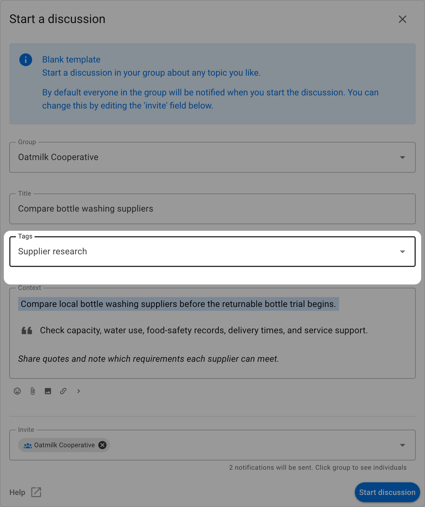

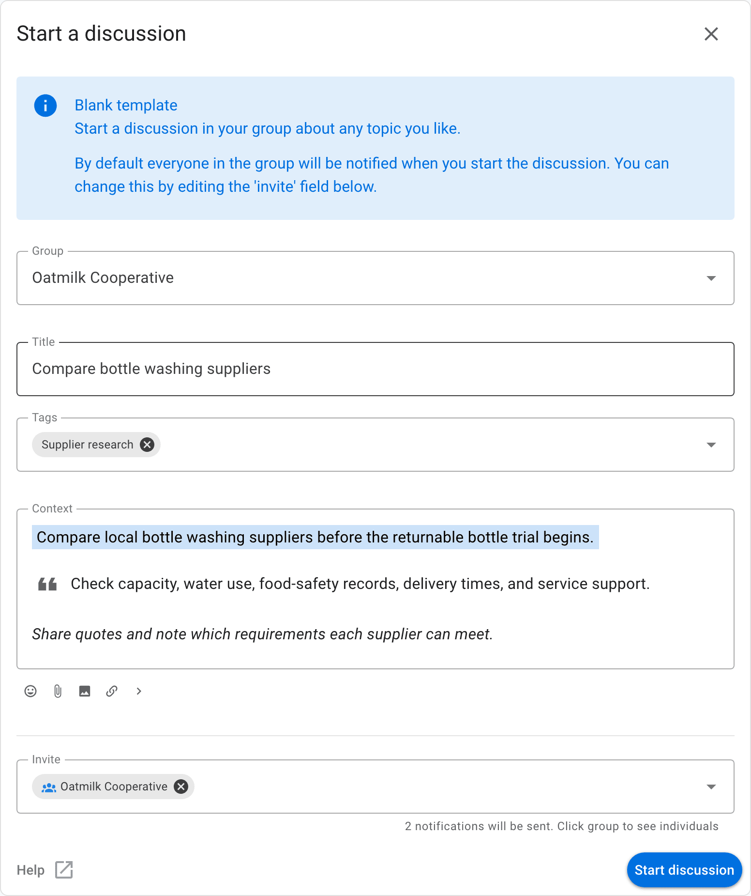

Use short, recognizable names such as Finance, Governance, Packaging, or Cafe partnerships.

<!-- translation-section: template-tags -->

## Tags in templates

Discussion and poll templates store default tag names. Anyone who can create or edit a template can change its default tags. Saving a template does not add those names to the organization's tag list, and renaming or deleting an organization tag does not change template defaults.

When someone starts a discussion or poll from a template, Loomio applies matching organization tags or creates new ones if the author has permission:

- **Members who can create tags** keep all of the template's default tags.
- **Members without tag-creation permission** keep existing organization tags and any default tags defined by templates in the destination group. Unmatched tag names from another group's template are dropped.

<!-- translation-section: edit-tags -->

## Edit tags

Only parent-group admins can rename, recolor, merge, or delete tags. Changes apply across the whole organization, including all subgroups.

On the group page, open **Tags** and select **Edit tags**.

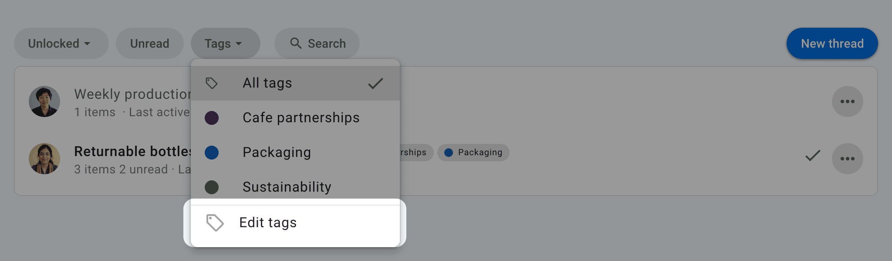

Select the pencil icon beside a tag to edit it.

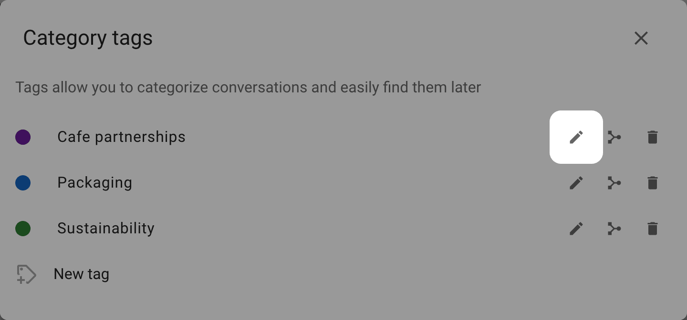

Change the tag name or pick a color, then select **Save**.

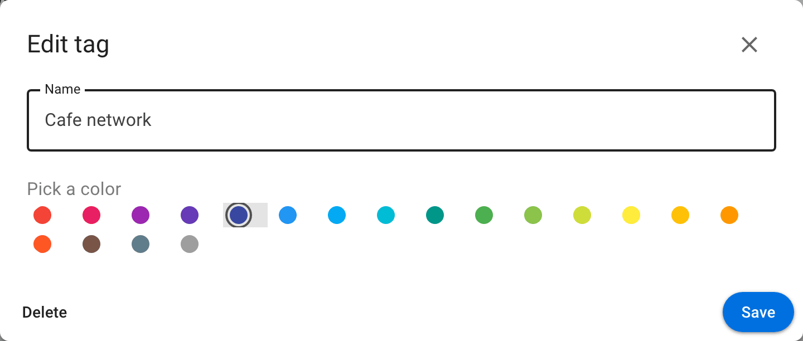

To merge a tag into another tag, select the merge icon beside it and choose the tag to keep. All items with the old tag move to the chosen tag.

To delete a tag, select **Delete** (or the trash icon). This removes the tag from every discussion, poll, outcome, and comment in the organization.

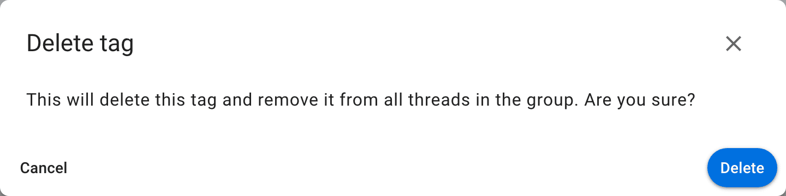

<!-- translation-section: edit-tag-in-thread-or-poll -->

### Edit tags in a thread or poll

To change tags on an existing thread or poll, open it and select the tag button beside its current tags near the title.

Select tags to add or remove them. Changes save immediately.

The picker lists tags used in the current group, unused organization tags, and the item's selected tags. In a multi-group organization, select **Show tags from other groups** to include tags used only in other groups, or **Show tags used in this group** to narrow the list again.

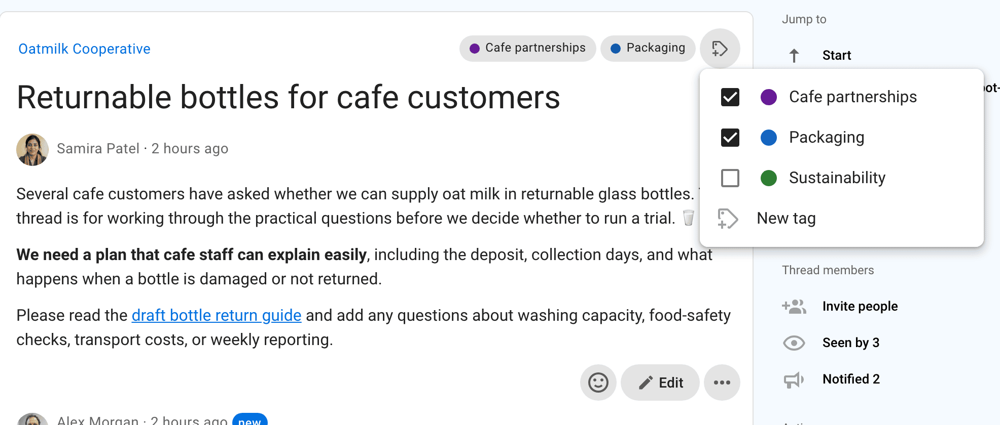

<!-- translation-section: tag-contributions -->

## Tag contributions

Open the three-dot menu (**⋯**) on a poll, outcome, or comment and select **Apply tags**. Add or remove tags in the picker; changes save immediately. When a contribution has tags, its tags and tag button appear on the right of its author line.

Tags apply to the item you select. Votes and ballots cannot be tagged.

<!-- translation-section: find-tagged-contributions -->

## Find tagged contributions

When a comment, poll, or outcome inside a thread has a tag, a **Tags** section appears in the thread sidebar (or the navigation drawer on mobile).

Select a tag to filter the thread to matching items and the items they reply to. To return to the full thread, select **×** on the filter bar, select the tag again, or select **Clear** in the sidebar.

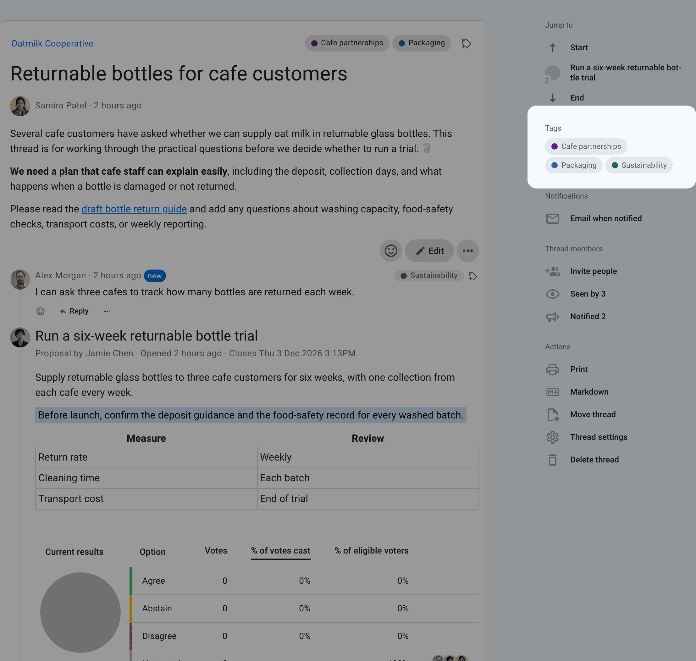

<!-- translation-section: global-search -->

## Search by tag

Open **Search** from the top navigation and select your parent group to show the tag menu. Choose a tag to find discussions, polls, outcomes, and comments with that tag.

Leave the search box empty to browse by tag, or enter keywords to search within tagged items. Select **Any tag** to clear the filter.

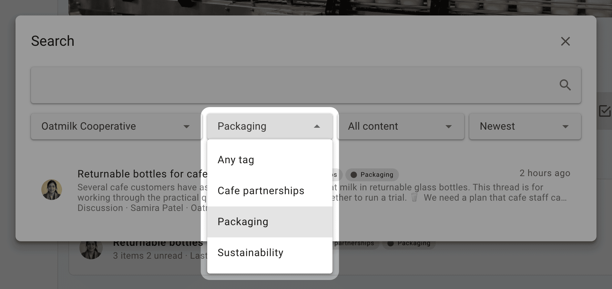
