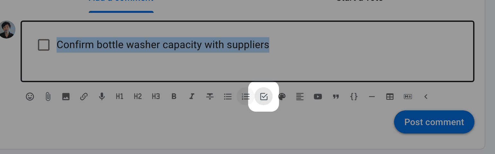
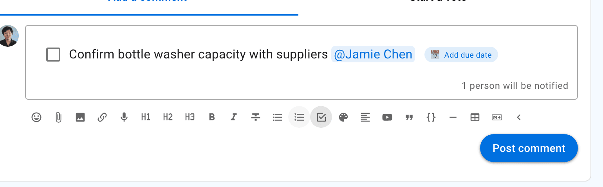
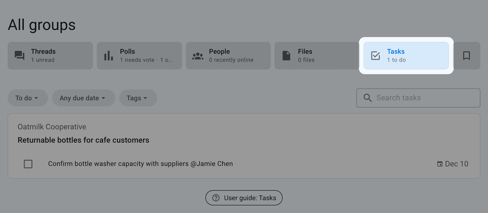
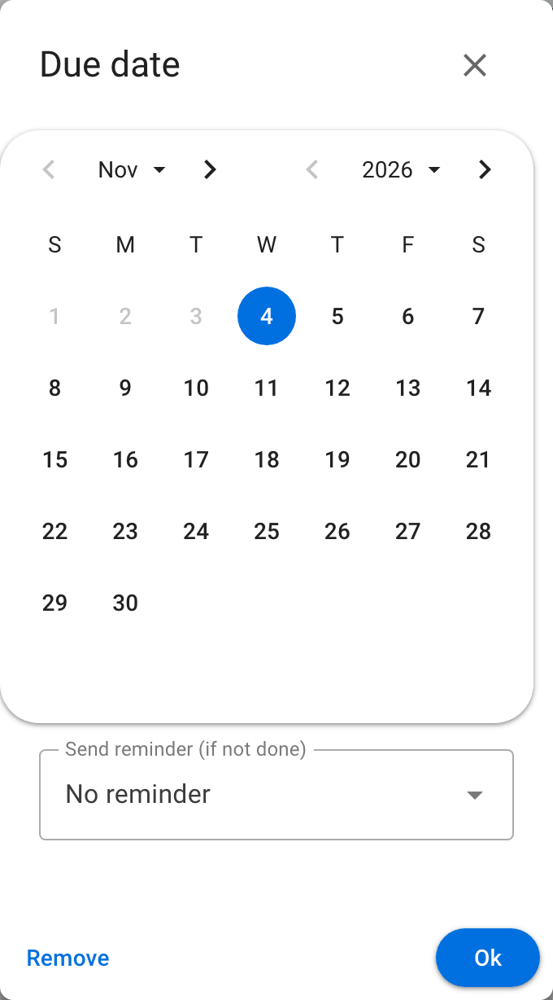
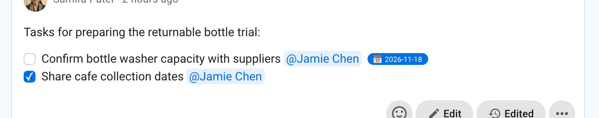

<!-- translation-section: introduction -->

# Assign and track tasks

Use tasks in threads and comments to name an action, assign it to someone, set a due date, and track whether it is complete.

<!-- translation-section: add-a-task -->

## Add a task

While writing a thread or comment, expand the formatting toolbar and click **Task list**. Type the action beside the checkbox.

<!-- translation-section: name-and-assign-the-task-to-a-person -->

## Name and assign the task to a person

Use an @mention in the task to assign it to a group member. An **Add due date** button appears once the task has an assignee.

Open **Tasks** on **All groups** to see tasks assigned to you across your groups, or open **Tasks** on a group page to view tasks in that group. Tasks are grouped by thread or poll, and you can filter them by status (**To do**, **Done**, or **All**), due date (**Overdue**, **Next 7 days**, **Later**, or **No due date**), assignee (on a group page), subgroup, category tag, or search.

<!-- translation-section: set-a-reminder -->

## Set a reminder

Click **Add due date** to choose a due date and when Loomio should email the assignee a reminder. You can also remove an existing due date from this dialog.

<!-- translation-section: mark-it-as-done -->

## Mark it as done

Click the checkbox beside a task to mark it as done. You can do this while editing the text, while reading it if you are the assignee, or from the **Tasks** page. Click it again to reopen the task.
