<!-- translation-section: introduction -->

# Using threads

A discussion keeps its context, comments, polls, and outcomes together in one thread. This page explains how to participate in a thread and use its navigation, settings, and actions.

<!-- translation-section: thread-anatomy -->

## Thread anatomy

A typical thread looks like this:

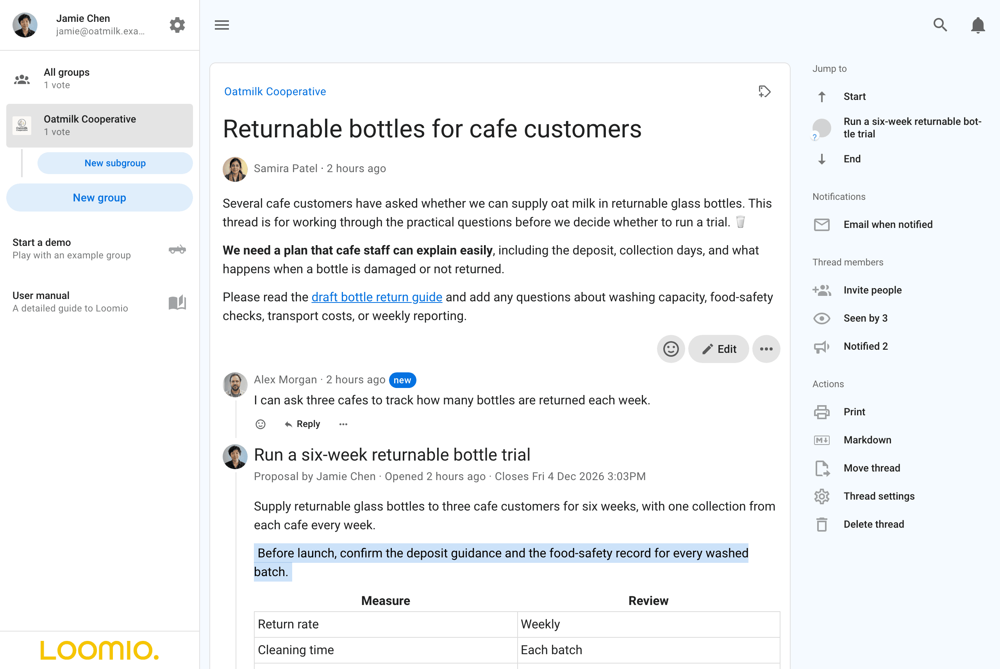

The main parts of a thread are:

- **Group name** — Links back to the group or subgroup the thread belongs to.
- **Access settings** — Shows who can see the thread. A group discussion is visible to group members and anyone invited to it, based on the group's privacy settings.
- **Category tags** — Labels beneath the title that group related discussions.
- **Discussion context** — The opening post at the top of the thread, with controls to react or edit.
- **Comments and polls** — Replies, polls, and outcomes posted beneath the context, each with its own interaction and action controls.
- **Right sidebar** — Shortcuts to milestones (**Jump to**), notification settings, **Seen by** and **Notified** lists, and thread actions.

<!-- translation-section: discussion-context -->

## Discussion context

The **context** stays at the top of the thread and frames the conversation or decision.

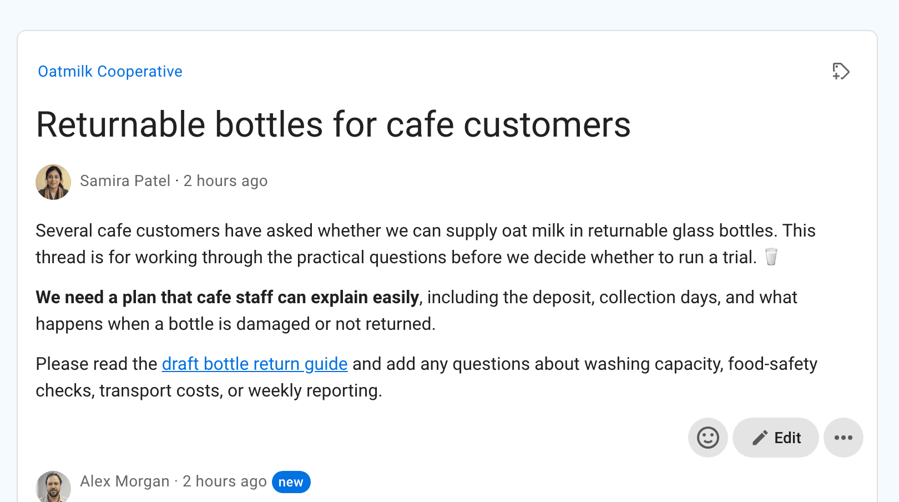

You write the context when starting a discussion and can update it with the pencil icon (**Edit**). As the conversation progresses, you can update the context with new background information, an agenda, or the final outcome.

The formatting bar below the text field lets you format text, attach files, insert images, and embed videos. See [Format text and attach files](/en/user_manual/discussions/formatting/).

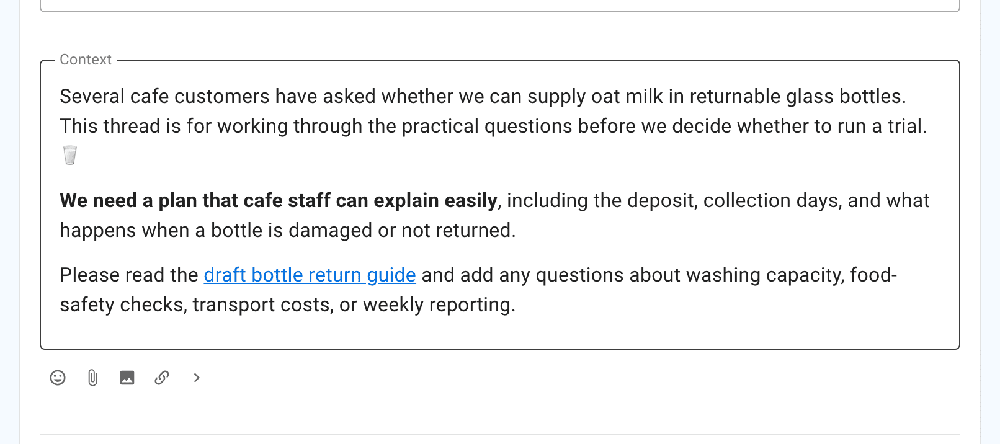

<!-- translation-section: notify-people-about-context-changes -->

### Notify people about context changes

When you edit the context, use **What's changed?** to summarize your update and choose who to notify.

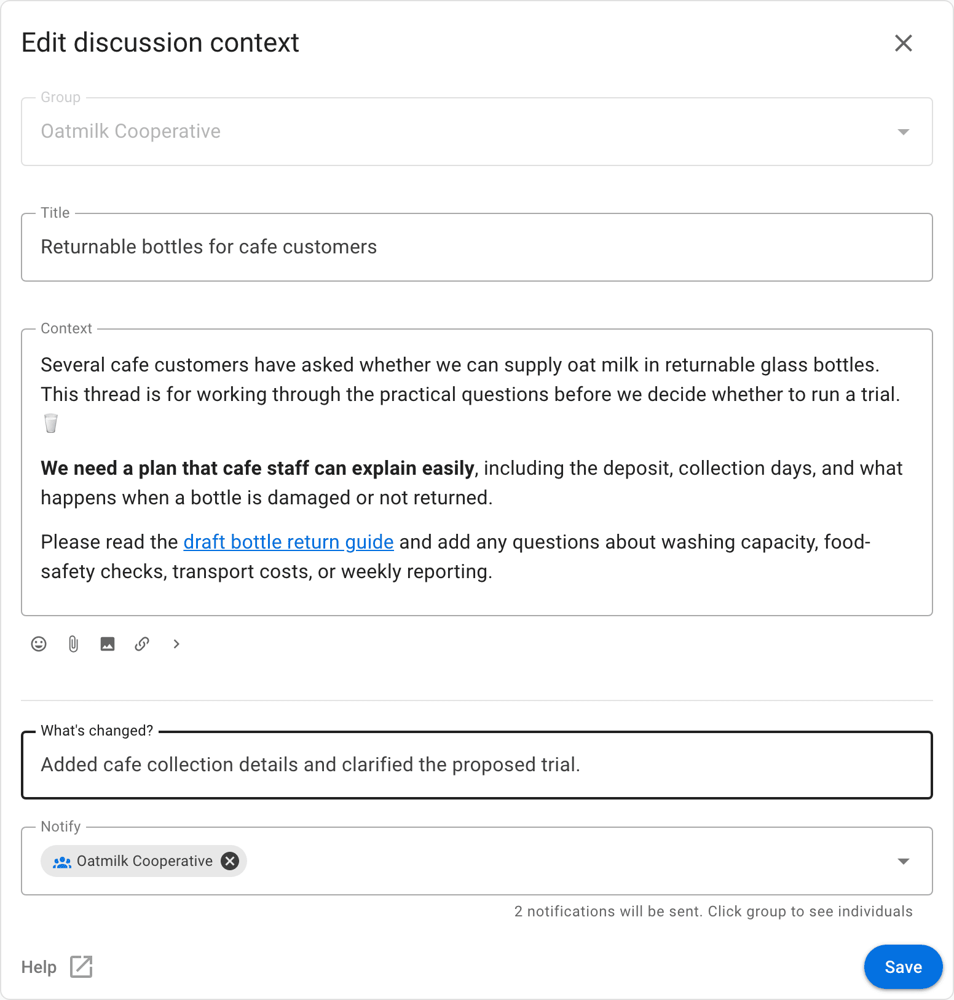

The thread records that you edited the context, and the people you notify receive your summary.

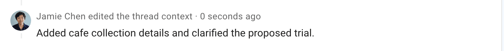

<!-- translation-section: navigation -->

## Navigation

The **Jump to** section in the right sidebar helps you move through a thread:

- **Start** goes to the discussion context.
- **New to you** appears when the thread has unread activity.
- **Latest** appears when newer activity exists beyond the loaded items.
- Milestone links jump directly to important comments, polls, and outcomes.
- **End** goes to the latest item in the thread.

Comments with an H2 or H3 heading, polls, and proposals appear as milestone links automatically. Select any milestone to jump to it.

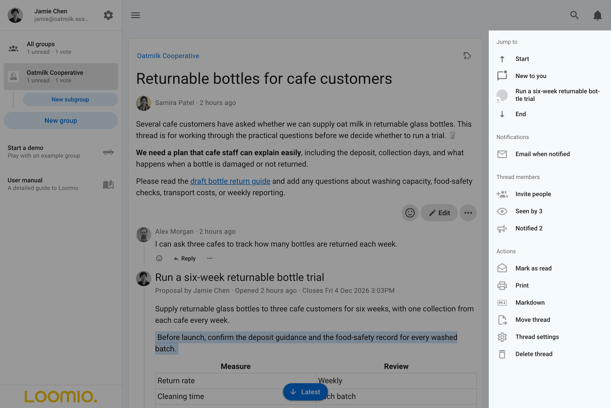

When you post a comment, poll, vote, or outcome, Loomio marks your own item as read.

<!-- translation-section: notifications-and-members -->

## Notifications and members

The right sidebar controls your email notifications for the thread and shows who has been invited, who has seen the thread, and who has been notified.

<!-- translation-section: email-notifications-for-this-thread -->

### Email notifications for this thread

Select your current notification setting to choose whether Loomio emails you about all activity, only activity that specifically notifies you, or no activity. Choosing all activity can generate many emails in a busy thread.

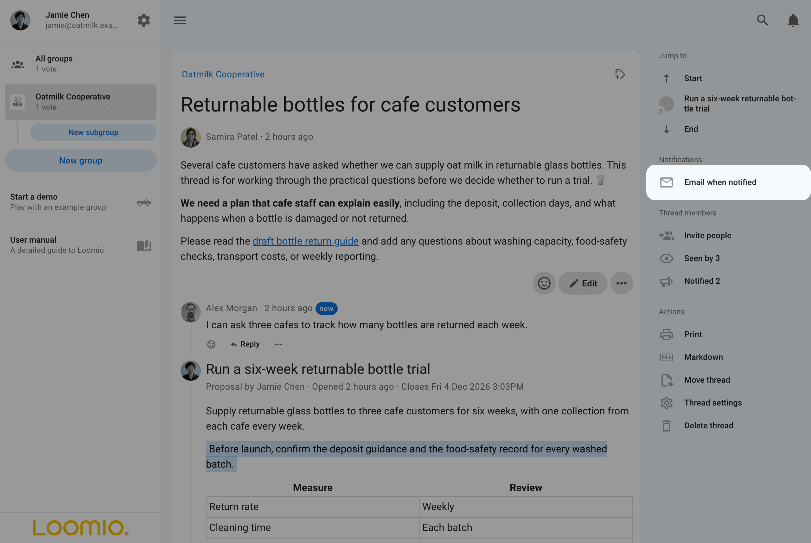

<!-- translation-section: invite-people -->

### Invite people

Select **Invite people** in the right sidebar to invite people or notify them about the thread. See [Inviting people to a discussion](/en/user_manual/discussions/inviting_people) for details on groups, subgroups, parent groups, guests, and chat rooms.

<!-- translation-section: seen-by -->

### Seen by

**Seen by** shows who has opened the thread and when. Use it to check whether key people have seen important information.

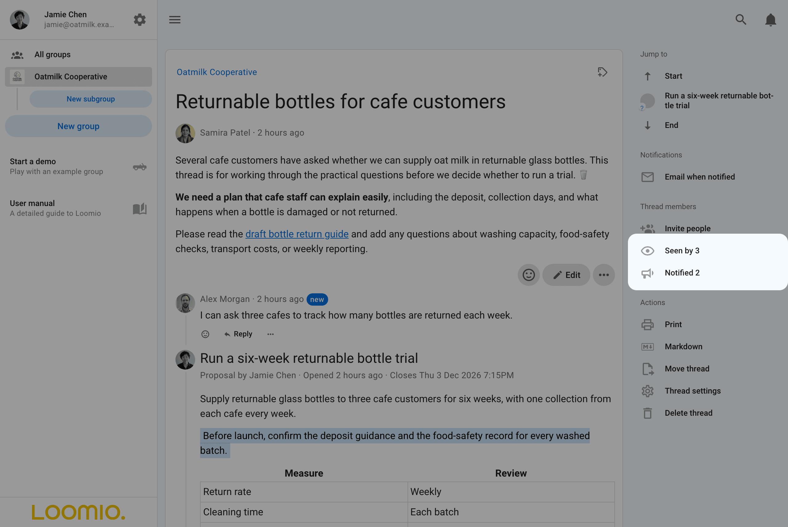


<!-- translation-section: notified -->

### Notified

**Notified** opens the thread's notification history, including invitations, mentions, and replies. It shows who was notified and whether each notification was read when that information is available.

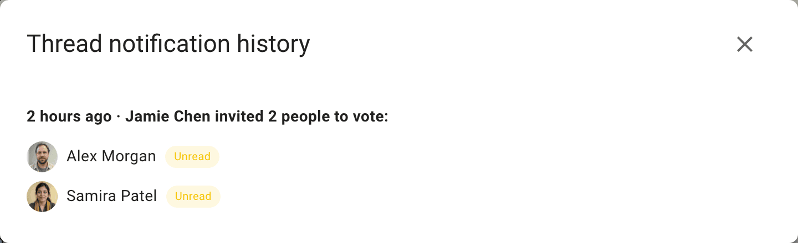

<!-- translation-section: thread-settings-and-display -->

<a id="thread-settings-and-display"></a>

## Thread settings

Thread admins and group admins can select **Thread settings** to control how replies are arranged and set other discussion options.

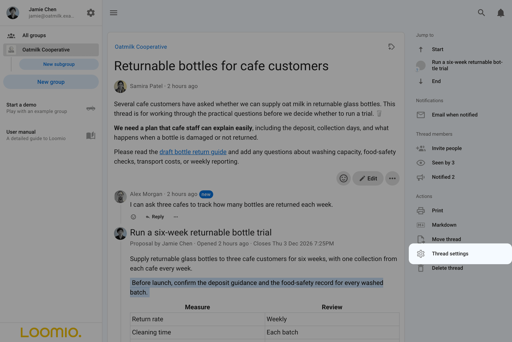

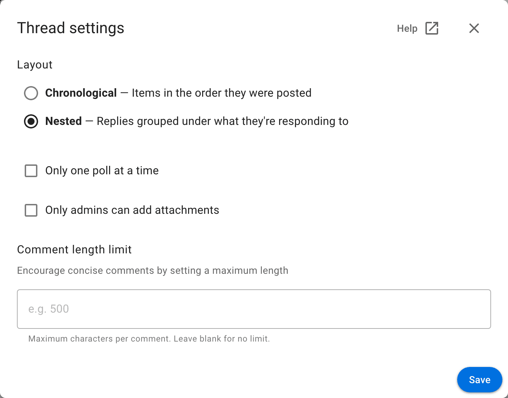

### Layout

Choose **Chronological** to list items in the order they were posted, or **Nested** to group replies under the item they respond to. This changes the layout for everyone in the thread.

<a id="allow-multiple-polls-at-the-same-time"></a>

### Only one poll at a time

When checked, no one can start another poll until the current poll closes. This is unchecked by default for new threads. Threads started from a discussion template inherit that template's setting.

### Only admins can add attachments

Enable this setting to limit new files and inline images to thread admins and group admins throughout the thread, including poll responses and email replies. Existing attachments stay available, and participants can still edit their text or remove attachments.

Discussion and poll templates can set this for new threads. See [Discussion templates](/en/user_manual/discussions/templates) and [Poll templates](/en/user_manual/polls/poll_templates).

### Comment length limit

Set a maximum number of characters per comment to keep replies concise. Leave it blank for no limit. The limit applies to everyone, including group admins and thread admins.

<!-- translation-section: actions -->

## Actions

The right sidebar lists actions for the whole thread. Some actions also appear in the three-dot menu (**⋯**) beside a thread on the group page.

The actions you see depend on your permissions. Group admins can manage threads, and group settings may allow members to use some management actions. See [Group permissions](/en/user_manual/groups/settings/permissions).

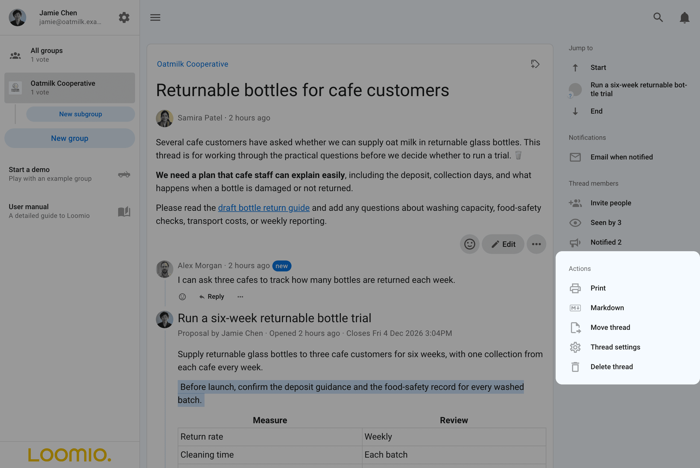

<!-- translation-section: print -->

### Print

Select **Print** to open a print-friendly view of the thread. Use your browser's print dialog to save it as a PDF.

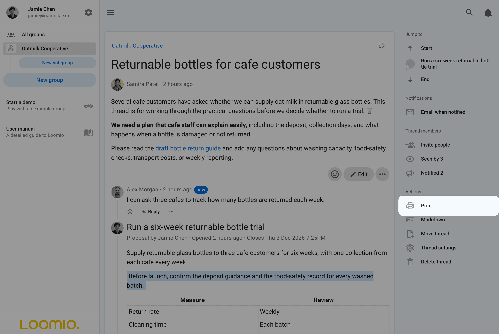

<!-- translation-section: markdown -->

### Markdown

Select **Markdown** to export the thread as structured Markdown. Choose **Copy Markdown** to copy it to your clipboard, or **Download Markdown** to save a `.md` file for meeting minutes, archives, documents, or AI tools.

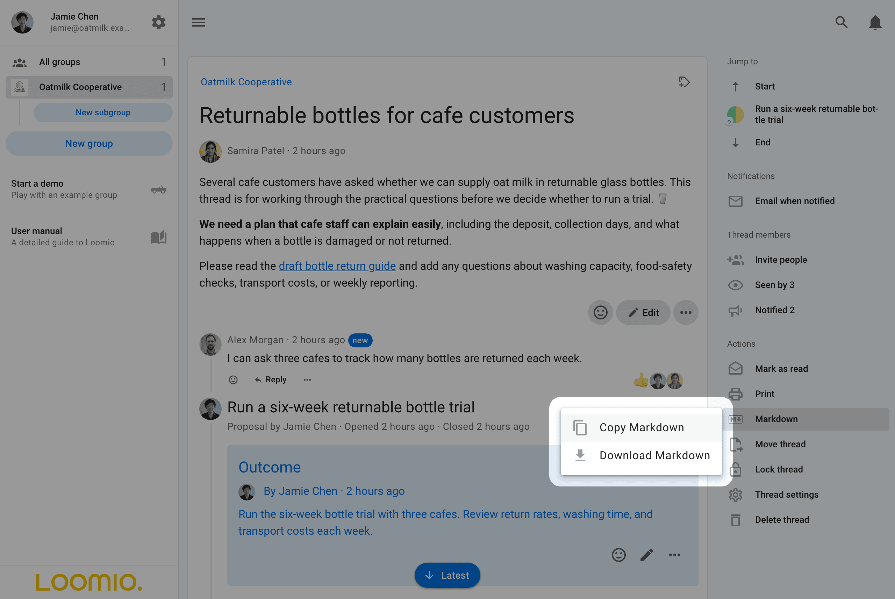

The export starts with YAML front matter listing the thread key, URL, group, dates, and tags. It then includes the discussion context and every comment, poll, vote, and outcome in threaded order. Each poll appears as a section, and comments, votes, and outcomes appear as block quotes showing the author, timestamp, item number, and reactions.

Loomio follows the thread's visibility rules. Hidden results and hidden vote reasons are omitted, and voters stay anonymous in anonymous polls. If an open poll hides results until you vote, vote first—**Markdown** and **Print** are unavailable until you do.

For example, a discussion containing a comment, reactions, a proposal, two votes, a reply, and an outcome produces this Markdown:

```markdown
---
key: "fi2TAgeC"
url: "https://www.loomio.com/d/fi2TAgeC/returnable-bottles-for-cafe-customers"
group: "Oatmilk Cooperative"
created: "2026-09-10T23:28:30Z"
last_activity: "2026-09-10T23:28:30Z"
---

# Discussion: Returnable bottles for cafe customers · Samira Patel · 2026-09-10 23:28

Several cafe customers have asked whether we can supply oat milk in returnable glass bottles. This thread is for working through the practical questions before we decide whether to run a trial. 🥛

**We need a plan that cafe staff can explain easily** , including the deposit, collection days, and what happens when a bottle is damaged or not returned.

Please read the [draft bottle return guide](https://example.com/oatmilk-bottle-return-guide) and add any questions about washing capacity, food-safety checks, transport costs, or weekly reporting.

> **Alex Morgan** · 2026-09-10 23:28 · #1 · 👍 Jamie Chen, Samira Patel
>
> I can ask three cafes to track how many bottles are returned each week.

## Proposal: Run a six-week returnable bottle trial · Jamie Chen · 2026-09-10 23:28 · #2

- **Status:** Closed 2026-09-10T23:28:30Z
- **Options:** Agree; Abstain; Disagree

Supply returnable glass bottles to three cafe customers for six weeks, with one collection from each cafe every week.

<mark>Before launch, confirm the deposit guidance and the food-safety record for every washed batch.</mark>

| Measure | Review |
| --- | --- |
| Return rate | Weekly |
| Cleaning time | Each batch |
| Transport cost | End of trial |

### Current results

| Option | Votes | % of votes cast | % of eligible voters | Voters |
| --- | --- | --- | --- | --- |
| Agree | 1 | 50% | 33% | Samira Patel |
| Abstain | 1 | 50% | 33% | Alex Morgan |
| Disagree | 0 | 0% | 0% | No voters |
| Not voted | 1 |  | 33% | Jamie Chen |

> **Samira Patel** voted **Agree** · 2026-09-10 23:28 · #3 · ❤️ Jamie Chen
>
> The six-week trial gives us enough time to test collections and washing capacity.
>
> > **Alex Morgan** · 2026-09-10 23:28 · #4
> >
> > Could we confirm which cafes will participate before the trial starts?

> **Alex Morgan** voted **Abstain** · 2026-09-10 23:28 · #5
>
> I can support the trial once the collection dates are confirmed with each cafe.

> **Jamie Chen** shared an outcome · 2026-09-10 23:28 · #7
>
> Run the six-week bottle trial with three cafes. Review return rates, washing time, and transport costs each week.
```

Headings and labels use your selected language. Participant content stays in its original language.

<!-- translation-section: pin-or-unpin-a-thread -->

### Pin or unpin a thread

Pinned threads stay at the top of the group page. Groups often pin welcome discussions, news, and announcements.

Open the three-dot menu (**⋯**) beside the thread on the group page and select **Pin thread**. Pinned threads are ordered by when they were pinned. To reorder them, unpin and pin them again.

Select **Unpin thread** to return a thread to normal activity order.

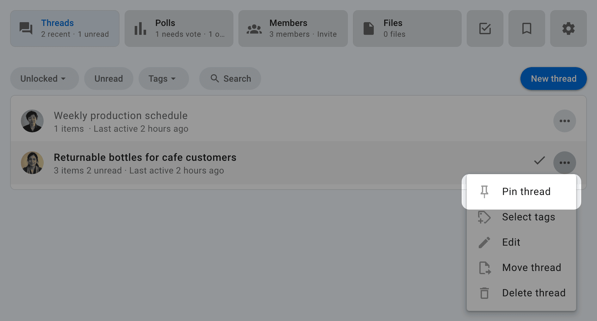

<!-- translation-section: move-a-thread -->

### Move a thread

Select **Move thread** to move a thread to another group, a subgroup, or a direct thread. It becomes visible to members of the destination group and anyone invited to it.

Before moving, Loomio shows how many people would lose access. You can choose to keep them as guests without sending notifications:

- **Moving to another group or subgroup:** Keeping people as guests requires permission to invite guests in the destination group. Existing guests keep access.
- **Converting to a direct thread:** People who have already participated keep access automatically. Choosing the guest option keeps other current members and guests too. You and the thread creator become thread admins.

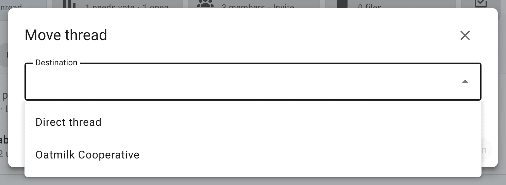

>[!Tip]
>Start a draft as a direct discussion or in a private subgroup, then move it to the group when it is ready.

To move specific items rather than the whole thread, see [Moving items between threads](/en/user_manual/discussions/moving_items/).

<!-- translation-section: lock-or-unlock-a-thread -->

### Lock or unlock a thread

Lock a thread to archive it as-is. No one can post, edit, or invite people in a locked thread. All active polls must close before you can lock a thread.

Select **Lock thread** under **Actions**. Locked threads move out of the open discussions list and carry a **Locked** tag.

To find a locked thread, open the discussion filter on the group page and select **Locked**. Open the thread and select **Unlock thread** to reopen it for comments and changes.

<!-- translation-section: delete-a-thread -->

### Delete a thread

Deleting a thread removes it permanently and cannot be undone. Lock the thread instead if you might need it later.

Select **Delete thread** and confirm.

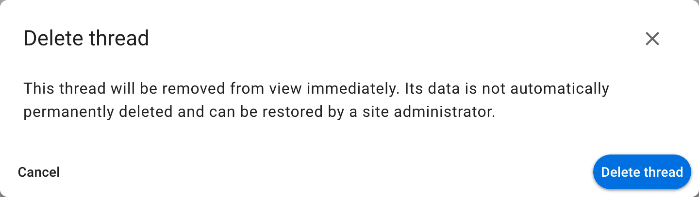
