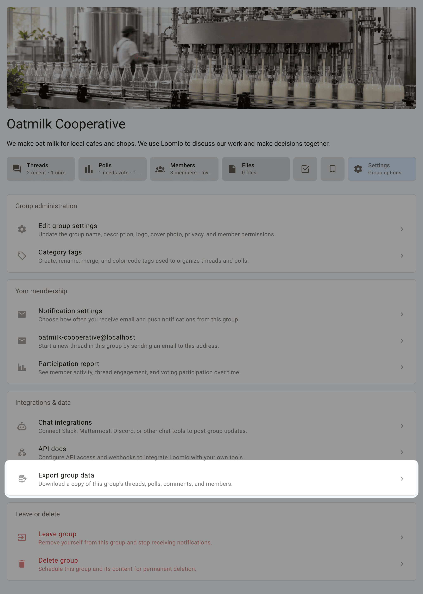

<!-- translation-section: introduction -->

# Group data backup or export

With group data export, you can:

- Download member data to audit group membership.
- Archive or analyze your group's threads, comments, and polls.
- Open poll results in a spreadsheet or script.
- [Print or save PDFs of a thread or poll for your records.](#print-thread-to-pdf)
- Move your group, including its users, threads, polls, and files, to another Loomio server.

You can use this feature to move from Loomio's hosted service to a [self-hosted server](https://github.com/loomio/loomio). If you run your own server and want to move to Loomio's managed hosting in the USA, EU, or Australia, [contact us](/contact).

[Contact us](/contact) if you want to transfer a group from loomio.com to a regional service (loomio.eu for Europe, or loomio.nz for Australia and New Zealand).

<!-- translation-section: export-data -->

## Export data

Only a group admin can export group data. Open **Settings** on the group page and select **Export group data**.



Loomio prepares the export in the background and emails you a download link when it is ready. The link stays active for one week.

<!-- translation-section: export-group-data-as-csv -->

### Export group data as CSV

Use CSV to inspect group data, including member details and activity, in a spreadsheet such as Microsoft Excel or Google Sheets.

<!-- translation-section: export-group-data-as-html -->

### Export group data as HTML

Use HTML to save a readable copy of your group's discussions and polls for archival purposes.

<!-- translation-section: export-group-data-as-json -->

### Export group data as JSON

Use JSON to move your group data to a self-hosted Loomio server.

The JSON export includes:

- The group, its members, and membership requests
- Threads, comments, reactions, tags, templates, notifications, and related records from included groups
- Polls, options, votes, and outcomes; an anonymous poll is included only after it has closed
- Subgroups you belong to
- Open, Closed, and Visible to parent group subgroups when you export their parent group as a parent group admin, even if you do not belong to those subgroups
- References to files and images attached to the included content

The JSON export does not include:

- Secret subgroups you do not belong to, including their membership and content
- Subgroups awaiting deletion
- Anonymous polls that have not closed
- Direct threads and polls that do not belong to the group

<!-- translation-section: print-thread-to-pdf -->

## Print thread to PDF

To save a single thread for your records, open its actions menu and select **Print**. Loomio generates an HTML page with the thread's comments, polls, votes, outcomes, and formatting. Use your browser's print tool to print it or save it as a PDF, or copy the content into another document.


<!-- translation-section: import-your-group-data-on-another-loomio-server -->

## Import your group data on another Loomio server

This section is for administrators running a self-hosted Loomio server. For setup instructions, see the [Loomio repository](https://github.com/loomio/loomio).

1. Copy the `.json` file to the container's `import` folder:

```sh
scp your-group-data.json username@some-domain.org:loomio-deploy/import
```

2. Open the Rails console in the running container:

```sh
docker exec -ti loomio-app rails console
```

3. Run the import service:

```ruby
GroupExportService.import('/import/your-group-data.json')
```
