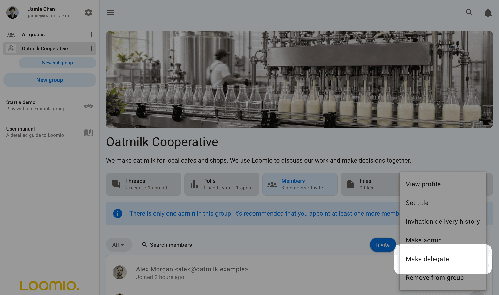
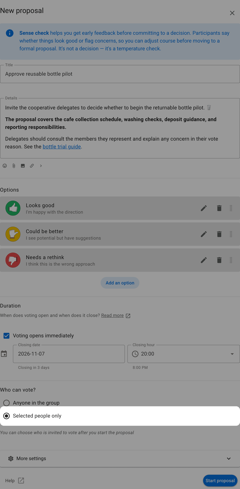
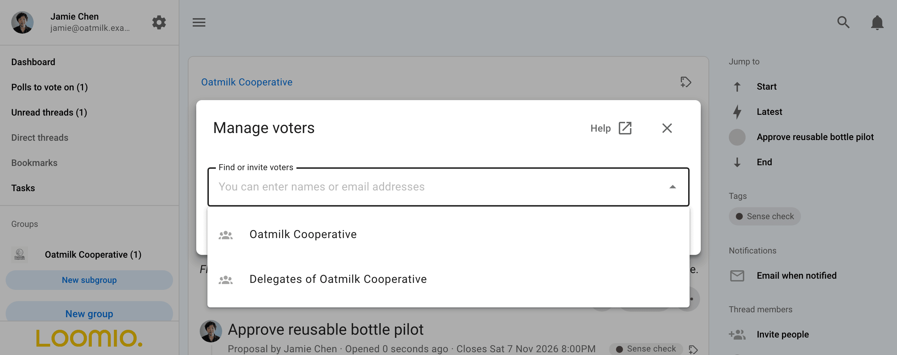
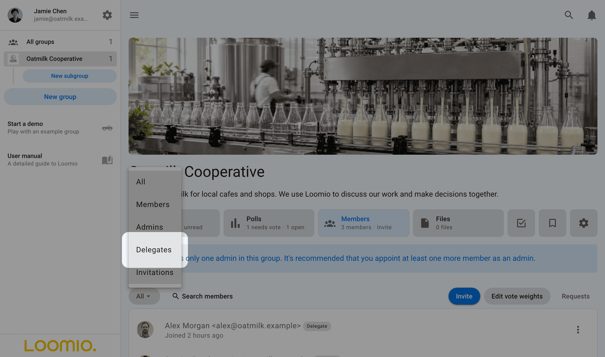

<!-- translation-section: introduction -->

# Delegated voters

Use delegates when everyone in a group should share the same discussion space, but only a defined set of members—such as directors or elected representatives—should vote. This is simpler than maintaining a separate subgroup just to separate voters from non-voters.

Use a private subgroup instead when those members also need discussions, files, or a member list that other members should not see.

Only a group admin can assign or remove delegate status. On the **Members** tab of your group page, open the actions menu beside a person's name and select **Make delegate**. Select **Revoke delegate** in the same menu to remove the designation.

To create a poll or proposal that only delegates can vote on, select **Selected people only** in the poll settings.

When choosing who to invite to vote, select **Delegates of [group name]**.

To view all delegates in a group, open the **Members** tab and select **Delegates** from the filter menu.

