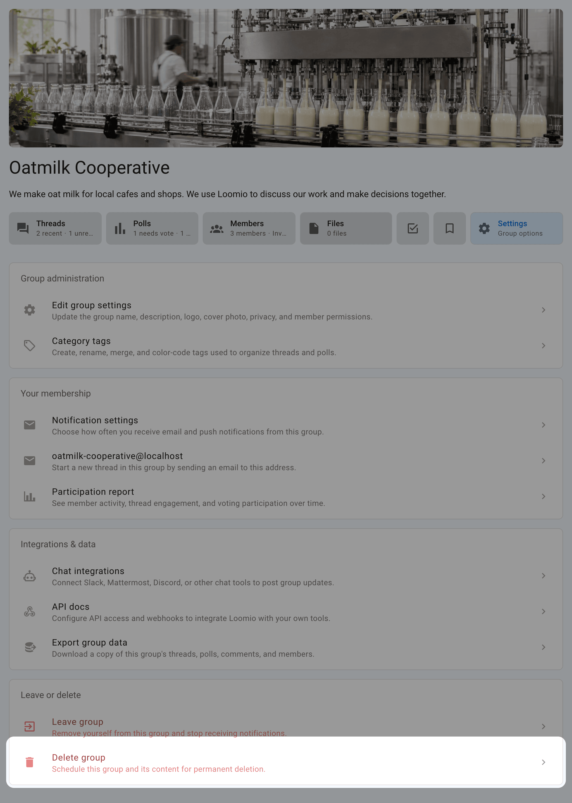
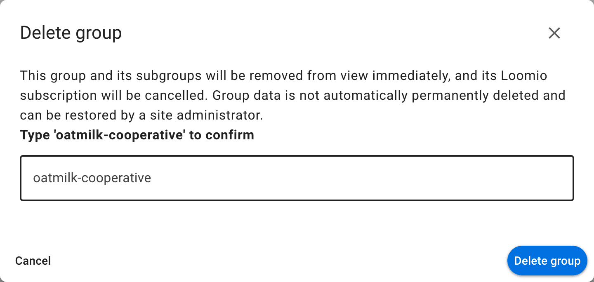

<!-- translation-section: introduction -->

# Deleting your group

Only a group admin can delete a group. Deleting a group removes access immediately and schedules all group and subgroup data for permanent deletion after 90 days.

Before you delete a group, [export the group data](/en/user_manual/groups/data_export) and download any uploaded files you want to keep.

To delete a group, open the group's actions menu and select **Delete group**.

Enter the group handle to confirm deletion.

When you confirm deletion:

- The group and its subgroups are removed from view immediately. Members and group admins lose access to view, participate in, or export content, including polls opened from saved links.
- Pending activity notifications and poll reminders for the group and its subgroups stop, though messages already being sent may still arrive.
- Your Loomio subscription is canceled.
- Direct discussions and polls outside the group are unaffected.

Loomio also sends a warning email listing the counts for the group's subgroups, members, discussions, polls, and comments. If you deleted the group by mistake or still need to export its data, reply to that email or contact us within 90 days to restore access.

<!-- translation-section: group-data-is-permanently-deleted-after-90-days -->

## Group data is permanently deleted after 90 days

After 90 days, Loomio permanently deletes all threads, polls, files, and other content in the group and its subgroups. This cannot be undone.
