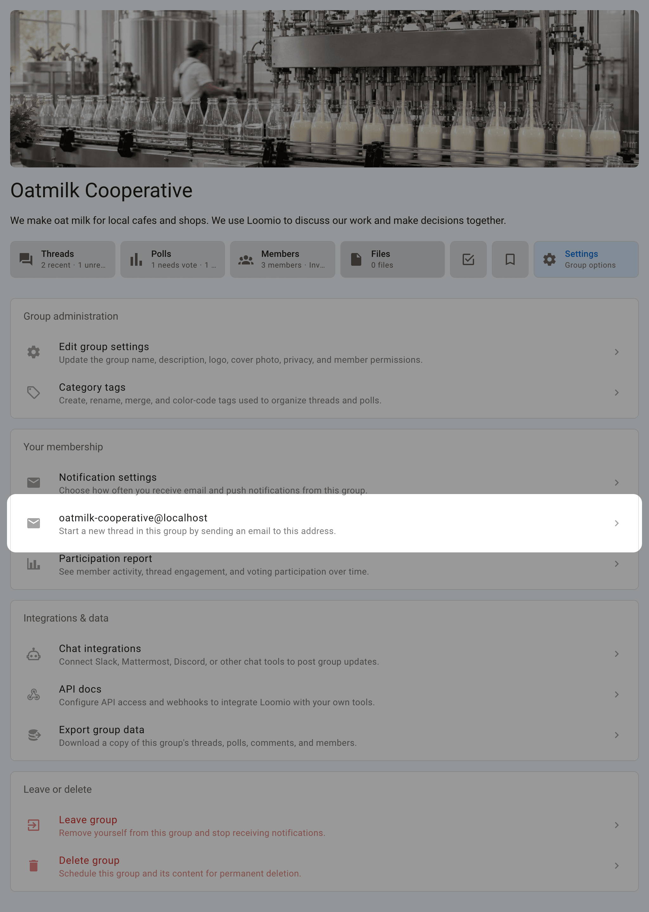
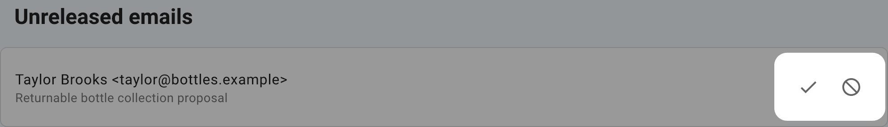

<!-- translation-section: introduction -->

# Send an email to start a thread in your group

Each Loomio group has its own email address. You can send or forward an email to this address to start a new thread in the group.

You can find the group's email address under **Settings** on the group page:

When you email this address, Loomio creates a new thread. The email subject becomes the thread title, the body becomes the thread description, and any attached files are added to the thread.

Loomio uses the email's "From" address to match the sender to a group member and set them as the thread author.

<!-- translation-section: preventing-unauthorized-emails -->

## Preventing unauthorized emails

To prevent non-members from starting threads, Loomio requires the "From" address of an incoming email to match a group member's email address.

If a member sends an email from an unrecognized address, Loomio holds the email and notifies group admins. A group admin can approve the email and add the address as an alias for that member, or reject further emails from that address.

Once an alias is added, future emails from that address start threads immediately.

