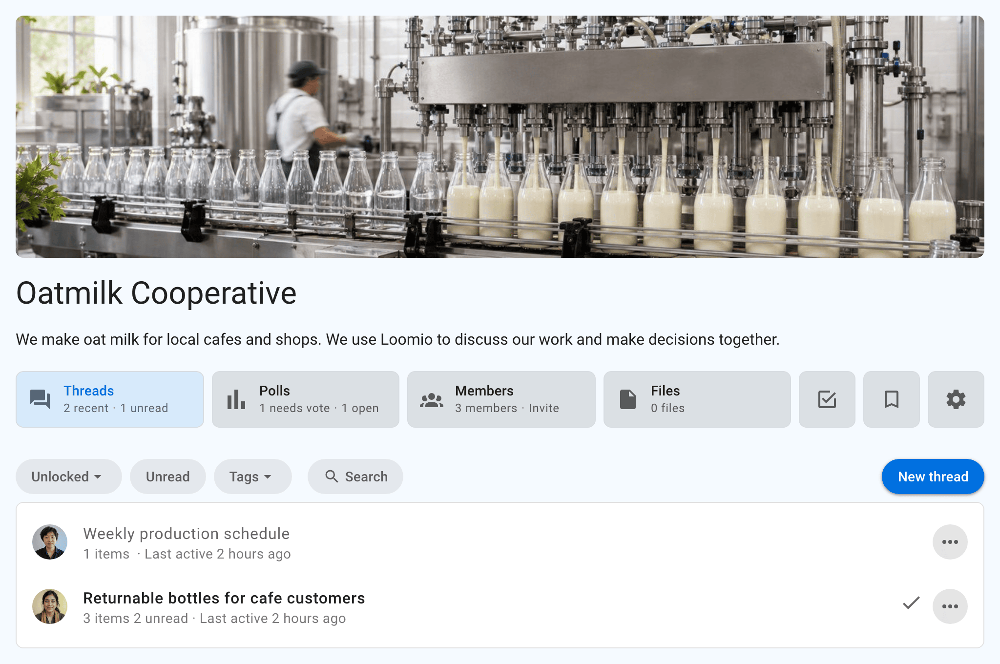

<!-- translation-section: introduction -->

# Groups

A Loomio group is a shared space where members hold discussions, share information, and make decisions together.

You can customize your group page with a name, description, logo, cover image, and links to documents such as your terms of reference. This helps members understand the group's purpose and how to participate.

To get started, [create a group](/en/user_manual/groups/starting_a_group), choose its [privacy settings](/en/user_manual/groups/settings/privacy), and [invite people](/en/user_manual/groups/inviting_people).

If you are preparing a new group, see [Introducing Loomio to your group](/en/user_manual/overview/introducing_loomio) for a practical sequence from choosing the first piece of work through to recording an outcome.

<!-- translation-section: administration-facilitation-and-moderation-code-of-conduct -->

## Code of conduct

A code of conduct helps members understand how to participate and how the group responds to inappropriate behavior. See the [Facilitator's Guide](/guides/facilitators-guide/commencing/#culture-protocol-expectations) for guidance on setting expectations.
