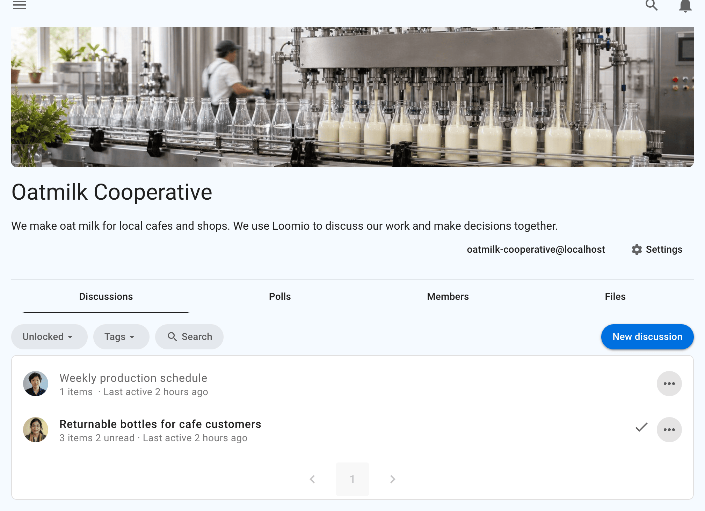

<!-- translation-section: introduction -->

# Groups

A Loomio group is a safe place for people to meet, have discussions and make decisions. 

It’s a container where group members can find and share information, participate in important discussions and decisions that affect their work.  

A Loomio group looks like this.  At the top of the page you will see an image and logo that you can tailor to represent your organization.  This allows people arriving into your group to see they have joined a place they recognize and feel welcome - a safe space where people feel at home, amongst friends and can participate effectively.

Give your group a recognizable name and use its description to explain its purpose, who is involved and how members can participate. You can also add a logo, cover image and links to documents such as your terms of reference.

To get started, [create a group](/en/user_manual/groups/starting_a_group), choose its [privacy settings](/en/user_manual/groups/settings/privacy), and [invite people](/en/user_manual/groups/inviting_people).

If you are preparing a new group, see [Introducing Loomio to your group](/en/user_manual/overview/introducing_loomio) for a practical sequence from choosing the first piece of work through to recording an outcome.

<!-- translation-section: administration-facilitation-and-moderation-code-of-conduct -->

## Administration, Facilitation and Moderation - Code of Conduct

A code of conduct can help members understand how to participate and how the group will respond to inappropriate behaviour. See the [Facilitator's Guide](/en/guides/facilitators_guide/commencing#culture-protocol-expectations) for guidance on setting expectations.
