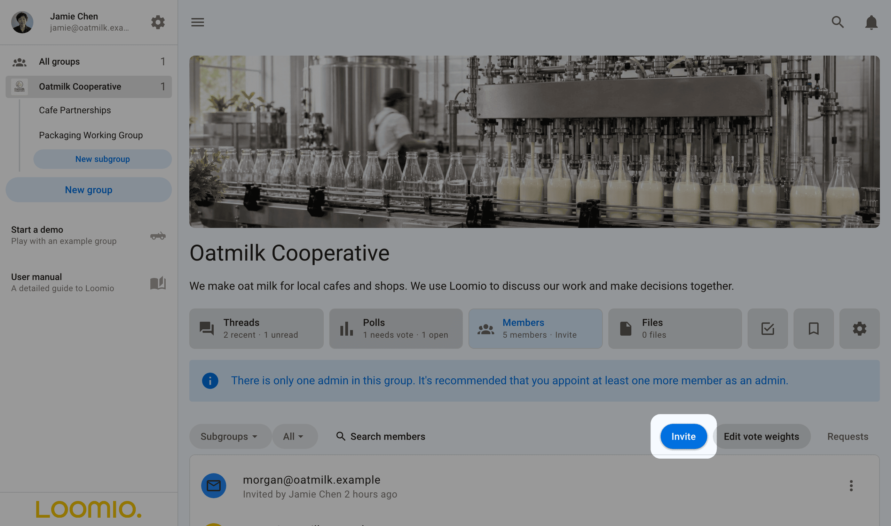
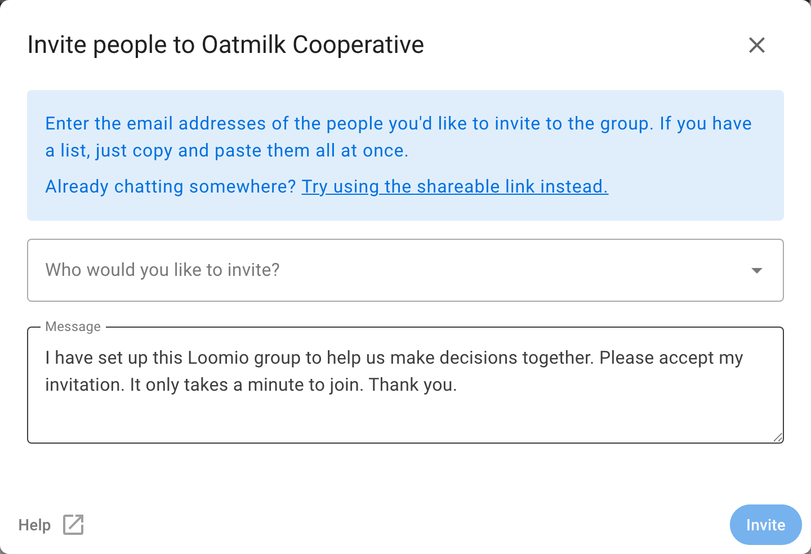
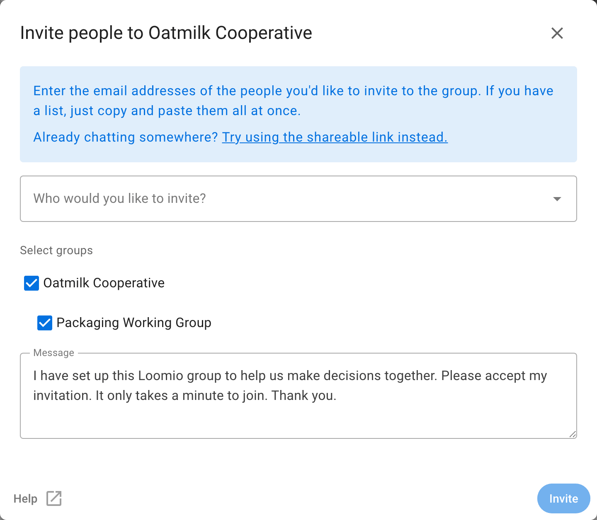
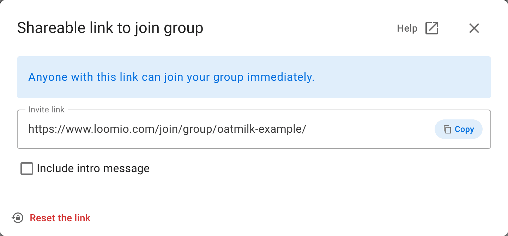
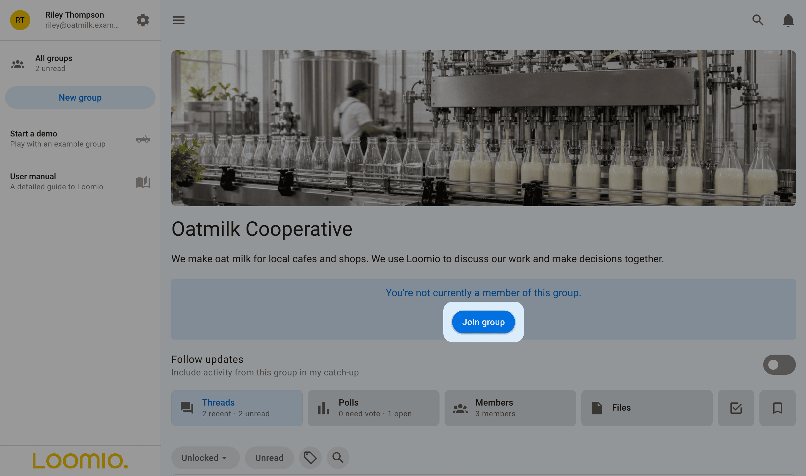
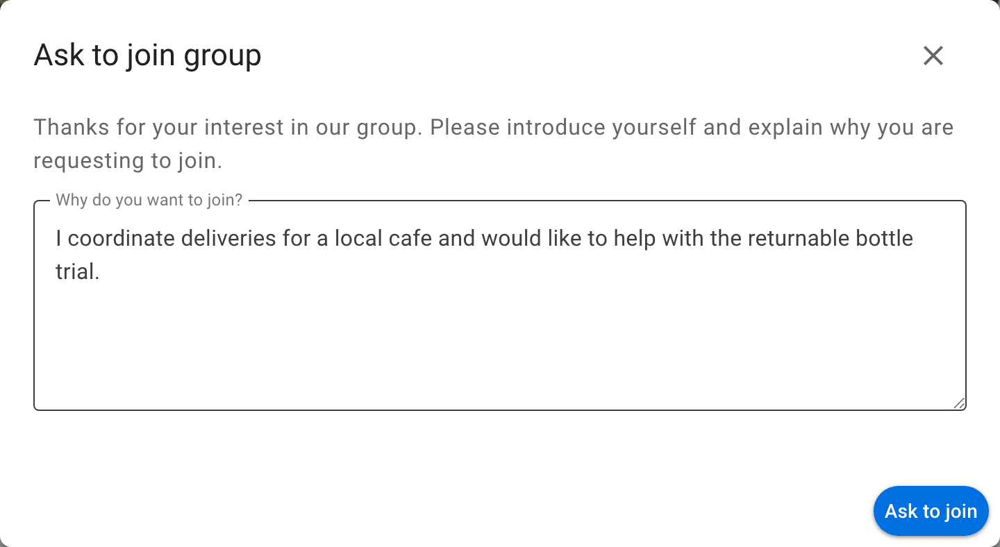
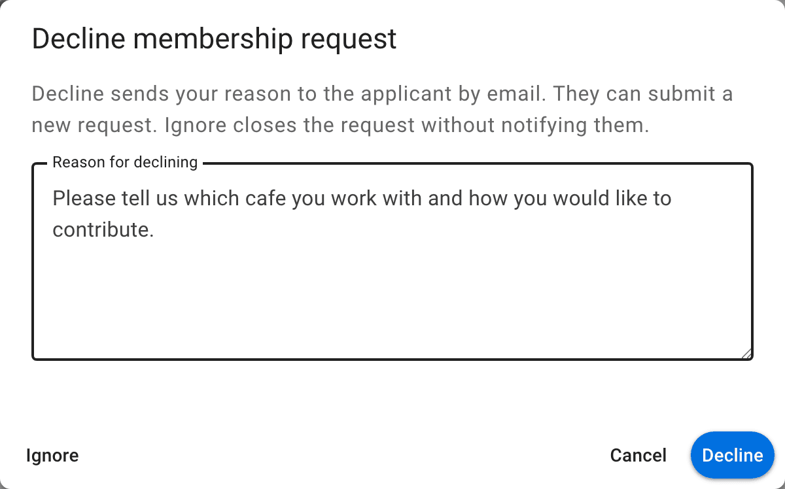
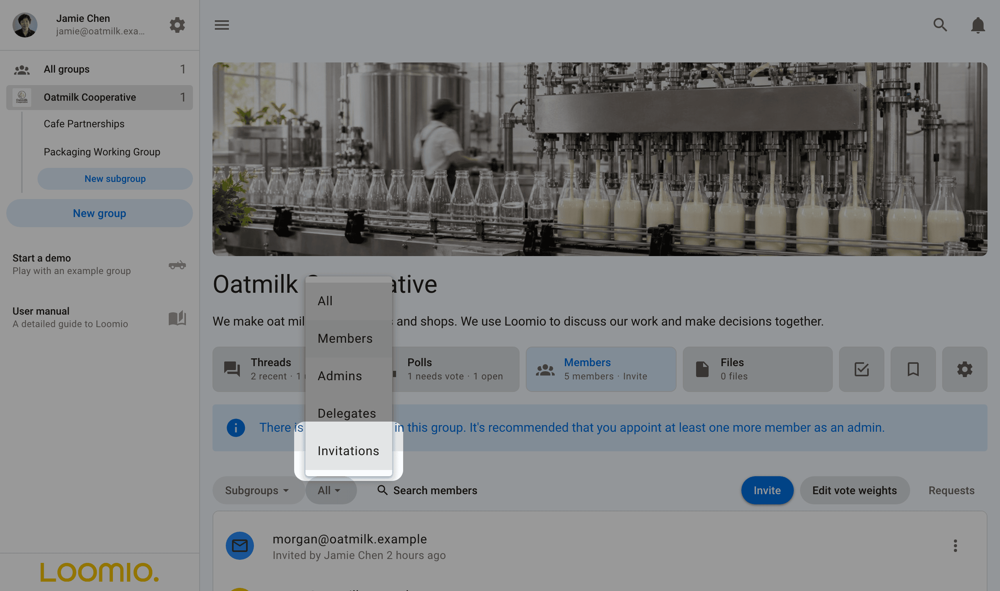
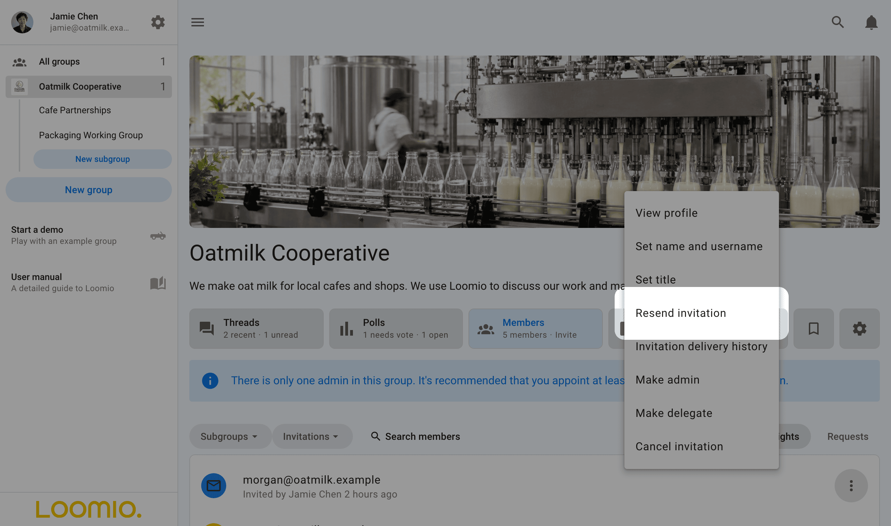
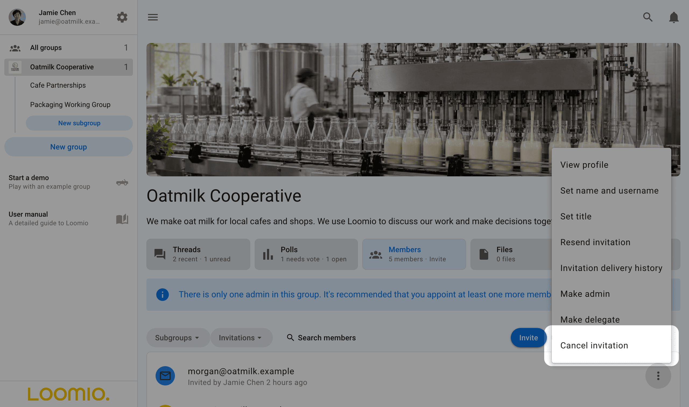

<!-- translation-section: introduction -->

# Invite people to a Loomio group

You can invite people to your Loomio group by email, share an invitation link, or let people request to join. Open the **Members** tab on your group page to get started.

<!-- translation-section: send-invitations-via-email -->

## Send invitations via email

Select **Invite** on the **Members** tab to send an email with a single-use invitation link. The recipient can join with an existing Loomio account or create a new one.

<!-- translation-section: invite-many-at-once -->

### Invite many at once

You can invite up to 100 people at once by entering or pasting email addresses separated by commas or spaces.

When inviting people to a group in an organization, you can also select the parent group or related subgroups you belong to. Expand a selected group into individual people to remove anyone you do not want to invite. People who are already members are excluded automatically.

>[!Tip]
>You can copy a column of email addresses from Google Sheets or Microsoft Excel and paste it directly into the invitation field.

When you select **Invite**, Loomio sends each address a unique, single-use invitation link in your current language.

<!-- translation-section: invite-people-to-subgroups -->

### Invite people to subgroups

When inviting people to a parent group, you can add them to one or more subgroups at the same time. Check the subgroups you want them to join when they accept the invitation.

<!-- translation-section: share-a-link-to-your-group -->

## Share a link to your group

Select **Share** to generate a reusable invitation link for a newsletter, chat channel, email, or website.

To stop people from joining with an existing link, select **Reset this link**. This invalidates the old link and creates a new one.

<!-- translation-section: request-to-join-group -->

## Request to join group

People can request to join an Open or Closed group from its group URL, such as `https://www.loomio.com/group-name`. Visitors see the public group details and select **Join group** to answer the joining prompt and submit their request.

The joining prompt lets applicants introduce themselves and explain why they want to join.

Under [Group privacy](/en/user_manual/groups/settings/privacy#how-people-join), choose **Request to join** to require review of membership requests. You can also customize the joining prompt in group settings.

<!-- translation-section: review-membership-requests -->

### Review membership requests

Group admins and members with permission to add members can review requests under **Membership requests** on the **Members** tab.

For each request, you can:

- **Approve** to add the applicant as a member and notify them.
- **Ignore** to close the request without notifying the applicant or allowing another request.
- **Decline** to send an explanation by email and notification; the applicant can submit a new request later.

<!-- translation-section: managing-invitations -->

## Managing invitations

Open the filter menu on the **Members** tab and select **Invitations** to see pending invitations. Use the actions menu beside an invitation to manage it.

You can also make an invited person a group admin or set their title (for example, "IT Support") before they accept.

<!-- translation-section: invitation-notification-history -->

### Invitation delivery history

If someone does not receive their invitation email, a group admin can check its delivery status. Open the actions menu beside their name on the **Members** tab and select **Invitation delivery history** to see when invitations were sent and any recorded delivery problems.

<!-- translation-section: re-send-invitations -->

### Resend invitations

If someone lost or missed their invitation email, open the actions menu beside their name on the **Members** tab and select **Resend invitation**.

<!-- translation-section: cancelling-invitations -->

### Canceling invitations

If you entered the wrong email address or no longer want to invite someone, open the actions menu beside their invitation on the **Members** tab and select **Cancel invitation**.

