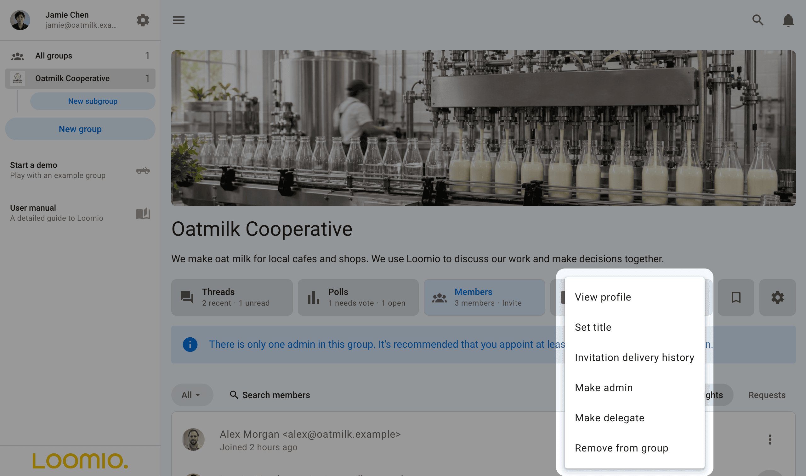
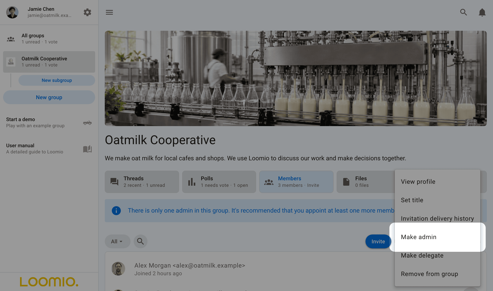
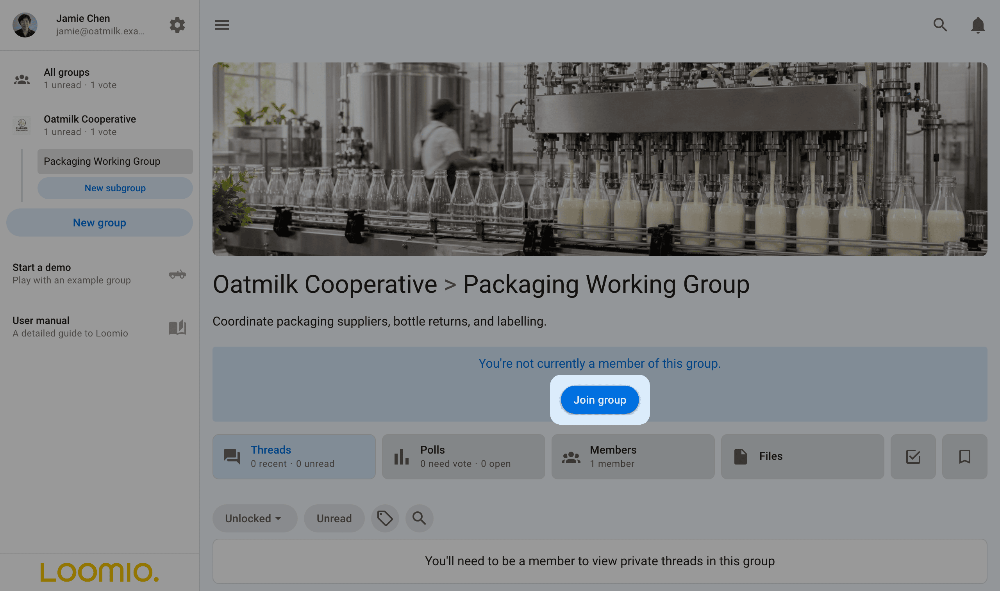
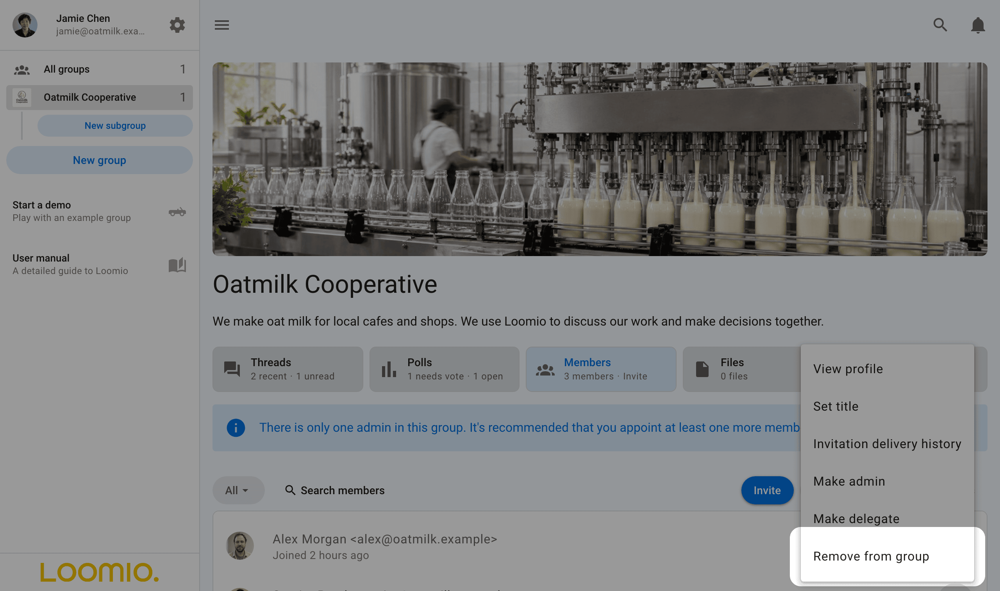
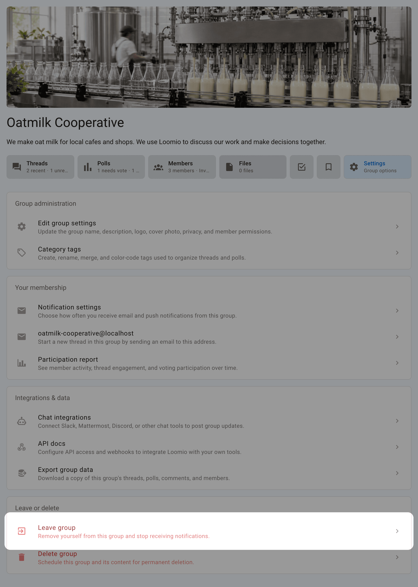
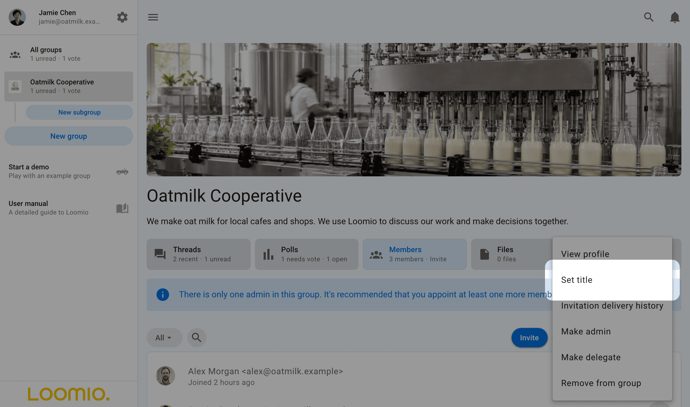

<!-- translation-section: introduction -->

# Member management

Group admins manage members from the **Members** tab on the group page. Open the actions menu beside a member to set their title, make them a group admin, make them a delegate, or remove them from the group.

<!-- translation-section: administering-your-group -->

## Administering your group

A Loomio group has two roles: **member** and **group admin**.

Group admins can add and remove members, manage member permissions, change group privacy settings, manage subscriptions, view member email addresses, and export group data.

The person who creates a group is a group admin by default. We recommend having at least two group admins so someone can always manage the group. A group can have as many group admins as you need.

To promote a member, open the actions menu beside their name on the **Members** tab and select **Make admin**.

<!-- translation-section: managing-subgroups -->

## Managing subgroups

Parent group admins can join any non-secret subgroup and then make themselves a subgroup admin.

Select **Join group** on the subgroup page.

Once you are a member of the subgroup, open the actions menu beside your name on its **Members** tab and select **Make admin**.

>[!Note]
>This does not apply to [**Secret** subgroups](/en/user_manual/groups/subgroups#permissions).

<!-- translation-section: removing-members -->

## Removing members

To remove someone, open the actions menu beside their name and select **Remove from group**.

When removed from a group:

- The person loses access to the group and its subgroups, and stops receiving group notifications.
- Their existing comments and votes remain in place.
- Private polls disappear from their dashboard and voting list. Public polls remain readable, but they cannot vote unless invited back. Leaving while a poll is closed does not preserve voting rights if it is reopened.

You can add removed members back later. Rejoining restores their access and existing votes in active polls.

<!-- translation-section: leaving-group -->

## Leaving a group

To leave a group, open the group's actions menu and select **Leave group**.

Leaving has the same effect on group and subgroup access as being removed by a group admin.

<!-- translation-section: set-title -->

## Set title

A member's title shows their role in the group or the organization they represent. You or a group admin can set or change your title by selecting **Set title** from the actions menu beside your name on the **Members** tab.

You can have different titles in different subgroups.

<!-- translation-section: member-email-addresses -->

## Member email addresses

Only group admins can see member email addresses.

To review all member email addresses across the group and its subgroups, [export the group data](/en/user_manual/groups/data_export) as a CSV file and open it in Microsoft Excel or Google Sheets.

You can also search for members by email address on the **Members** tab to find and manage a specific person.
