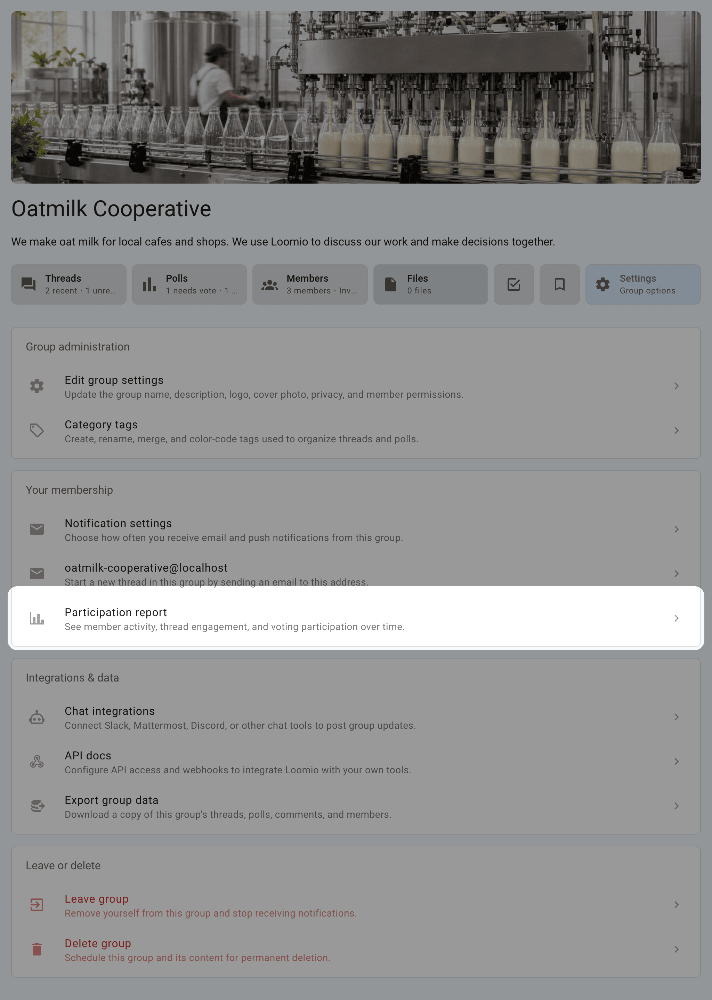
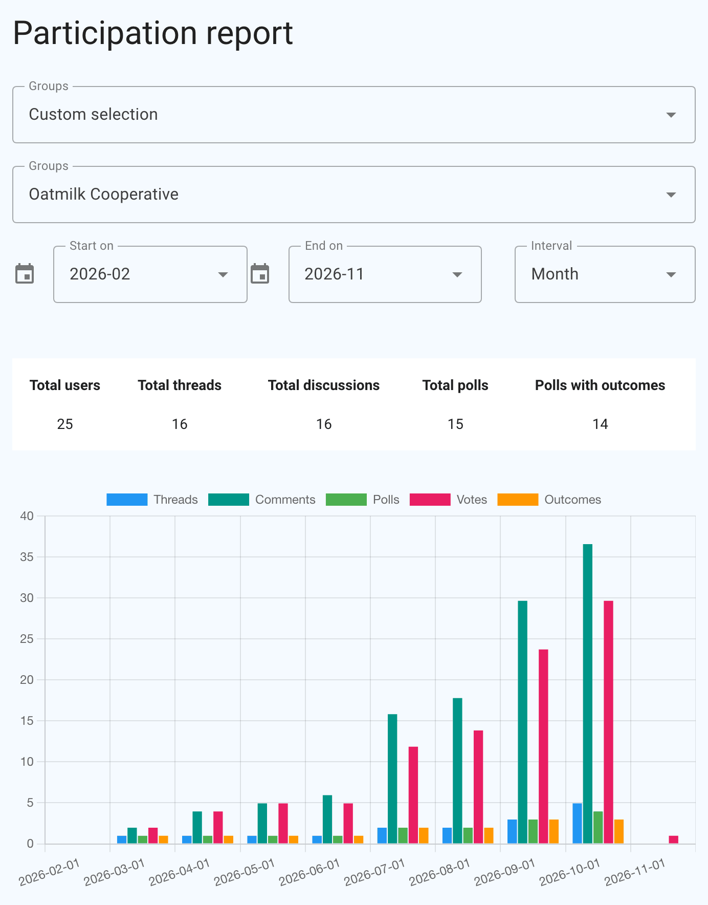
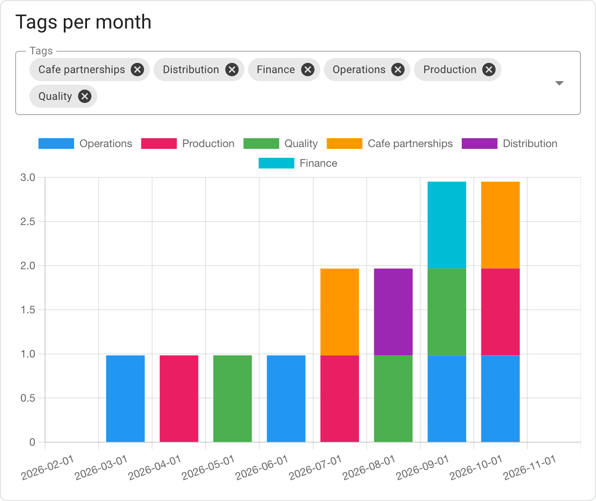
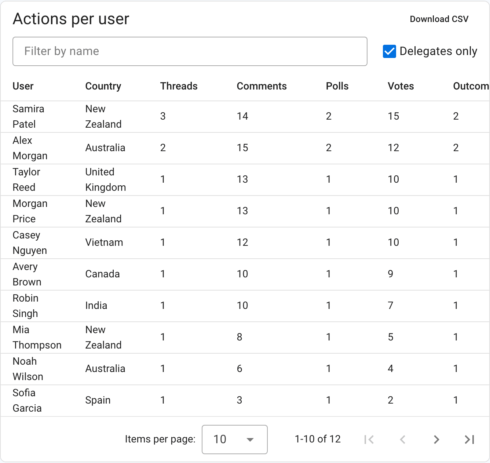
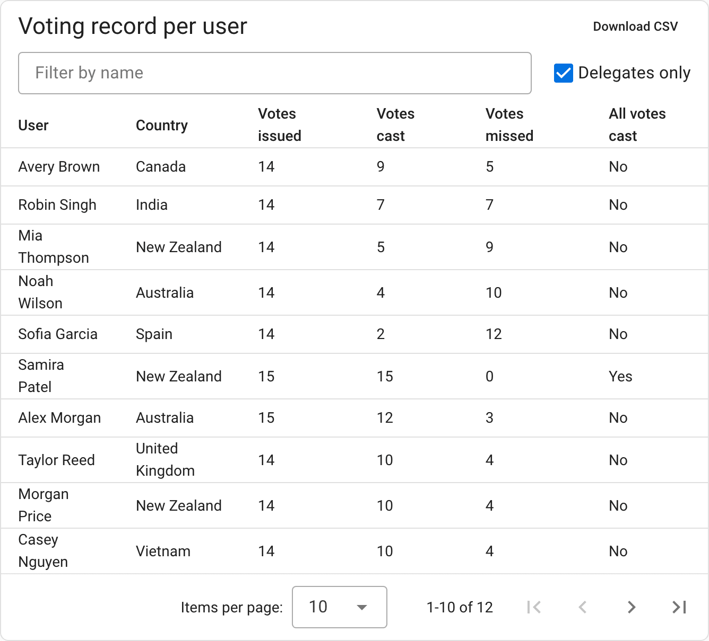
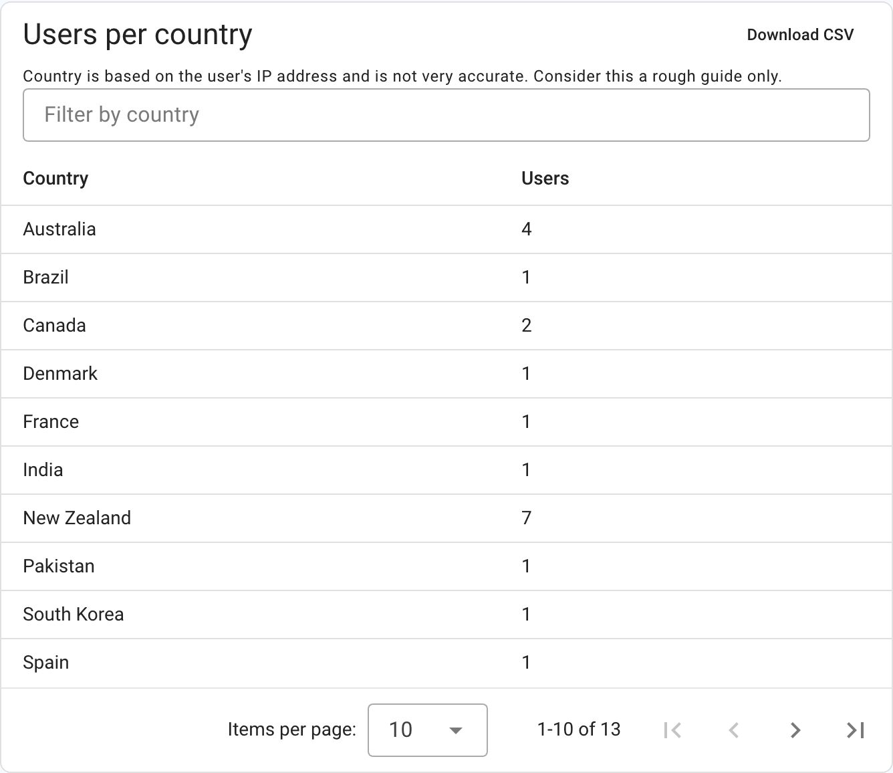
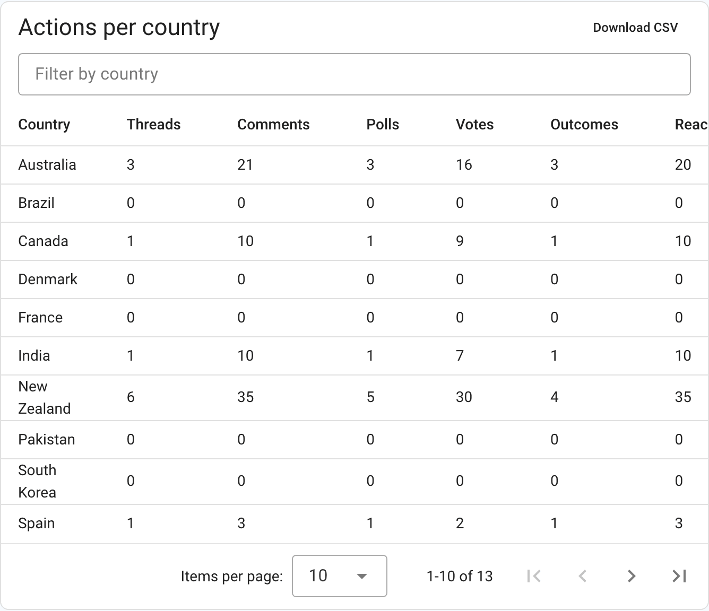

<!-- translation-section: introduction -->

# Participation report

The participation report shows activity across your Loomio group and its subgroups.

You can choose which groups to include, set a start and end date, and group results by year, month, week, or day.

Every group member can view the report, but each person only sees results for groups they belong to. Different members may therefore see different totals.

To open the report, open the group's actions menu and select **Participation report**. In any table in the report, select a column heading to sort by that column.

<!-- translation-section: what-s-in-the-report -->

## What's in the report

<!-- translation-section: actions-per-month -->

### Actions over time

This graph shows how many threads, comments, polls, votes, and reactions happened during each selected time interval so you can spot changes in activity. Select a label on the graph to hide or show that metric.

<!-- translation-section: tag-usage -->

### Tag usage

This chart shows how often tags were applied during the selected time frame, such as how many discussions used a particular decision process or template.

<!-- translation-section: actions-per-user -->

### Actions per user

This table shows how many threads, comments, polls, votes, and reactions each member contributed during the selected time frame.

Turn on **Delegates only** to limit the table to current delegates in any of the selected groups. Their activity is combined across the selected groups, and delegates with no activity still appear. The CSV download uses the same filter.

<!-- translation-section: voting-record-per-user -->

### Voting record per user

This table compares the number of votes issued to each person with the number they cast, shows missed votes, and highlights people who cast every vote issued to them. A person with no issued votes is not marked as having cast all votes. Anonymous polls are excluded because anonymous ballots are not linked to individual voters.

Turn on **Delegates only** to review the voting record of current delegates. The CSV download uses the same name and delegate filters.

<!-- translation-section: users-per-country -->

### Users per country

This table shows how many members of the selected groups are in each country, based on their current IP address.

<!-- translation-section: actions-per-country -->

### Actions per country

This table groups threads, comments, polls, votes, and reactions by the country detected for each member.

