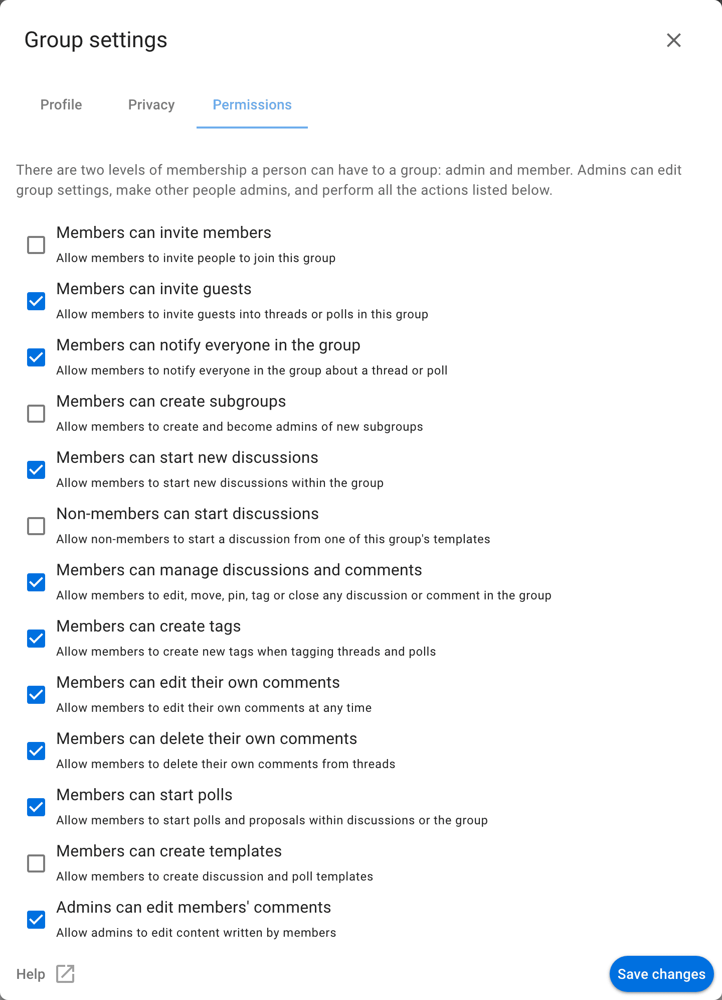

<!-- translation-section: introduction -->

# Group permissions

The **Permissions** tab controls what members can do in the group and, for non-secret groups, what non-members can do. Open **Edit group settings** from the group's actions menu, then select **Permissions**.

Group admins always keep full management permissions. Turning on a permission lets members perform that action without making them group admins.

Permissions control whether members can:

- Add members or invite guests
- Send announcements
- Create subgroups
- Start and manage discussions
- Create and manage tags
- Edit or delete comments where the setting permits
- Start proposals and polls
- Create discussion and poll templates

For non-secret groups, group admins can also allow non-members to start discussions. A non-member who starts a discussion becomes a guest on that thread, but does not become a group member or gain access to other private discussions.

The **Admins can edit members' comments** setting lets group admins edit content written by members. Turn this on only if your group has agreed that group admins should be able to change members' comments.

Review permissions whenever your group's purpose, membership, or moderation needs change, and grant each role only the permissions it needs.
