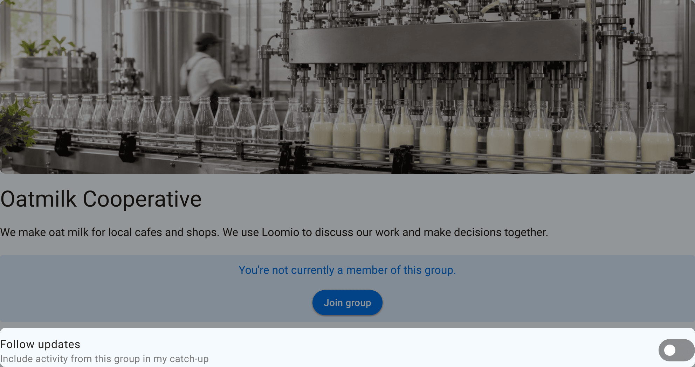

<!-- translation-section: introduction -->

# Group privacy

Privacy controls who can find a group and who can read its content. On the group page, open **Settings**, select **Edit group settings**, and choose **Privacy**.

Changing privacy affects existing content. Making a parent group private also changes its public subgroups to **Visible to parent group** and makes their threads private.

<!-- translation-section: open -->

## Open

Open groups are public spaces. Anyone can find the group and read its discussions, polls, and files. Only members can view the member list.

<!-- translation-section: follow-an-open-group -->

### Follow an Open group

People can follow an Open group without joining it. Following adds unread group activity to their catch-up email so they can review it on their own schedule. Followers do not become members, do not gain voting rights, and do not receive immediate notifications.

Turn on **Follow updates** on the group page to include its unread discussions, comments, polls, and other thread activity in your catch-up email. Turn it off to stop following the group.

<!-- translation-section: closed -->

## Closed

Anyone can find a Closed group and read its name and description. Discussions, polls, files, and the member list are private to members and invited guests.

<!-- translation-section: visible-to-parent-group -->

## Visible to parent group

Parent group members and subgroup members can find the subgroup. Its threads are private to subgroup members and invited guests.

<!-- translation-section: secret -->

## Secret

Only people who have been invited or added can see a Secret group and its content. Secret groups do not appear in the public group directory.

<!-- translation-section: how-people-join -->

## How people join

Under **How do people join?**, choose one of the following options:

| Joining option | How it works |
| --- | --- |
| **Join without approval** | People can join themselves |
| **Request to join** | People request to join and wait for approval |
| **Invitation only** | People need an invitation to join |

When approval is required, people select **Join group**, answer the joining prompt, and submit a request. See [Inviting people](/en/user_manual/groups/inviting_people#request-to-join-group) for instructions on customizing the prompt, reviewing requests, and inviting people directly.

<!-- translation-section: group-directory -->

## Group directory

Open and Closed parent groups can be listed in the public group directory so people can discover them. Subgroups and Secret groups cannot be listed.
