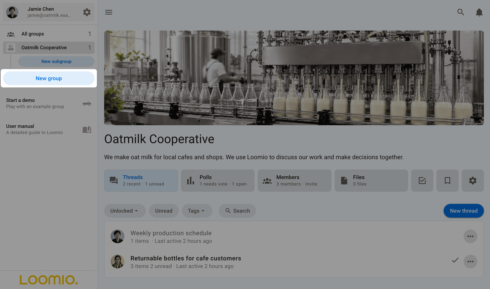

<!-- translation-section: introduction -->

# Starting a new group

If you are new to Loomio, you can start a group on a free trial from the [Loomio website](https://www.loomio.com/). During a free trial, your group unlocks 30 extra days—with subgroups and guests enabled—once three people vote in a proposal or poll. If you already use Loomio and want to start another group, select **New group** in the sidebar, or from the group switcher menu at the top of the page when the sidebar is closed.

Most organizations only need one parent group, with as many [subgroups](/en/user_manual/groups/subgroups) as needed inside it.

<!-- translation-section: group-details -->

## Group details

<!-- translation-section: group-name -->

### Group name

Enter a short, clear name for your group.

<!-- translation-section: group-handle -->

### Group handle

Loomio assigns a handle automatically based on your group name. The handle is used in the group's URL and email address, such as `loomio.com/your-group-handle` and `your-group-handle@loomio.com`.

You can edit the handle during setup or change it later in group settings. When you change it, links and email addresses using the old handle continue to work. Loomio keeps up to three old handles; after that, the oldest handle expires.

<!-- translation-section: group-description -->

### Group description

Add a short description to appear at the top of the group page and give new members context.

Choose a [privacy setting](/en/user_manual/groups/settings/privacy) and select **Start group** to create the group. You are automatically made the first group admin and can update these details later in group settings.
