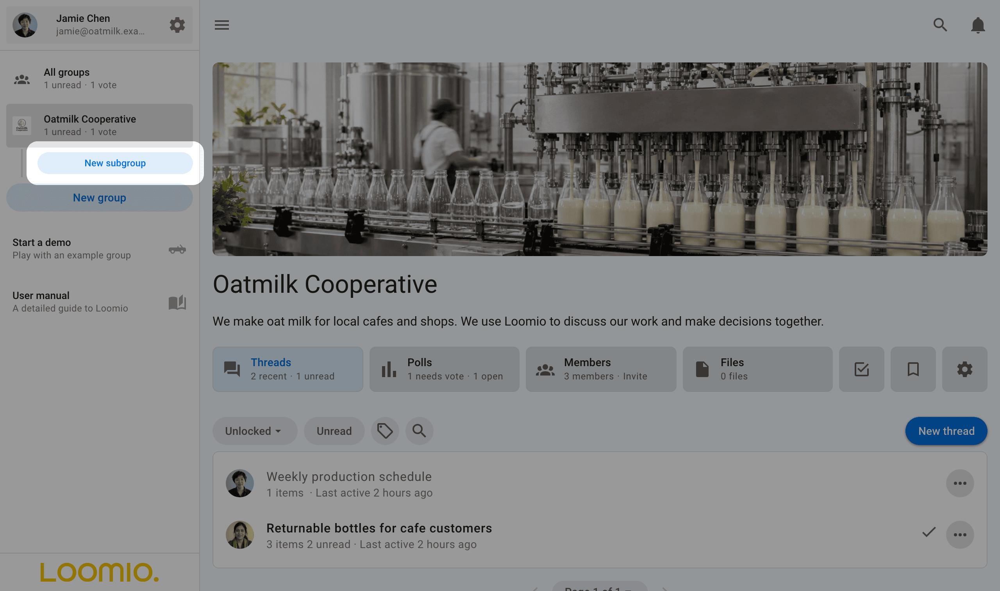
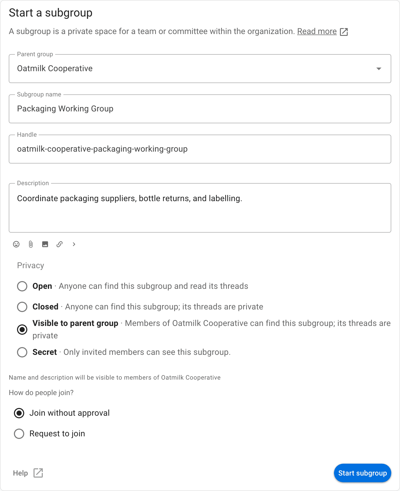
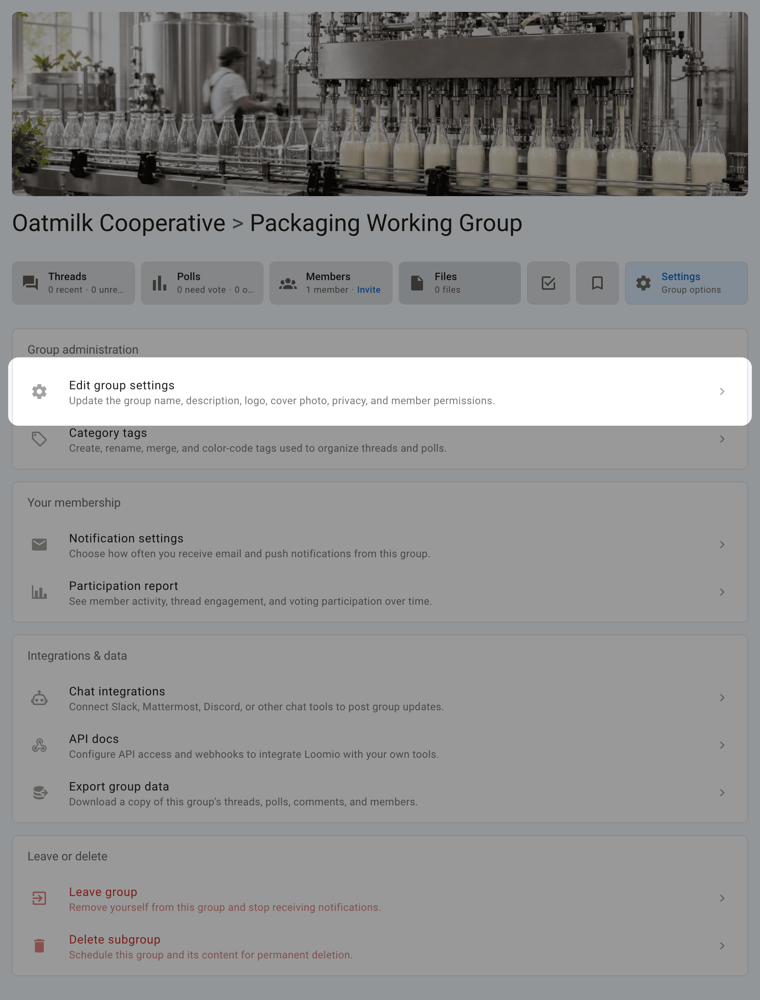
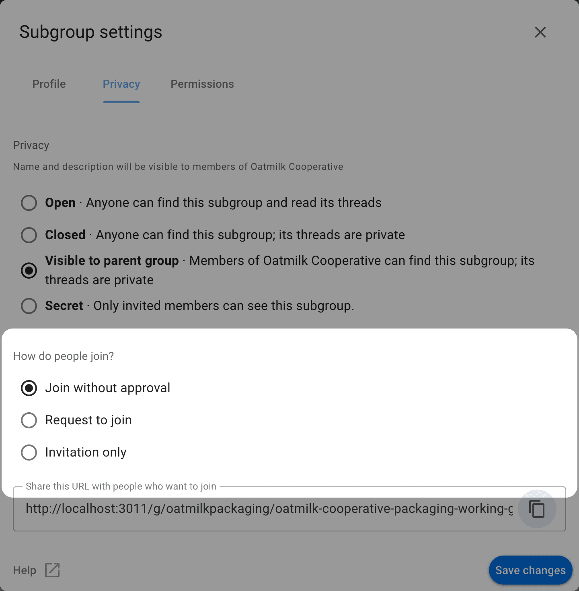
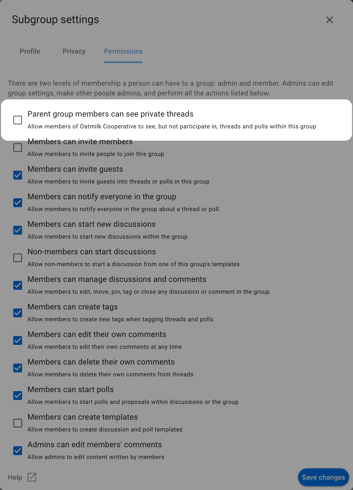
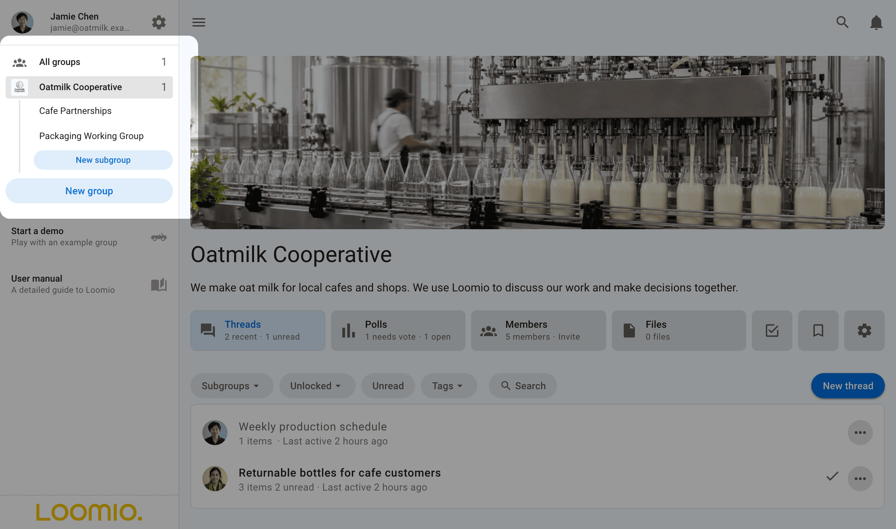
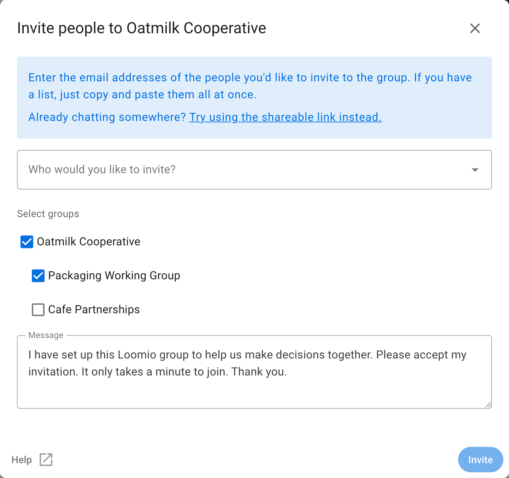
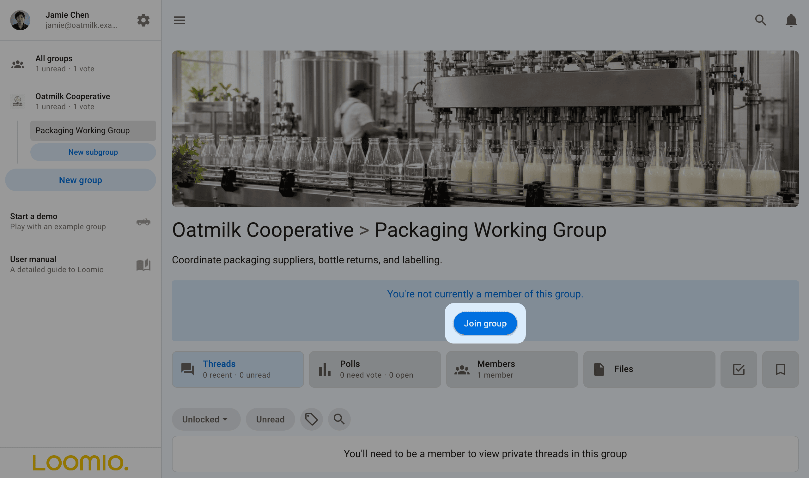
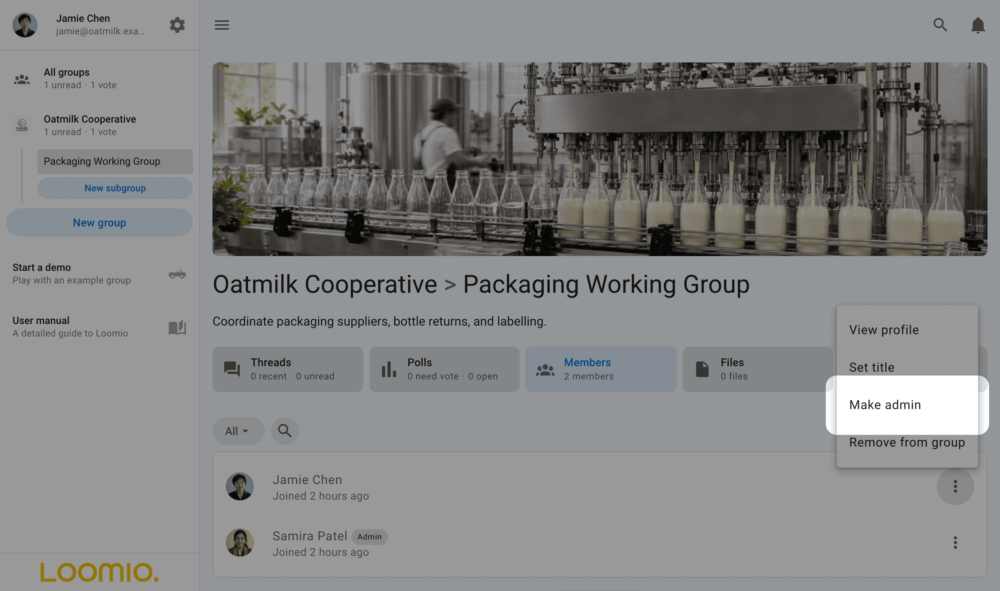

<!-- translation-section: introduction -->

# Subgroups

Subgroups help you organize discussions and members around specific teams or topics inside a parent group. For example, an organization might create subgroups for:

- A governance board
- A working team or project group
- A topic such as strategy or learning

Subgroups work like regular groups and have most of the same features and settings. Someone can belong to a subgroup, such as a board, without belonging to the parent group.

<!-- translation-section: add-a-subgroup -->

## Add a subgroup

>[!Note]
>Who can add subgroups is controlled by the parent group's [permission settings](/en/user_manual/groups/settings/permissions). By default, only group admins can create subgroups.

To create a subgroup, open your parent group page, select **New subgroup** in the sidebar, enter a name, choose a privacy setting, and select **Start subgroup**.

When the subgroup is ready, [invite people](/en/user_manual/groups/inviting_people) to join it. You can change the subgroup's [group settings](/en/user_manual/groups/settings) from the actions menu on the subgroup page.

<!-- translation-section: subgroup-settings -->

## Subgroup settings

<!-- translation-section: privacy -->

### Privacy

Choose who can find the subgroup and read its threads:

| Privacy | Who can find it | Who can read its threads |
| --- | --- | --- |
| **Open** | Anyone | Anyone |
| **Closed** | Anyone | Subgroup members and invited guests |
| **Visible to parent group** | Parent group members and subgroup members | Subgroup members and invited guests |
| **Secret** | Invited subgroup members | Subgroup members and invited guests |

The **Parent group members can see private threads** permission also lets parent group members read subgroup threads without joining.

When the parent group is private, subgroups can only be **Visible to parent group** or **Secret**. See [Group privacy](/en/user_manual/groups/settings/privacy) for details.

<!-- translation-section: how-people-join -->

### How people join

Choose [how people join](/en/user_manual/groups/settings/privacy#how-people-join) when creating the subgroup, or in **Edit group settings** > **Privacy**.

<!-- translation-section: permissions -->

### Permissions

Turn on **Parent group members can see private threads** in **Permissions** to let parent group members read subgroup threads without joining. These readers do not gain voting rights or subgroup membership.

<!-- translation-section: find-subgroups -->

## Find subgroups

Select your parent group name in the sidebar to see its subgroups.

<!-- translation-section: invite-to-a-subgroup -->

## Invite to a subgroup

You can [invite people to a subgroup](/en/user_manual/groups/inviting_people) the same way you invite them to a parent group. If they already belong to the parent group or another subgroup you are in, type their name or select that group, then expand it into individual people and remove anyone you do not want to invite.

<!-- translation-section: simultaneously-invite-people-to-subgroups-and-parent-group -->

### Simultaneously invite people to subgroups and parent group

When you select **Invite** on your parent group's **Members** tab, check any subgroups you want the invited people to join at the same time.

<!-- translation-section: administer-a-subgroup -->

## Administer a subgroup

Subgroups can have their own group admins, separate from the parent group admins.

A parent group admin can join any non-secret subgroup and make themselves a subgroup admin. This does not apply to Secret subgroups. See [Managing subgroups](/en/user_manual/groups/member_management#managing-subgroups) for details.

<!-- translation-section: delete-a-subgroup -->

## Delete a subgroup

Group admins can delete a subgroup the same way they [delete a group](/en/user_manual/groups/deleting_your_group). Make sure you are on the subgroup page, not the parent group page, before deleting.
