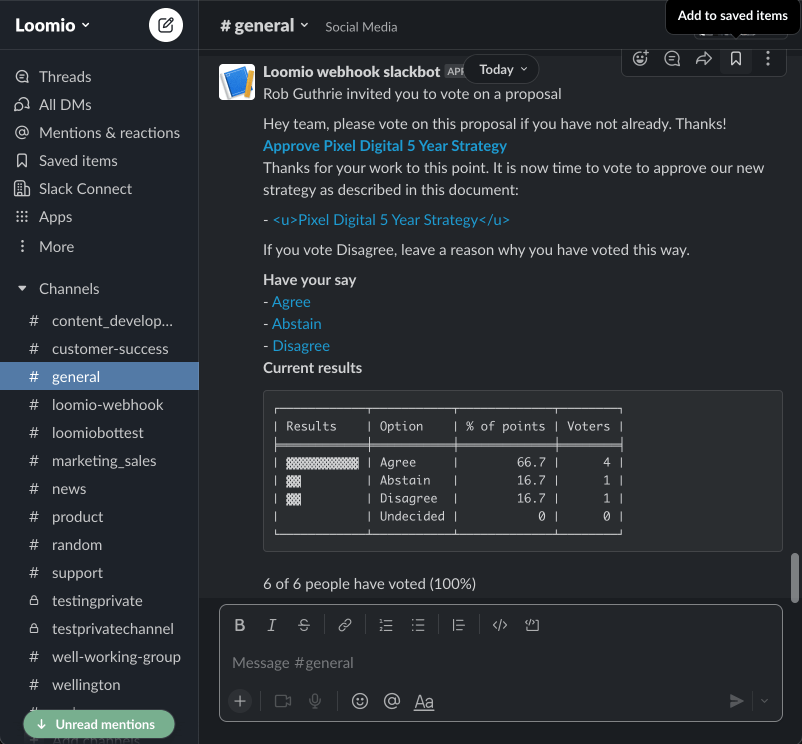
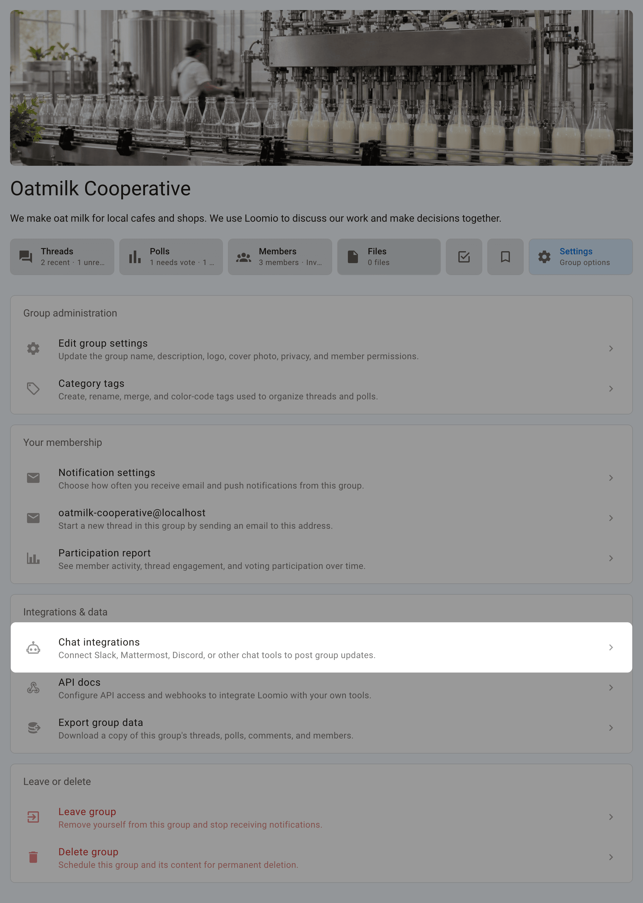
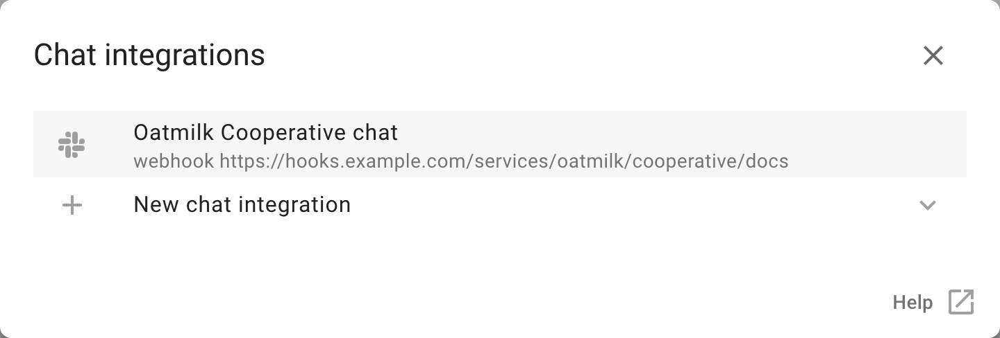
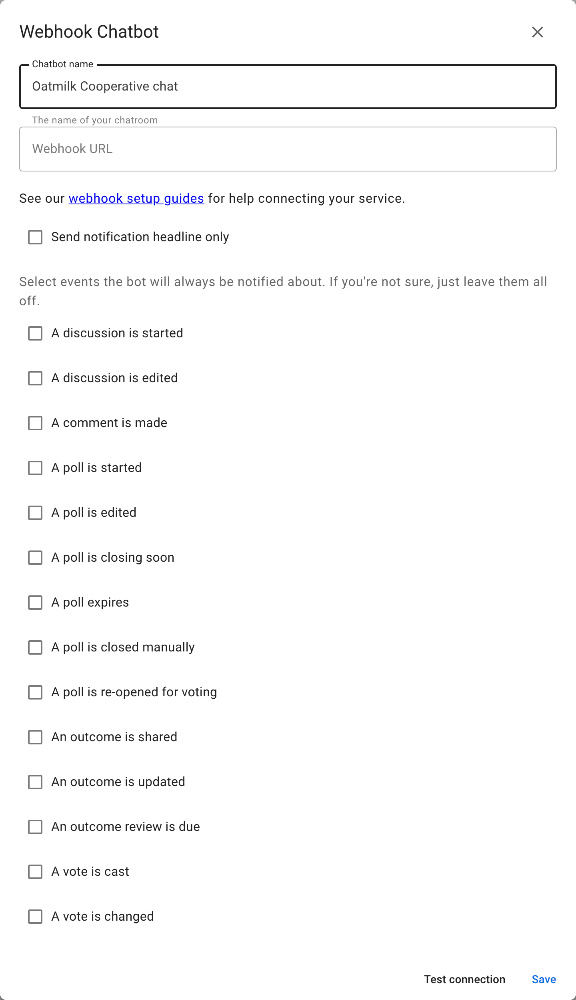
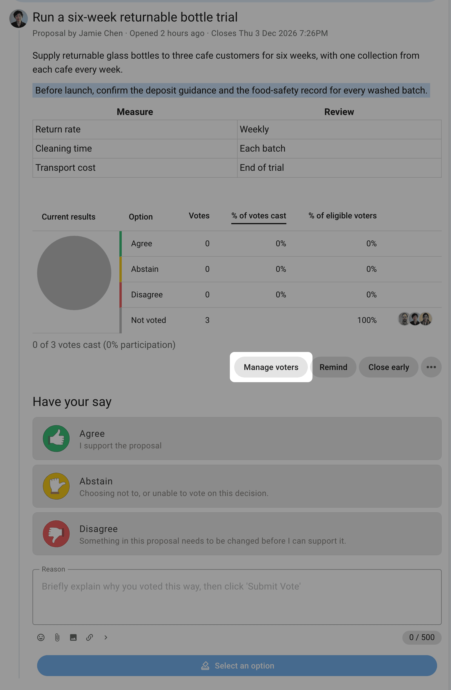
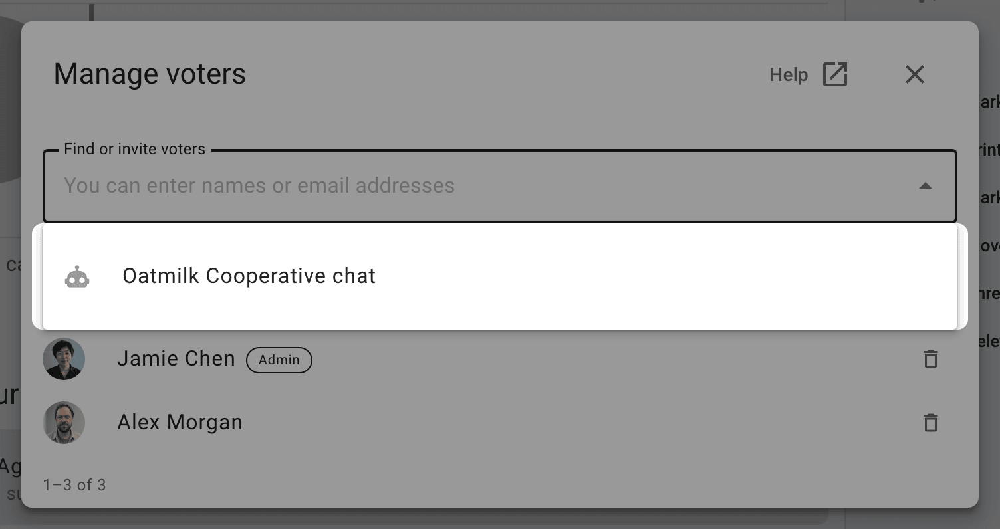
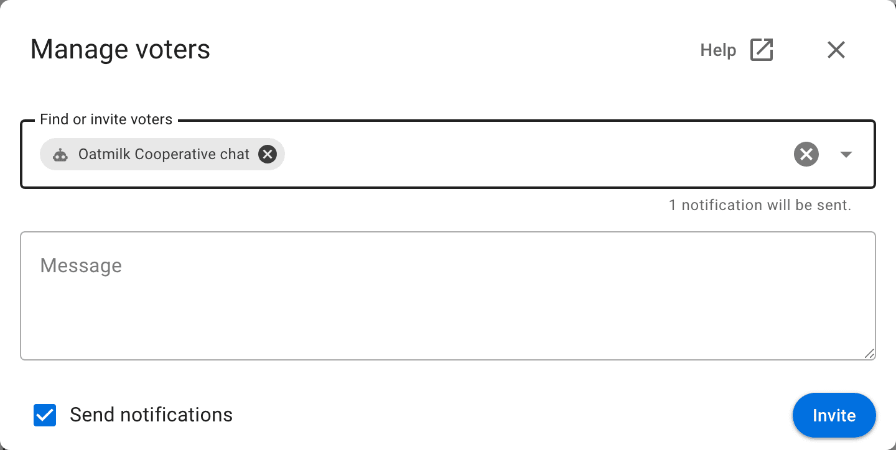
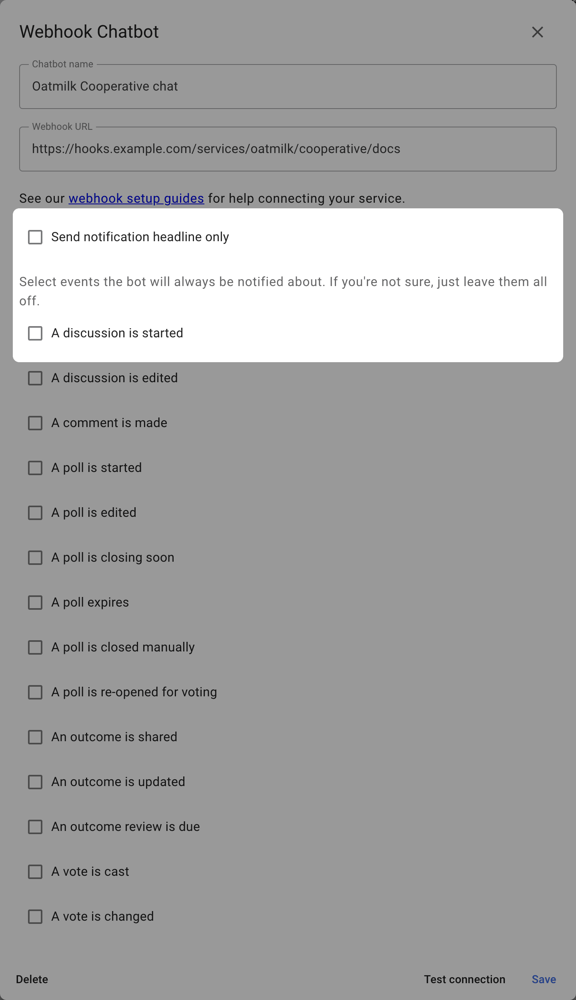

<!-- translation-section: introduction -->

# Chat integrations

Loomio can send notifications to your chatroom.

Chat tools and Loomio work well together. Use chat for quick conversation and timely updates. Move important topics to Loomio when people need time to participate, when a decision must be made, or when the group needs a lasting record.

Loomio supports Slack, Discord, Microsoft Teams, Matrix, and Mattermost.

You can send notifications to your chatroom manually whenever you invite people to a thread or poll. You can also set up automatic notifications for specific events, such as when someone starts a discussion.

<!-- translation-section: what-it-looks-like-in-chat -->

## What it looks like in chat

<!-- translation-section: generate-a-webhook-url -->

## Connect your chat service

Follow the guide for your chat service to get a webhook URL (or, for Matrix, a bot access token and room ID):

- [Slack](../slack/)
- [Microsoft Teams](../microsoft_teams/)
- [Discord](../discord/)
- [Matrix](../matrix/)
- [Mattermost](../mattermost/)

You can also connect other services that accept incoming webhooks with HTML or Markdown formatting, such as Zapier or Rocket.Chat. Choose the **Mattermost** chat integration in Loomio and enter your custom webhook URL.

<!-- translation-section: set-up-a-chat-integration -->

## Set up a chat integration

You must be a group admin to add or edit chat integrations.

1. After setting up your chat service (see above), open **Settings** on your group page in Loomio and select **Chat integrations**.

   

   

2. Add a new chat integration for your service, enter a name (such as "Discord #general"), and paste the webhook URL.

   

3. Select any events you want sent automatically, or leave them unselected if you only want to send notifications manually, then save. You can change these settings at any time.

<!-- translation-section: invite-to-poll -->

### Send a notification manually

To notify your chatroom about a poll or discussion, open the item and select **Invite** (or another notification action such as **Share outcome**, **Remind to vote**, or **Poll edited**). Select your chat integration from the recipient list and send the notification.

<!-- translation-section: automatic-notifications -->

### Automatic notifications

To send a notification whenever a specific event happens, edit the chat integration and select that event.

