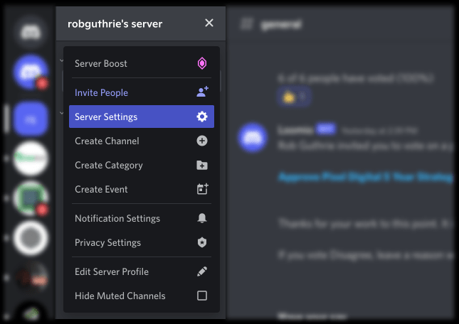
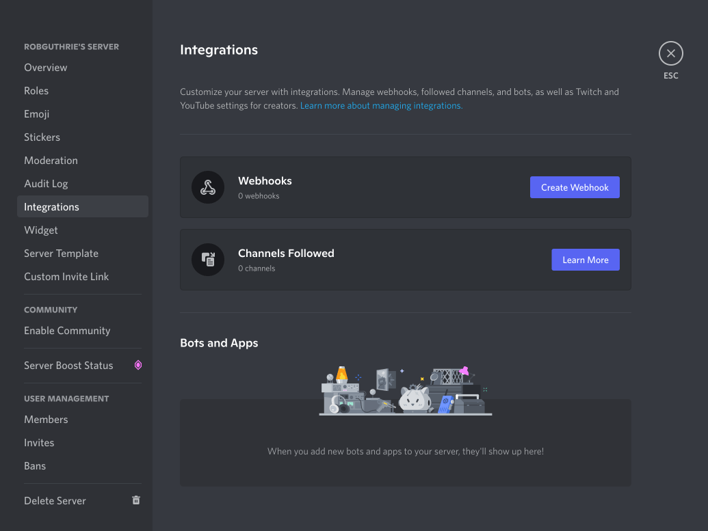
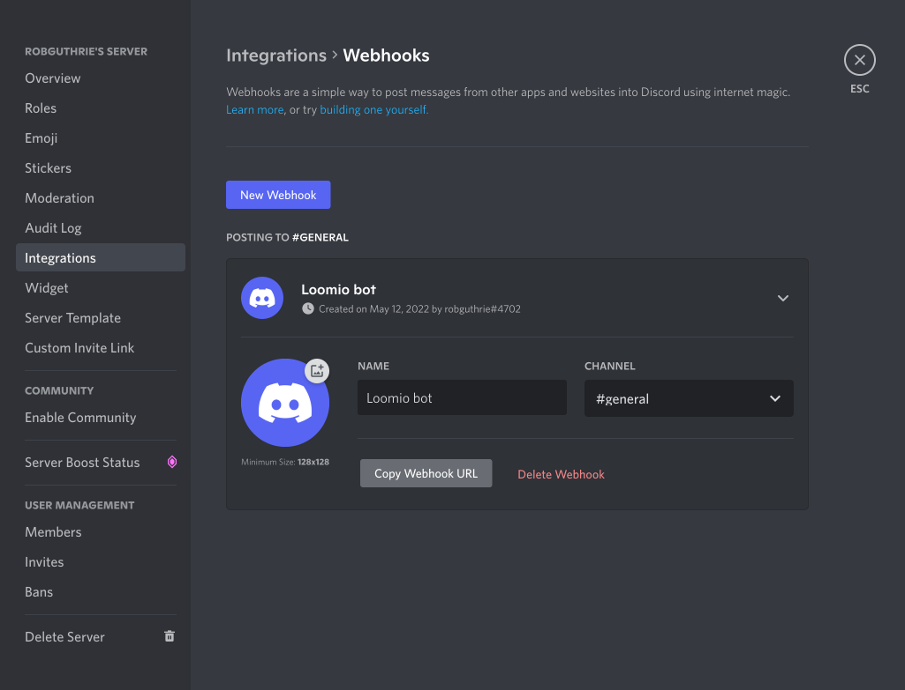

<!-- translation-section: introduction -->

# Discord integration

Loomio can send notifications to your Discord channels when new discussions, polls, comments, votes, and outcomes happen. You can also notify the channel manually when you want to remind people about a decision.

---

1. Open your Discord server and go to **Server Settings**.

   

2. Select **Integrations**.

   

3. Select **Add Webhook**, give it a name such as `Loomio`, choose a channel, and copy the webhook URL.

   

Now that you have a webhook URL, finish connecting it in Loomio:

[Set up a chat integration in Loomio](../chatbots/#set-up-a-chat-integration)
