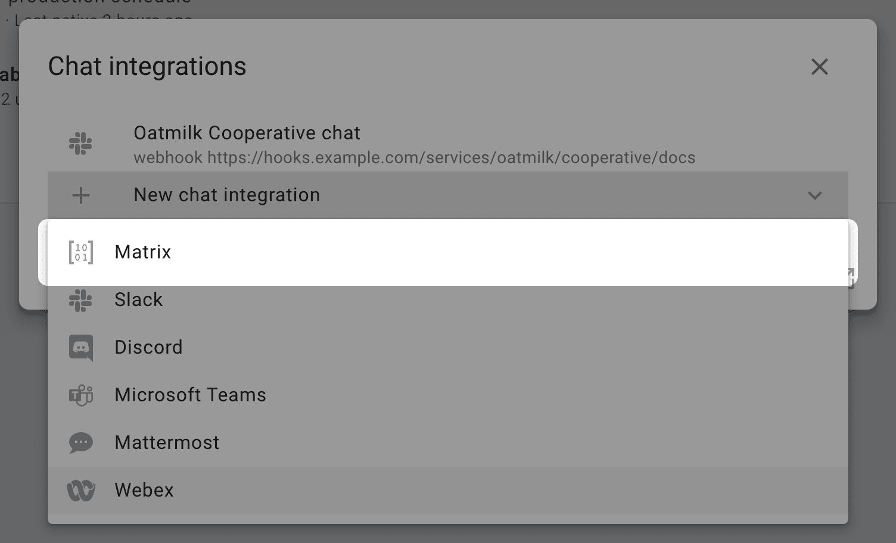
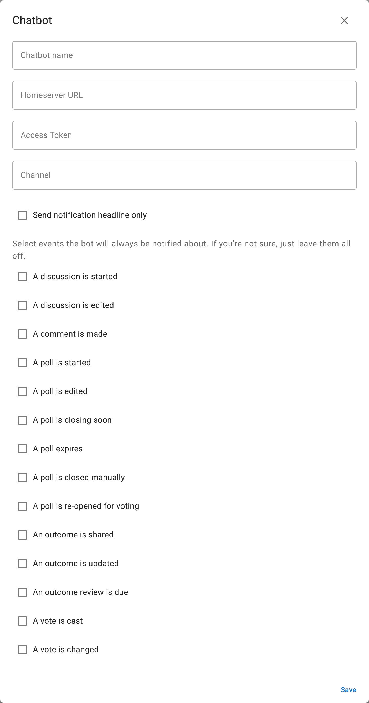
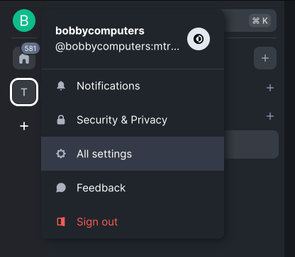
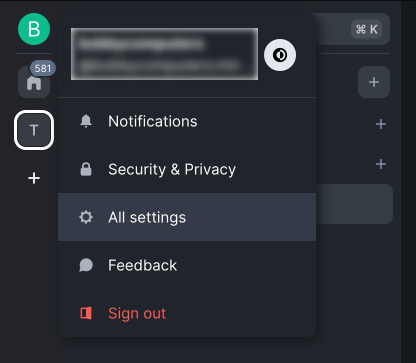
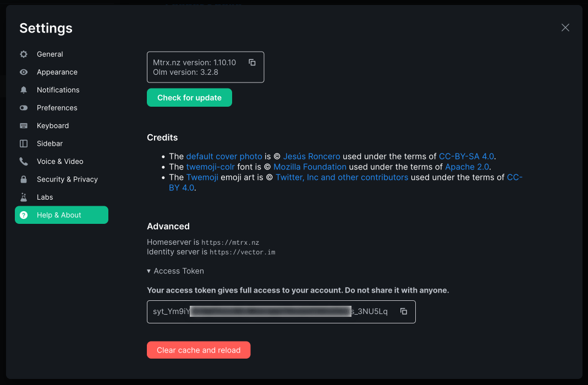
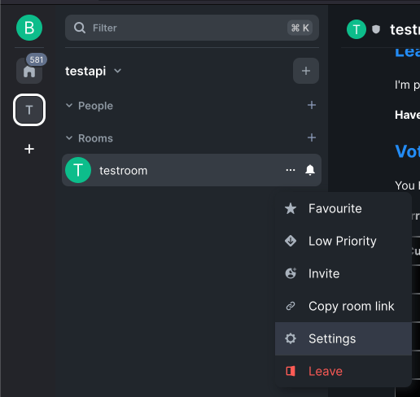
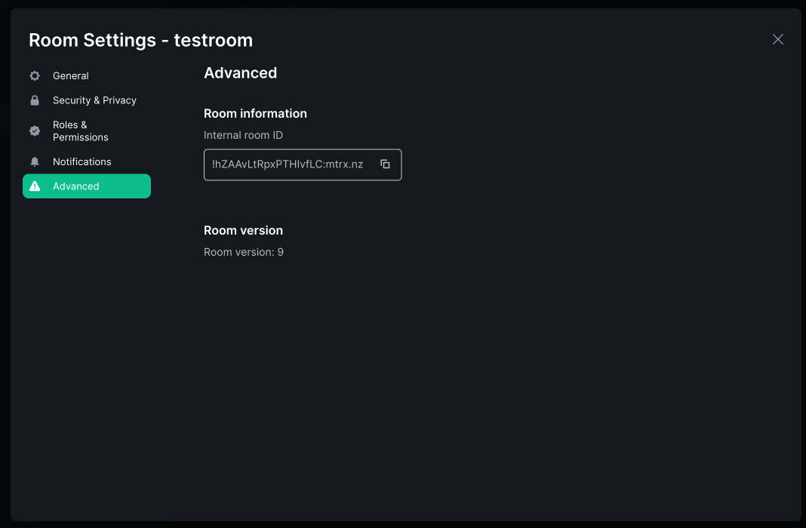

<!-- translation-section: introduction -->

# Matrix integration

Loomio can send notifications to a Matrix room when new discussions, polls, comments, votes, and outcomes happen. You must be a group admin to add a chat integration.

Unlike Loomio's other chat integrations, Matrix does not use a webhook. Instead, Loomio connects through a Matrix user account that acts as a bot and posts formatted messages to your room.

This guide uses the Element client.

---

1. Create a Matrix user account for Loomio, sign in to it in Element, and invite that account to the Matrix room where you want notifications to appear. Keep this session signed in — signing out invalidates the access token.

2. In your Loomio group, open the group menu, select **Chat integrations**, and add a **Matrix** chat integration.

   

   

3. In Element, open the bot account menu and select **All settings**.

   

4. Open **Help & About** and scroll to the **Advanced** section.

   

5. Copy the **Access Token** and paste it into the Loomio form.

   

6. Open the room's **Settings** menu and go to **Advanced**.

   

7. Copy the **Internal room ID**, paste it into the Loomio form, and save the integration.

   
