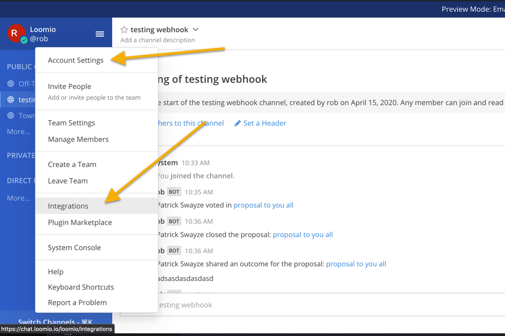
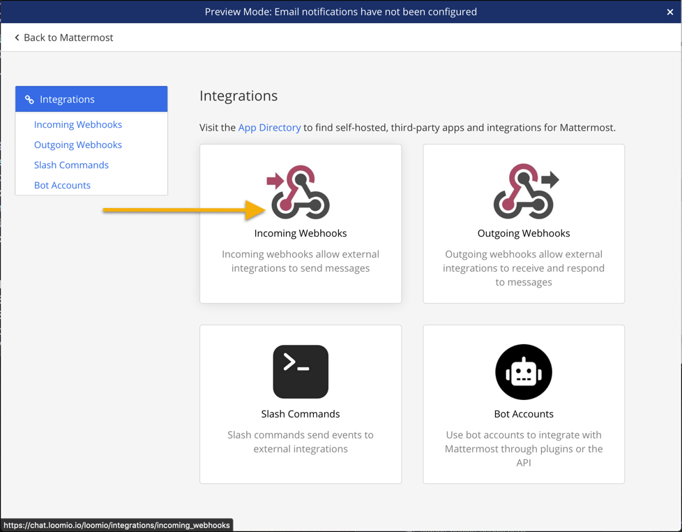
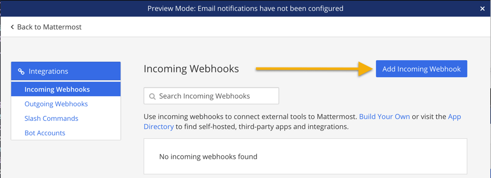
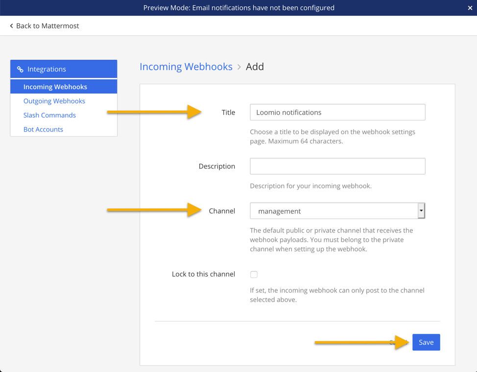
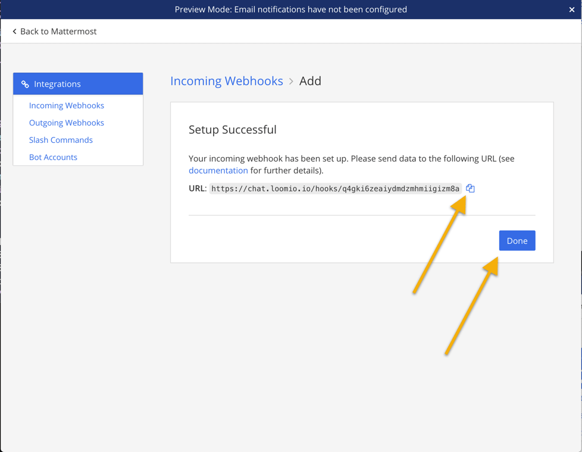

<!-- translation-section: introduction -->

# Mattermost integration

Loomio can send notifications to your Mattermost channels when new discussions, polls, comments, votes, and outcomes happen.

---

1. Open your Mattermost team in a browser and go to **Integrations**.

   

2. Select **Incoming Webhooks**.

   

3. Select **Add Incoming Webhook**.

   

4. Enter a name, choose the channel where you want notifications to appear, and select **Save**.

   

5. Copy the webhook URL.

   

Now that you have a webhook URL, finish connecting it in Loomio:

[Set up a chat integration in Loomio](../chatbots/#set-up-a-chat-integration)
