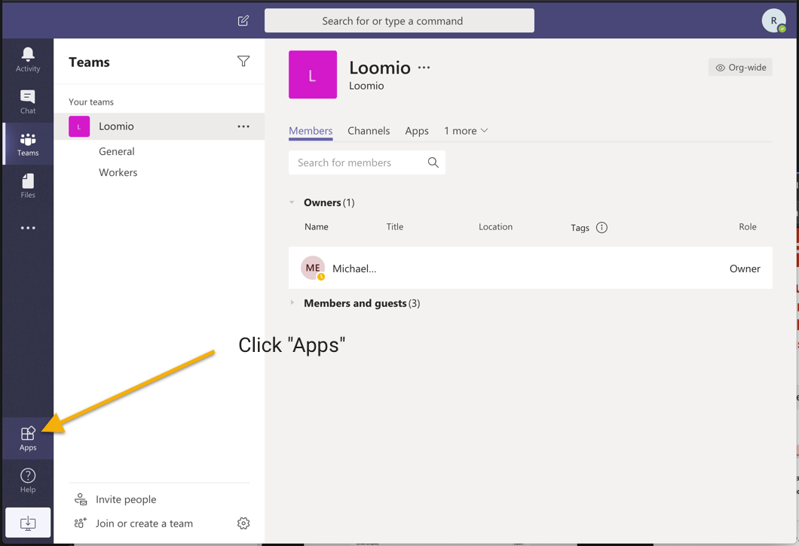
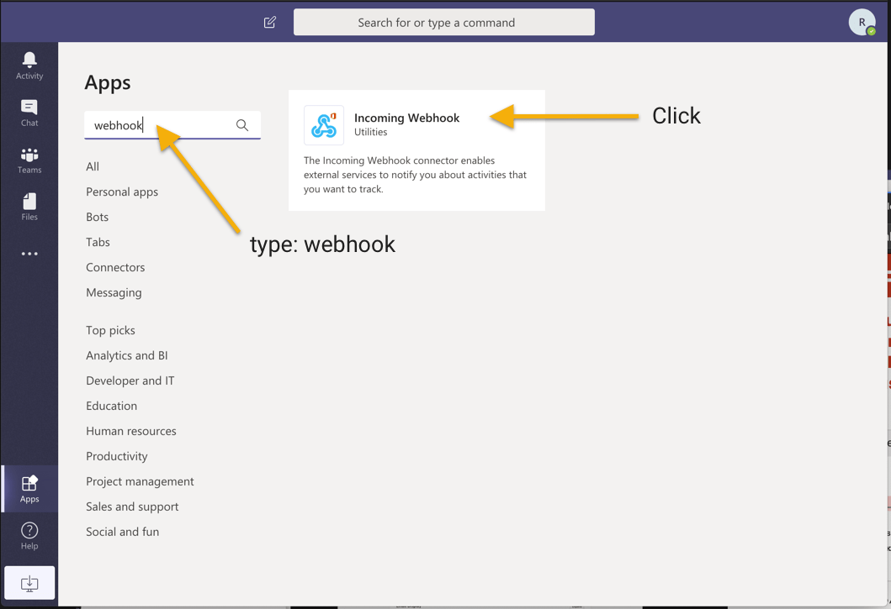
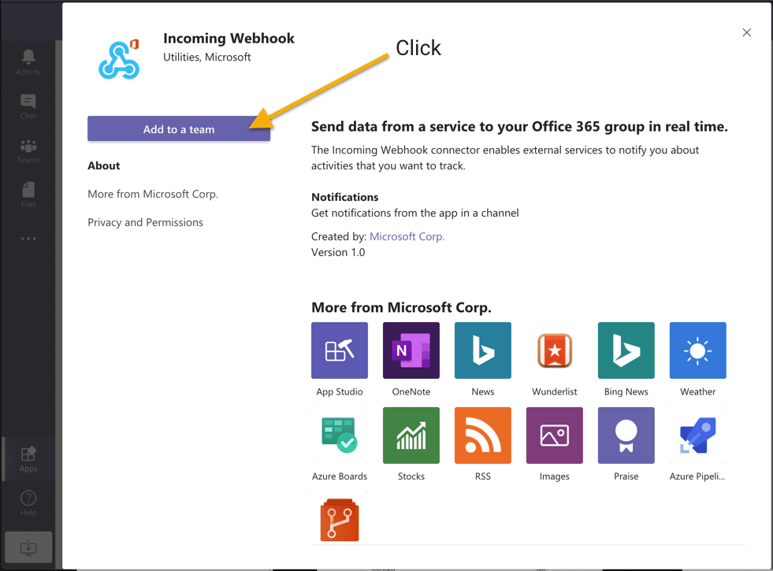
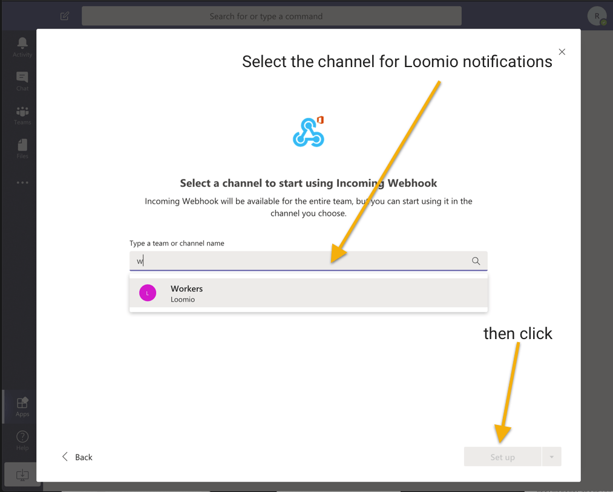
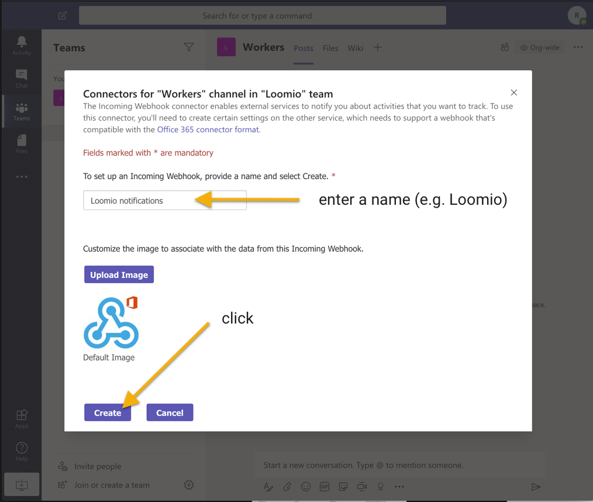
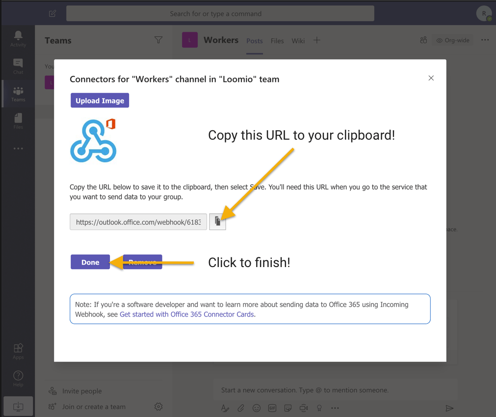

<!-- translation-section: introduction -->

# Microsoft Teams integration

Loomio can send notifications to your Microsoft Teams channels when new discussions, polls, comments, votes, and outcomes happen.

---

1. Open [Microsoft Teams](https://teams.microsoft.com) and select **Apps**.

   

2. Search for `webhook` and select **Incoming Webhook**.

   

3. Select **Add to a team**.

   

4. Choose the channel where you want Loomio notifications to appear.

   

5. Enter a name, such as `Loomio notifications`, and select **Create**.

   

6. Copy the webhook URL so you can paste it into Loomio.

   

Now that you have a webhook URL, finish connecting it in Loomio:

[Set up a chat integration in Loomio](../chatbots/#set-up-a-chat-integration)

_Loomio is not created by, affiliated with, or supported by Microsoft._
