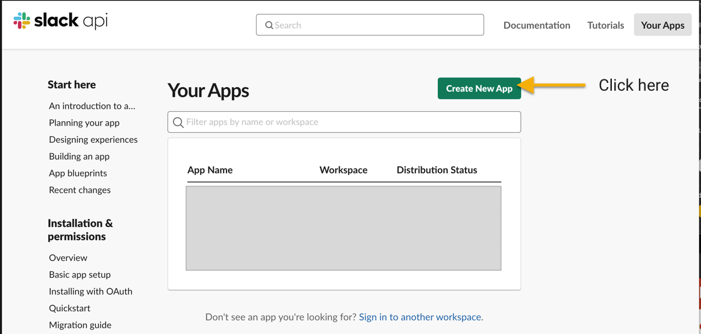
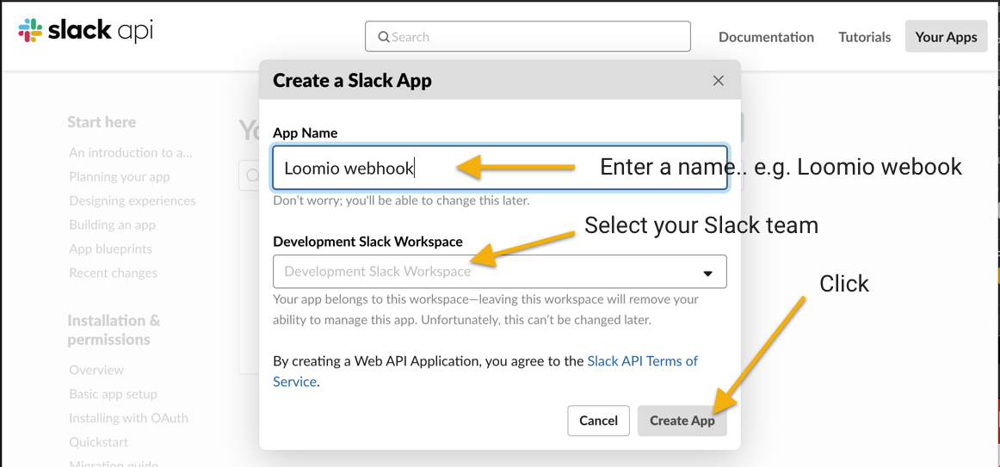
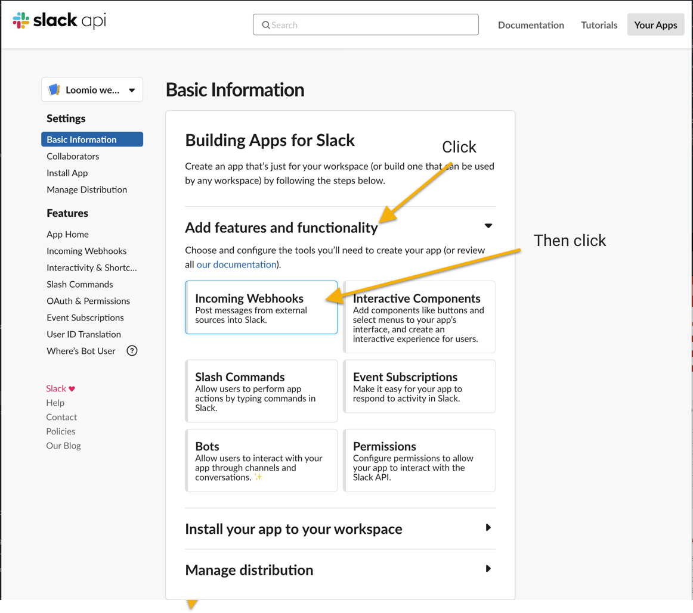
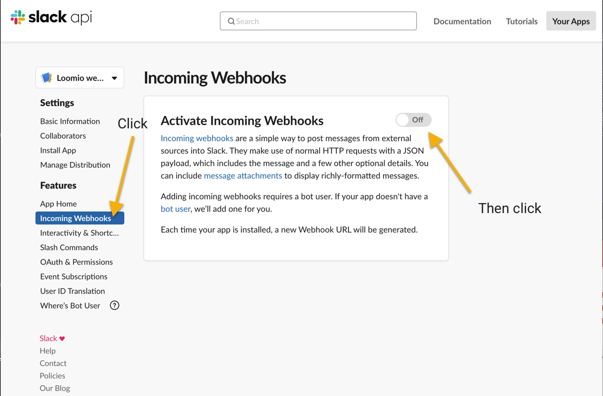
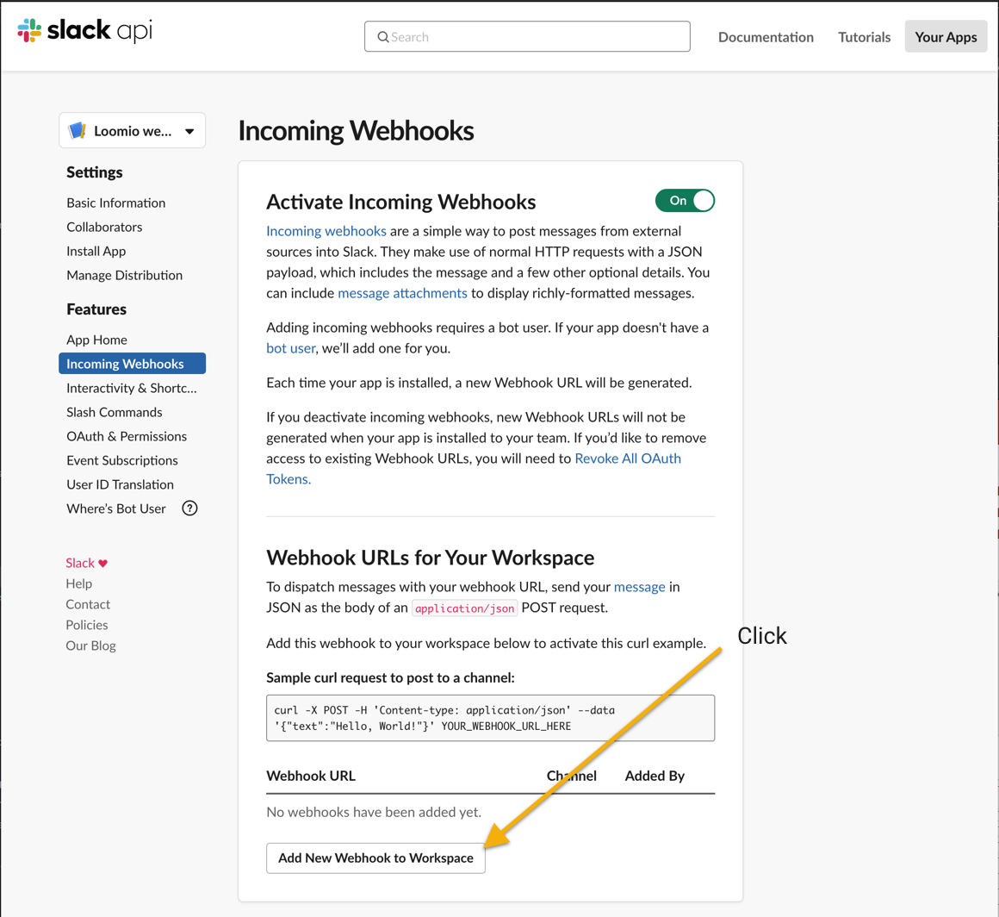
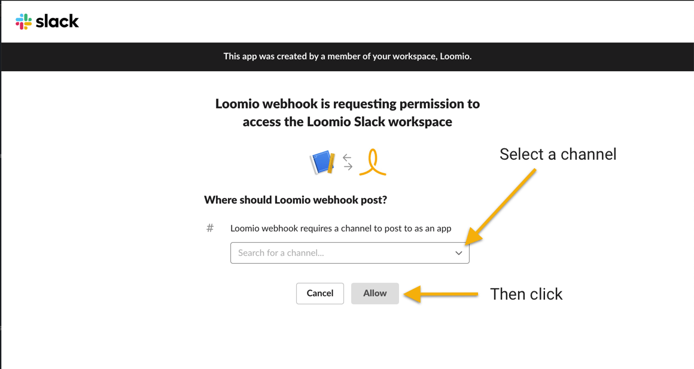
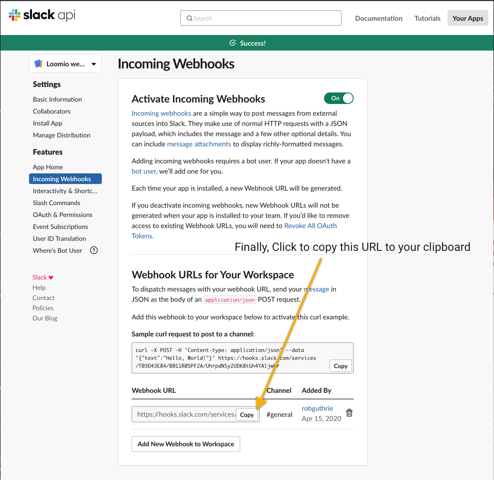

<!-- translation-section: introduction -->

# Slack integration

Loomio can send notifications to your Slack channels when new discussions, polls, comments, votes, and outcomes happen.

---

1. Open [api.slack.com](https://api.slack.com), sign in, and select **Create New App**.

   

2. Give your Slack app a name and choose your workspace.

   

3. Select **Incoming Webhooks**.

   

4. Turn on **Activate Incoming Webhooks**.

   

5. Select **Add New Webhook to Workspace**.

   

6. Choose the channel where you want Loomio notifications to appear.

   

7. Copy the webhook URL.

   

Now that you have a webhook URL, finish connecting it in Loomio:

[Set up a chat integration in Loomio](../chatbots/#set-up-a-chat-integration)

_Loomio is not created by, affiliated with, or supported by Slack._
