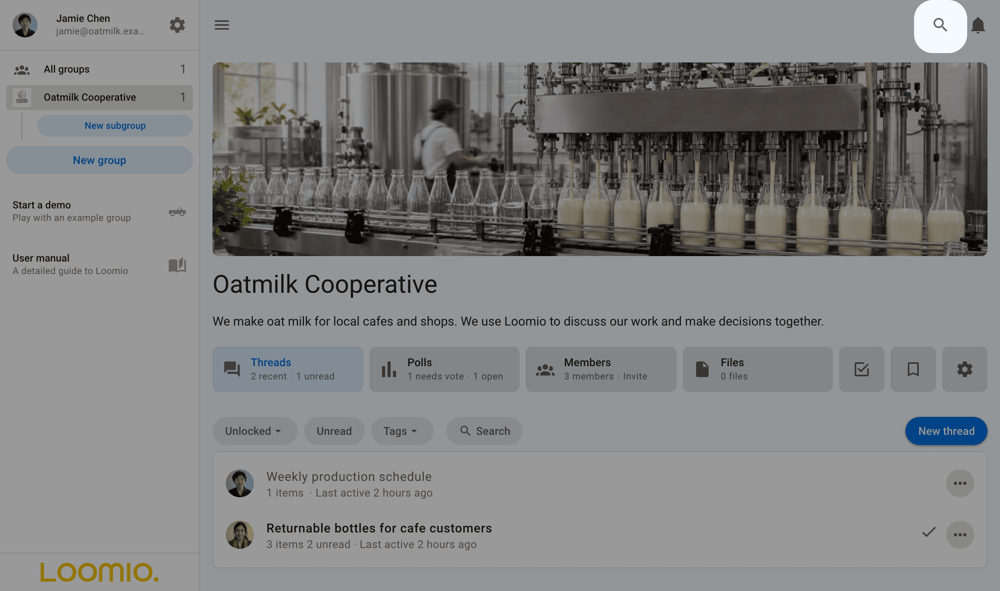
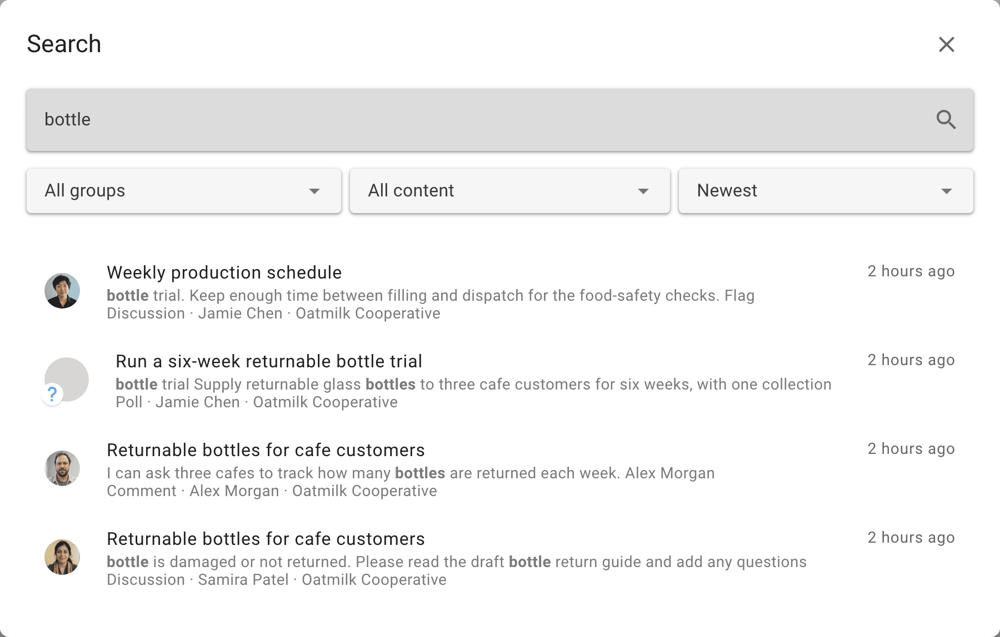
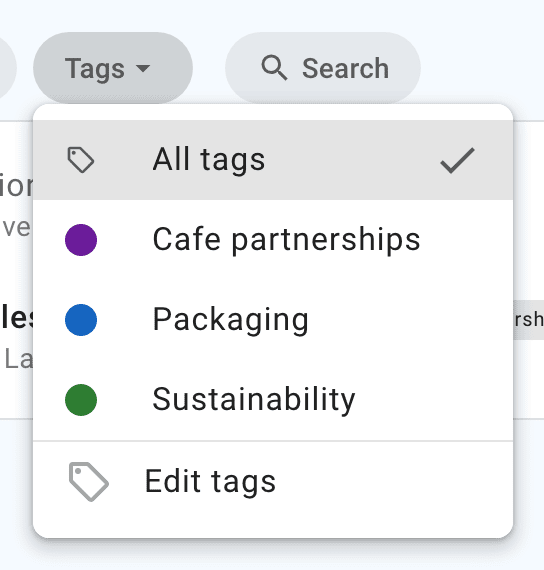

<!-- translation-section: introduction -->

# Finding content

Loomio provides several ways to find discussions and decisions across your groups.

<!-- translation-section: search -->

## Search

Select **Search** in the top navigation bar to search from any page in Loomio.

Search covers all groups and direct discussions you can access. It finds discussion titles, context, comments, polls, votes, and outcomes.

Type a word or phrase and press Enter. For example, searching for **bottle** finds Oatmilk Cooperative content with that word.

<!-- translation-section: search-tips -->

### Search tips

- Start with one or two specific words from the title or content.
- Search matches the beginning of a word, so a partial word such as **bott** can match **bottle**.
- Search handles minor misspellings when a query returns few results.
- Filter results by organization, subgroup, tag, or content type (such as comments or polls). Tag filters work without a search term and return items with that tag.
- Sort by **Best match** for relevance, or by newest or oldest if you know roughly when something was posted.

<!-- translation-section: filter-discussions -->

## Filter discussions

On a group's **Threads** page, you can filter threads by lock status, unread activity, category tag, or subgroup (choosing **This group only**, **My subgroups**, or **All subgroups**). On **All groups**, you can also filter by **Unread**, **Direct**, and category tag, or use **Search** to narrow the list.

<!-- translation-section: category-tags -->

## Category tags

Tags group related discussions, polls, outcomes, and comments under names chosen by your group, such as a project, team, or area of work.

Select a tag on **Threads**, **Polls**, or **Tasks** to show items with that tag. Inside a discussion, select a tag in the sidebar to see matching comments, polls, or outcomes along with the items they reply to.

Authors can tag their own posts. Group admins, thread admins, and anyone who can edit the discussion context can tag any item. See [Category tags](/en/user_manual/discussions/tags) for setup and permissions.

<!-- translation-section: unread-discussions -->

## Unread discussions

Select **Unread** on **All groups** or on a group's **Threads** page (or select the unread count on the **Threads** card) to see threads with new activity in the last six weeks. Inside a discussion, use the timeline to jump to unread items and key events.

<!-- translation-section: polls-awaiting-your-vote -->

## Polls awaiting your vote

Open **Polls** on **All groups** (or select the vote count on the **Polls** card) to see open polls you are invited to that you have not voted in yet. You can also filter by **Need Vote**, **Open**, **Closed**, poll type, or tag on **All groups** or any group page.

<!-- translation-section: bookmarks -->

## Bookmarks

Bookmark a discussion, comment, poll, vote, or outcome when you want to return to it. Open **Bookmarks** on **All groups** to see everything you have saved, or open **Bookmarks** on a group page to see bookmarks in that group. See [Bookmarks](/en/user_manual/users/bookmarks) for details.
