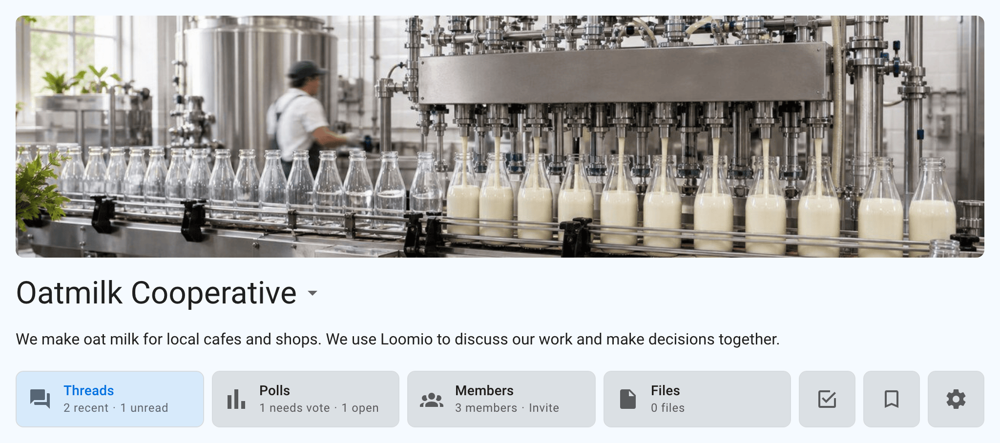
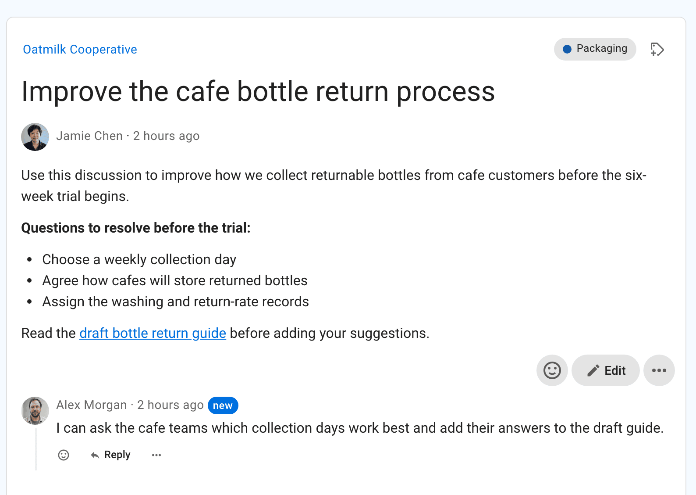
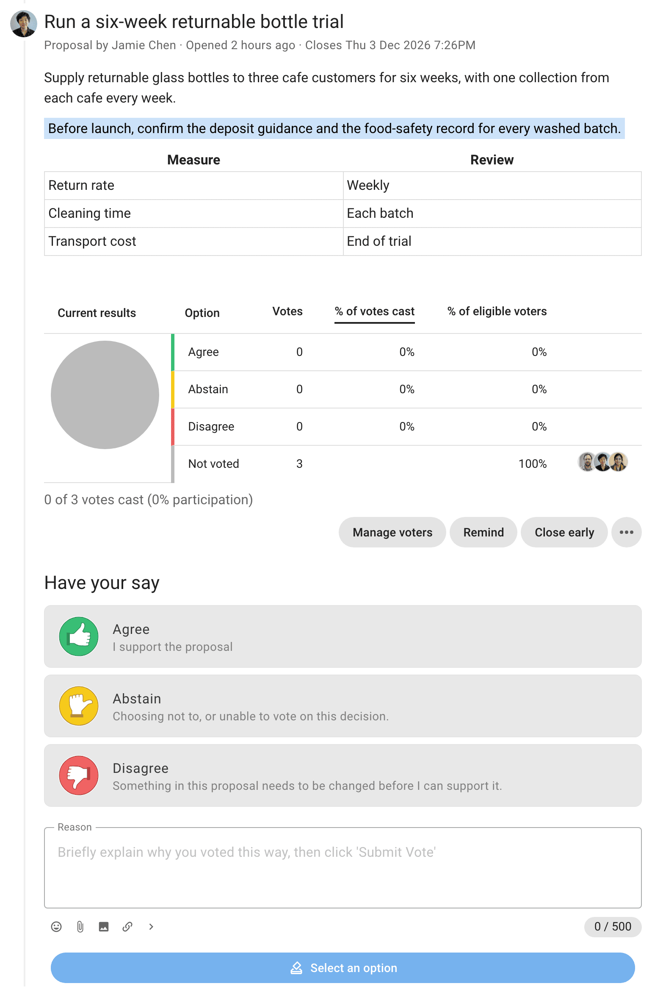

<!-- translation-section: introduction -->

# Getting started

Loomio is a discussion and decision-making tool for collaborative organizations.

It helps people discuss topics, explore proposals, and make decisions together.

<iframe width="660" height="415" src="https://www.youtube-nocookie.com/embed/K8ZRNtlRvAI" title="Loomio in 2 minutes" frameborder="0" allow="accelerometer; autoplay; clipboard-write; encrypted-media; gyroscope; picture-in-picture" allowfullscreen></iframe>

<!-- translation-section: how-loomio-works -->

## How Loomio works

Loomio has three main parts: groups, discussions, and polls.

<!-- translation-section: groups -->

### Groups

A group is a place for an organization, team, or community to work together. Its home page explains the group's purpose and links to its discussions, polls, members, and files.

<!-- translation-section: discussions -->

### Discussions

Discussions keep the information and conversation about a topic together. People can share context, comment, reply, react, and use polls to move a discussion toward an outcome.

Over time, discussions create a searchable record of the information your group considered and the decisions it made.

<!-- translation-section: polls-and-proposals -->

### Polls and proposals

Polls help a group understand preferences, gather advice, and make decisions. Different poll templates support different processes. A proposal asks people to respond to a suggested course of action and explain the reason for their response.

Polls can be part of a discussion or run independently from the **Polls** tab on a group page.

To learn where these parts appear in the interface, see the [Quick tour](/en/user_manual/overview/orientation). To start contributing, see [How to participate](/en/user_manual/overview/how-to-participate).

<!-- translation-section: try-it-out -->

## Try it out

To try Loomio with your group, [start a free trial](/try).

<!-- translation-section: how-people-use-loomio -->

## How people use Loomio

**Member organizations** use Loomio to involve members in decisions at scale. Political parties, consumer and worker cooperatives, and membership associations give members a shared place to raise topics, discuss issues, and vote in general assemblies.

**Self-managing organizations** use Loomio to involve staff in decisions. Self-managing teams, worker cooperatives, and sociocratic organizations run consent, consensus, and advice processes across distributed teams and time zones.

**Boards, councils, and distributed networks** use Loomio to coordinate stakeholders across locations and time zones. They keep discussions structured, track decisions, and preserve organizational memory.

**Residential communities and housing co-ops** use Loomio to make decisions together as neighbors. Cohousing communities, ecovillages, coliving cooperatives, housing co-ops, and land trusts use it to manage shared land, common spaces, and community agreements. Asynchronous discussions let residents participate whether they are on-site or traveling.
