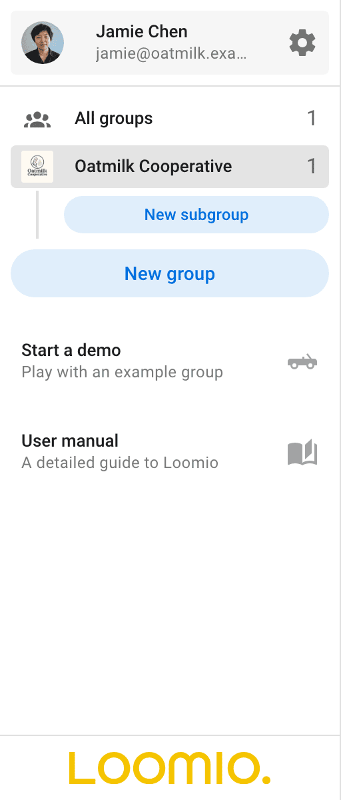
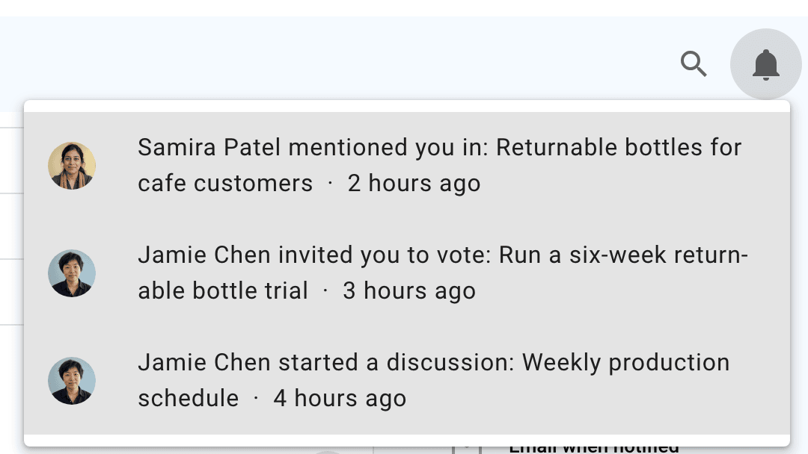

<!-- translation-section: introduction -->

# Quick tour

This page introduces the main parts of Loomio and where to find your work.

<!-- translation-section: group-page -->

## Group page

Your group home page describes the group and links to its work.

<!-- translation-section: tabs -->

### Tabs

The tabs under the group description show:

- **Discussions**: The group's discussion threads and recent activity.
- **Polls**: Open and closed polls in the group.
- **Members**: The people who belong to the group.
- **Files**: Files attached to discussions, comments, proposals, and polls across the group, so you can find a document without remembering where it was shared.

See [Finding content](/en/user_manual/overview/finding-content) for help with search, filters, tags, bookmarks, and unread discussions.

<!-- translation-section: sidebar -->

## Sidebar

Open the sidebar with the menu button (**☰**) at the top left on desktop, or in the bottom navigation bar on mobile.

Use the sidebar to open your dashboard, polls awaiting your vote, unread and direct discussions, tasks, and groups. It also links to the user manual and support.

<!-- translation-section: user-settings -->

### User settings

Select your name in the sidebar to open your user menu.

From this menu, you can edit your profile, change notification settings, choose a theme, manage your account, and sign out.

<!-- translation-section: notifications -->

## Notifications

Select the bell icon at the top right on desktop, or in the bottom navigation bar on mobile, to open your in-app notifications. A badge shows when you have unread notifications.

See [Notifications](/en/user_manual/users/email_settings) to learn about in-app notifications, email preferences, and notification settings for groups and discussions.

<!-- translation-section: mobile-navigation -->

## Mobile navigation

On mobile, the bottom navigation bar opens the sidebar, dashboard, and notifications. Inside a discussion, the thread menu opens its contents and actions.

<!-- translation-section: what-to-do-next -->

## What to do next

- Read [How to participate](/en/user_manual/overview/how-to-participate) to learn how to comment, reply, react, and vote.
- Read [Finding content](/en/user_manual/overview/finding-content) to learn how to locate discussions and decisions.
- Visit [Discussions](/en/user_manual/discussions) or [Proposals and polls](/en/user_manual/polls/intro_to_decisions) for detailed guidance.
