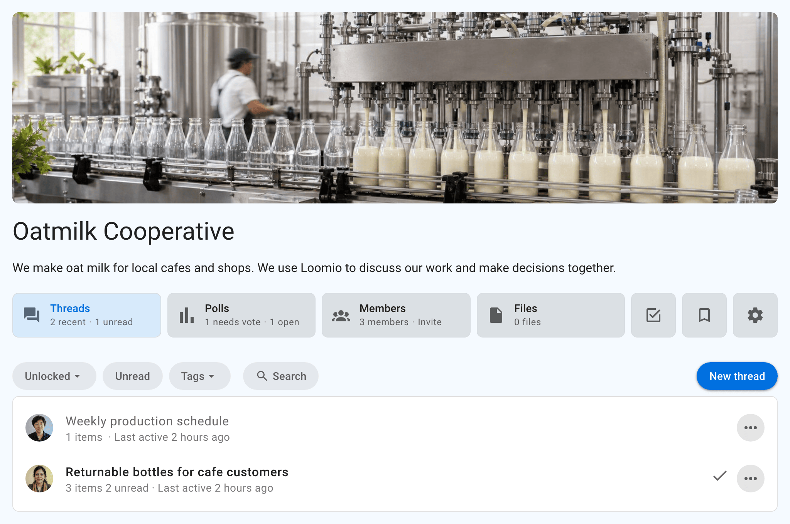
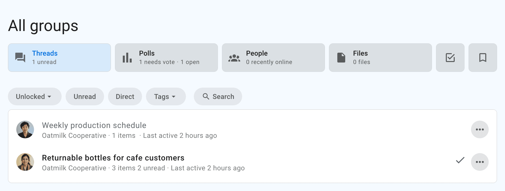
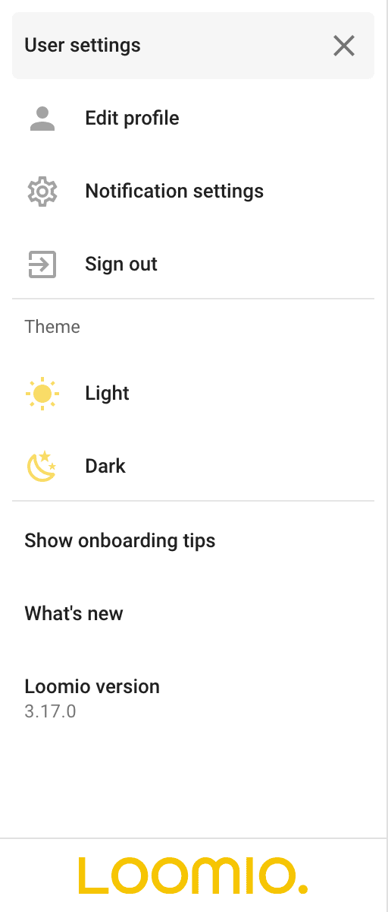

<!-- translation-section: introduction -->

# Quick tour

This page introduces the main parts of Loomio and where to find your work.

<!-- translation-section: group-page -->

## Group page

Your group home page describes the group and links to its work.

<!-- translation-section: tabs -->

### Sections

The navigation cards under the group description show:

- **Threads**: The group's discussion threads and recent or unread activity.
- **Polls**: Open and closed polls in the group, including any awaiting your vote.
- **Members**: The people who belong to the group, with a shortcut to invite new members.
- **Files**: Files attached to discussions, comments, proposals, and polls across the group, so you can find a document without remembering where it was shared.
- **Tasks**: Open and completed tasks in the group, with filters for status, due date, assignee, and tags.
- **Bookmarks**: Discussions, comments, polls, votes, and outcomes you have bookmarked in the group.
- **Settings**: Group administration, membership options, notification settings, integrations, and data export.

See [Finding content](/en/user_manual/overview/finding-content) for help with search, filters, tags, bookmarks, and unread discussions.

<!-- translation-section: all-groups -->

## All groups

Select **All groups** in the sidebar to see your work across every group you belong to. It uses the same navigation cards as a group page, with **Threads** (including unread and direct threads), **Polls**, **People** (a searchable directory of people you share groups with, showing who was recently online), **Files**, **Tasks**, and **Bookmarks**.

<!-- translation-section: sidebar -->

## Sidebar

Open the sidebar with the menu button (**☰**) at the top left on desktop, or in the bottom navigation bar on mobile.

Use the sidebar to switch between **All groups**, your groups and subgroups, and to start a new group or subgroup. When the sidebar is closed, select the group name (or **All groups**) at the top of the page to switch groups or start a new group. The sidebar also links to the user manual and support.

<!-- translation-section: user-settings -->

### User settings

Select your name in the sidebar to open your user menu.

From this menu, you can edit your profile, change notification settings, choose a theme, manage your account, and sign out.

<!-- translation-section: notifications -->

## Notifications

Select the bell icon at the top right on desktop, or in the bottom navigation bar on mobile, to open your in-app notifications. A badge shows when you have unread notifications.

See [Notifications](/en/user_manual/users/email_settings) to learn about in-app notifications, email preferences, and notification settings for groups and discussions.

<!-- translation-section: mobile-navigation -->

## Mobile navigation

On mobile, the bottom navigation bar opens the sidebar, **All groups**, and notifications. Inside a discussion, the thread menu opens its contents and actions.

<!-- translation-section: what-to-do-next -->

## What to do next

- Read [How to participate](/en/user_manual/overview/how-to-participate) to learn how to comment, reply, react, and vote.
- Read [Finding content](/en/user_manual/overview/finding-content) to learn how to locate discussions and decisions.
- Visit [Discussions](/en/user_manual/discussions) or [Proposals and polls](/en/user_manual/polls/intro_to_decisions) for detailed guidance.
