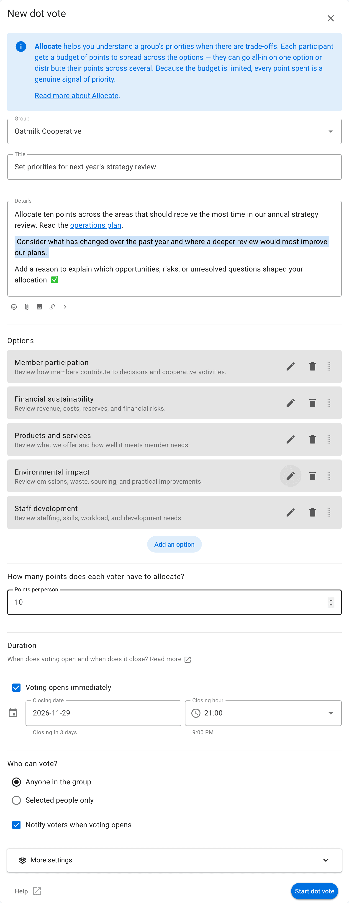
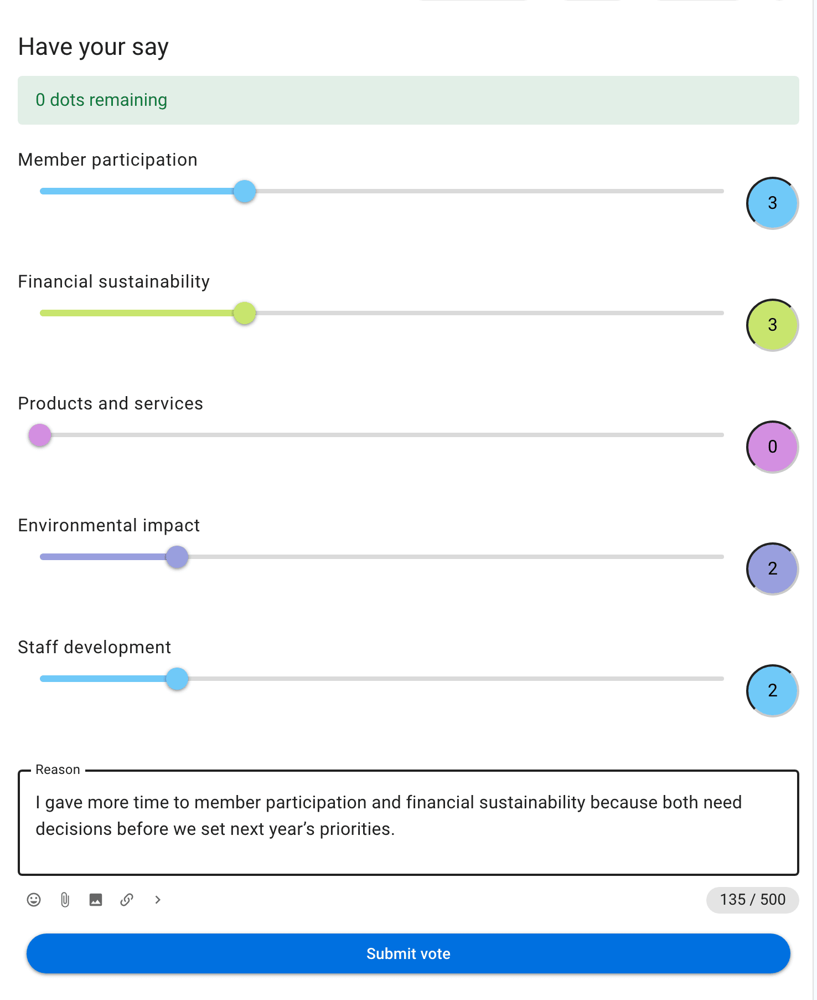
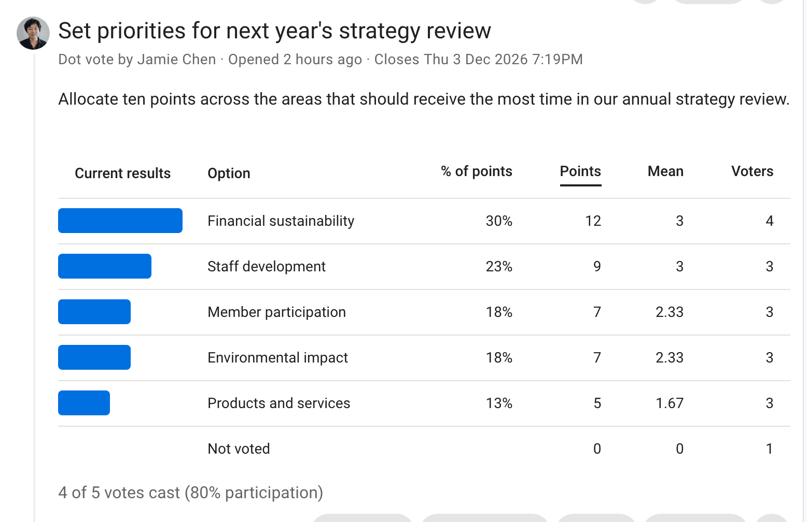
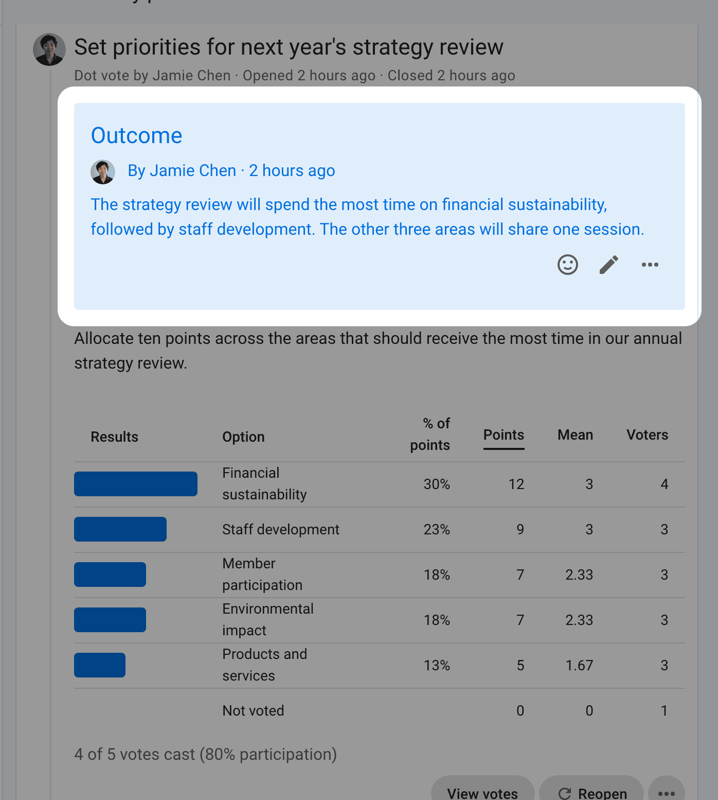

<!-- translation-section: introduction -->

# Allocate

Allocate, sometimes known as a dot vote, reveals priorities when there are trade-offs. Each participant receives a fixed budget of points to distribute across the options. Giving more to one option leaves fewer points for the others.

<!-- translation-section: when-to-use-allocate -->

## When to use Allocate

Use Allocate when time, money, attention, or another resource is limited. It works well for:

- prioritizing work for the next planning period;
- dividing a participatory budget between projects;
- choosing how much agenda time to give several topics;
- distributing a fixed number of volunteer hours; or
- identifying which improvements matter most to members.

The points show relative priority, not an amount that Loomio will assign automatically. Use [Score](/en/user_manual/polls/score/) when every option can receive a high rating without reducing support for another.

<!-- translation-section: example-set-priorities-for-an-annual-strategy-review -->

## Example: set priorities for an annual strategy review

Oatmilk Cooperative is planning its annual strategy review. It asks members which areas should receive the most time and attention. Each member gets ten points to allocate across five areas, showing relative priorities while requiring trade-offs.

<!-- translation-section: set-up-the-poll -->

## Set up the poll

Describe the decision and what the points represent. Add options at a similar level of scope, then set **Points per person**. In this example, each voter receives ten points to show how much review time each strategic area should receive.

A very large budget can create false precision. Choose a budget large enough to show differences, but small enough to require trade-offs. Make clear whether putting all points on one option is acceptable.

<!-- translation-section: vote -->

## Vote

Participants move the sliders to distribute their points. You can leave points unspent.

In this example, the voter assigns three points each to **Member participation** and **Financial sustainability**, two each to **Environmental impact** and **Staff development**, and none to **Products and services**. Giving an option zero points does not necessarily mean it has no value—the voter may simply have used their limited points elsewhere.

<!-- translation-section: read-the-results -->

## Read the results

The results order options by total points received. They also show:

- **% of points**: the option's share of all allocated points;
- **Points**: the total points allocated;
- **Mean**: the average among voters who gave the option points; and
- **Voters**: how many people gave the option at least one point.

In this example, **Financial sustainability** receives the most points, followed by **Staff development**. Every voter gave points to Financial sustainability, showing broad agreement that it needs review time.

Read point totals alongside the number of voters and their vote reasons to tell broad priorities apart from areas backed strongly by fewer people.

<!-- translation-section: share-an-outcome -->

## Share an outcome

When the poll closes, share an outcome. Because the poll does not assign time or money automatically, explain how the result will be used. See [Share an outcome](/en/user_manual/polls/intro_to_decisions#5-share-an-outcome) for how outcomes work.

