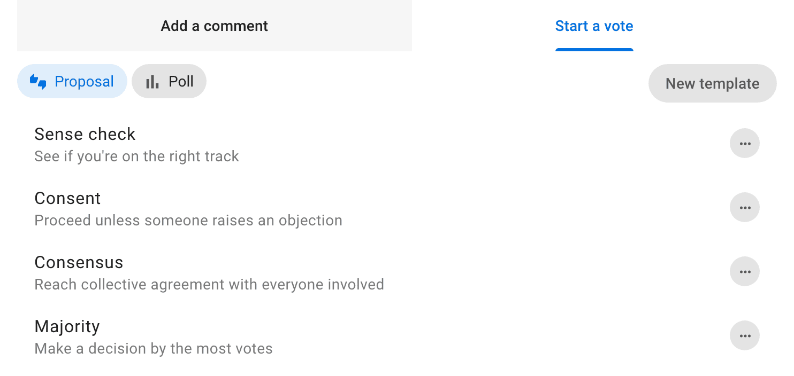
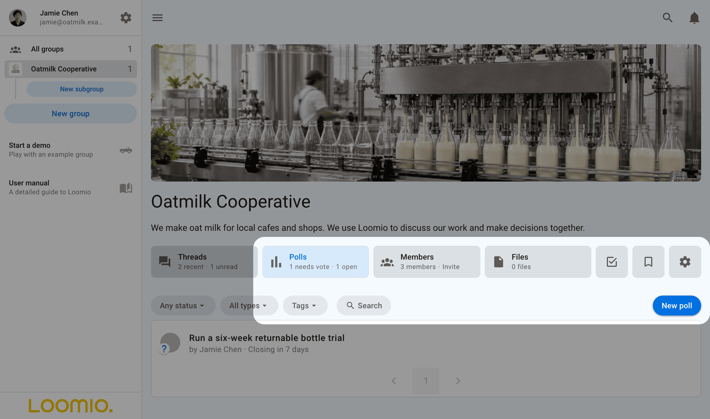
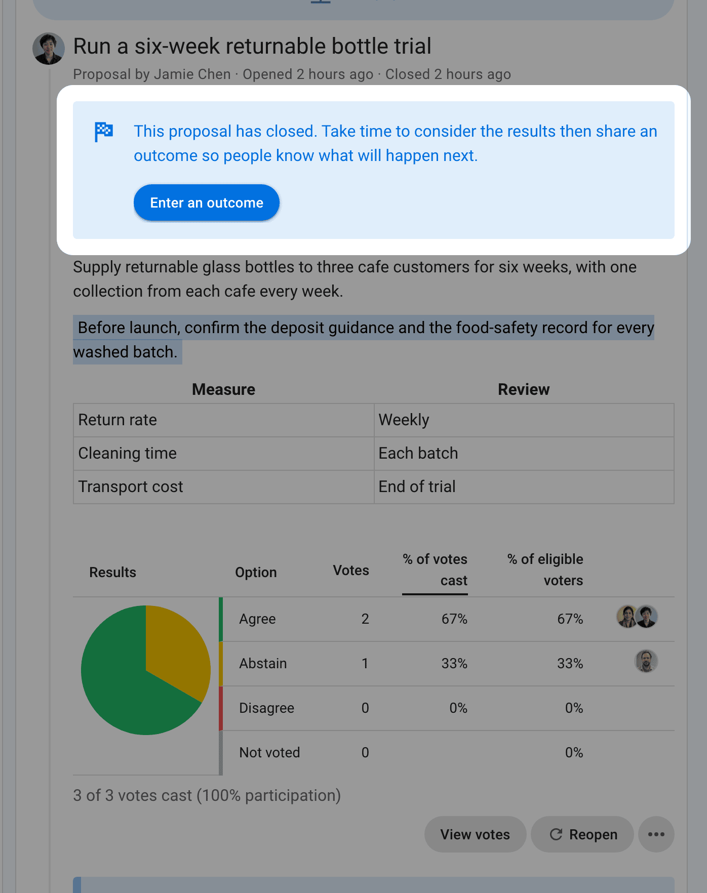
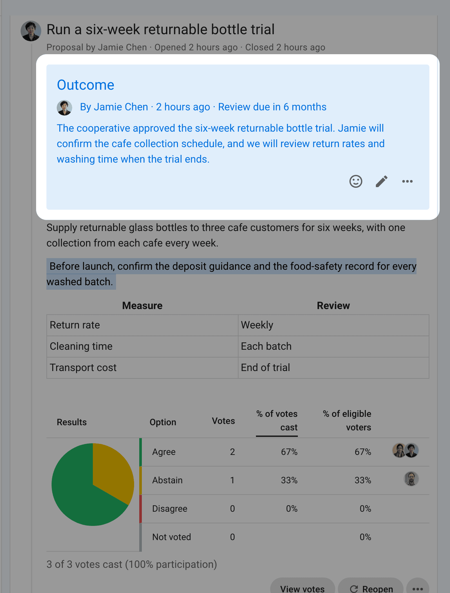

<!-- translation-section: introduction -->

# Proposals and polls

Proposals and polls collect structured responses from a group. Use them to test an idea, make a decision, set priorities, schedule a meeting, or elect representatives.

<!-- translation-section: find-the-right-help -->

## Find the right help

These parts of the manual answer different questions:

| If you want to… | Read… |
|---|---|
| Choose what participants should express | [Proposals](../proposals/) or [Polls](../proposal_types/) |
| Run a specific proposal template | [Sense check](../proposals/sense_check/), [Advice](../proposals/advice/), [Consent](../proposals/consent/), or [Consensus](../proposals/consensus/) |
| Configure the templates available to a group | [Poll templates](../poll_templates/) |
| Facilitate a decision from discussion to outcome | [Making decisions](/en/guides/making_decisions/) |

A **voting method** defines how people respond and how results are calculated. A **poll template** is a reusable configuration built on a voting method, with preset instructions, options, and settings. A **decision process** may use a discussion and several templates before the group reaches an outcome.

<!-- translation-section: proposals -->

## Proposals

A proposal asks people to respond to a statement or course of action. Loomio includes templates for common purposes:

- [Sense check](../proposals/sense_check/) gathers early reactions;
- [Advice](../proposals/advice/) gathers input for a decision maker;
- [Consent](../proposals/consent/) tests for meaningful objections; and
- [Consensus](../proposals/consensus/) seeks collective agreement.

See [Proposals](../proposals/) to compare them.

<!-- translation-section: polls -->

## Polls

Use a poll when participants need to select, score, allocate, rank, state their availability, or cast an election ballot:

- [Choose](../choose/) finds popular options;
- [Score](../score/) evaluates every option on a scale;
- [Allocate](../allocate/) distributes a limited budget of points;
- [Rank](../rank/) finds an overall order of preference;
- [Time poll](../meeting_polls/) finds when people are available; and
- [STV Election](../stv/) elects multiple winners proportionally.

See [Polls](../proposal_types/) to compare them.

<!-- translation-section: start-a-proposal-or-poll -->

## Start a proposal or poll

<!-- translation-section: choose-whether-to-use-a-discussion -->

### Choose whether to use a discussion

Start a proposal or poll inside a discussion when people need context, questions, or conversation before responding. A discussion can hold several proposals over time, keeping amendments and the final outcome together in one record.

Run a standalone poll when the discussion has already happened elsewhere, such as at a meeting, or when the question is simple and you only need to collect responses. Include enough detail or a link to the background so voters know what they are responding to.

<!-- translation-section: in-a-discussion -->

### In a discussion

Open the discussion, scroll to the reply area, select **Start a vote**, and choose a template.

<!-- translation-section: without-a-discussion -->

### Without a discussion

Open the **Polls** tab on the group page, select **New poll**, and choose a template.

If you create a discussion and a poll at the same time just to run a vote, avoid notifying people twice. Start the discussion without notifying them and use the poll invitation, or run the poll without a discussion.

<!-- translation-section: what-happens-next -->

## From start to outcome

A proposal or poll goes through these stages.

<!-- translation-section: 1-create-it -->

### 1. Create it

Give it a title and details, check its options and settings, and set a closing time. Then choose when voting opens:

- **Voting opens immediately** opens it as soon as you start it.
- An **Opening date** schedules it. People can see it before then, but they cannot vote until it opens.
- If you do neither, it is saved as a draft.

<!-- translation-section: 2-voting-opens -->

### 2. Voting opens

When voting opens, Loomio notifies the people you invited. See [Manage voters](../manage_voters/).

<!-- translation-section: 3-people-vote -->

### 3. People vote

While it is open, people can vote, add a vote reason, and change their vote. Results update as people vote unless results are hidden until closing. By default, people who have not voted receive a reminder 24 hours before it closes.

<!-- translation-section: 4-it-closes -->

### 4. It closes

The poll closes automatically at the closing time, or a thread admin can close it early. After it closes, a thread admin can reopen it with a new closing time. Polls that hide results until voting closes, including anonymous polls, cannot be reopened; you can extend their closing time while they are still open.

<!-- translation-section: 5-share-an-outcome -->

### 5. Share an outcome

When the poll closes, Loomio asks thread admins to share an outcome.

The outcome states what was decided and what happens next. It appears above the results so it is the first thing people read. When you publish it, you can notify people—they receive an email with the results and the outcome.

You can also set a **Review date** so Loomio reminds you to review the decision on that date.

