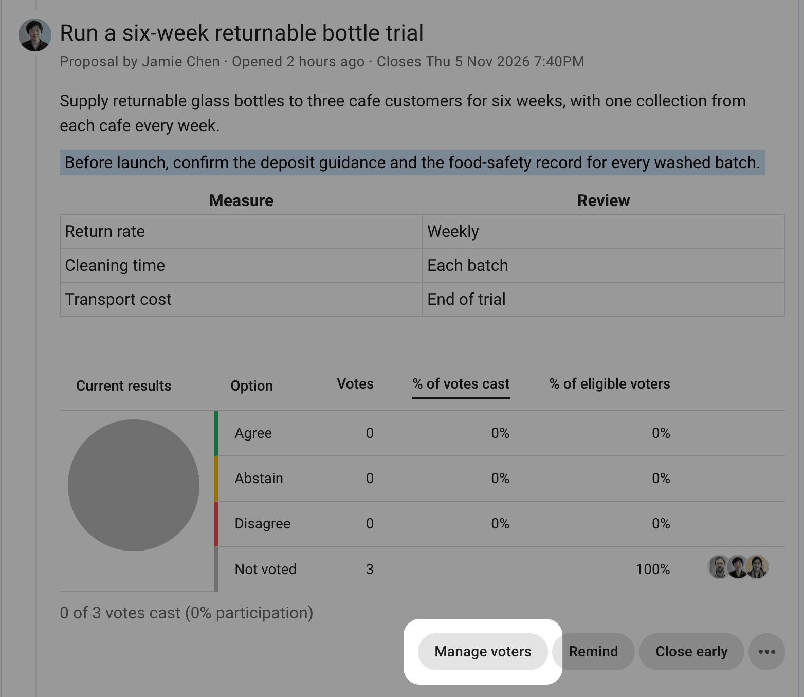
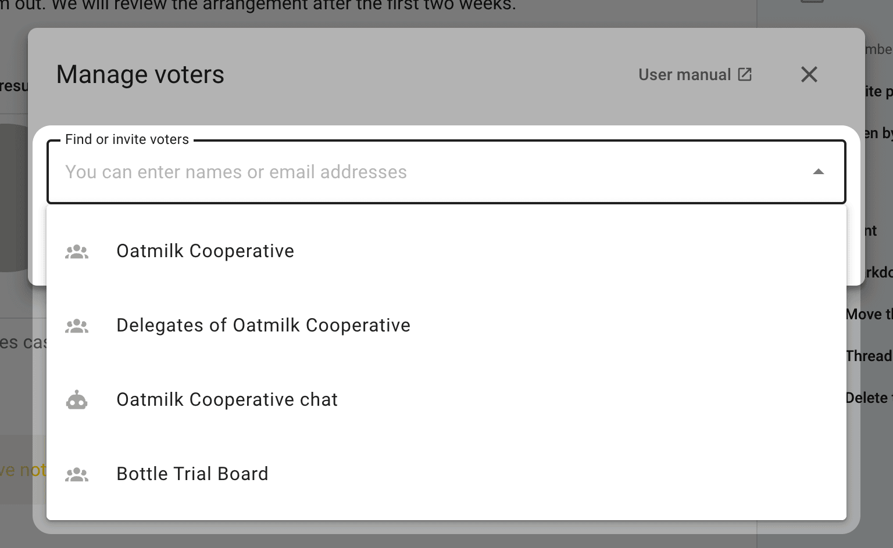
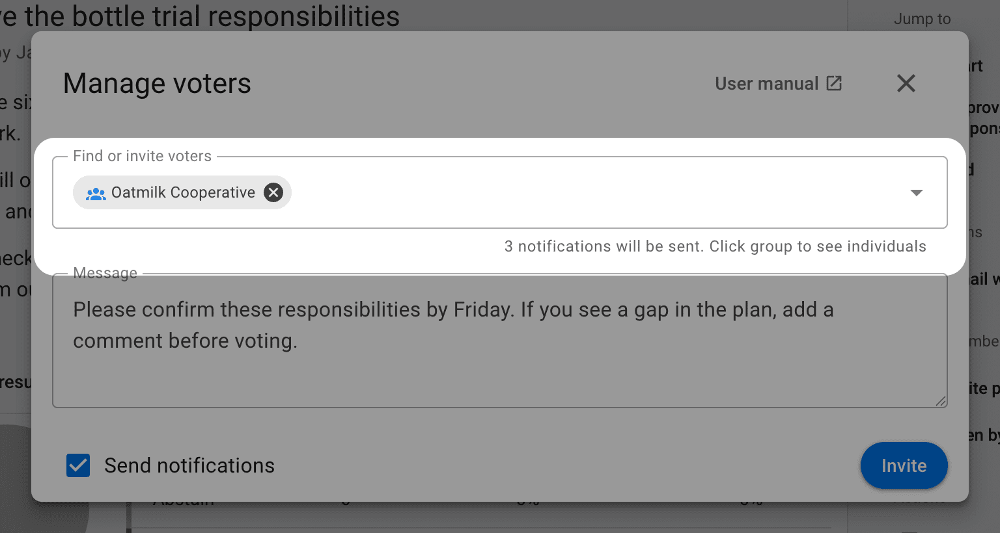
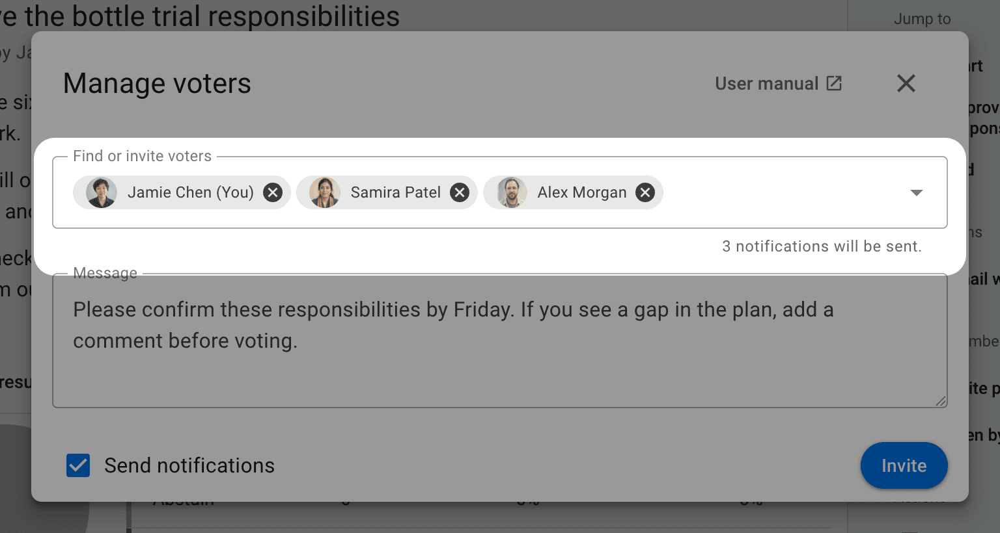
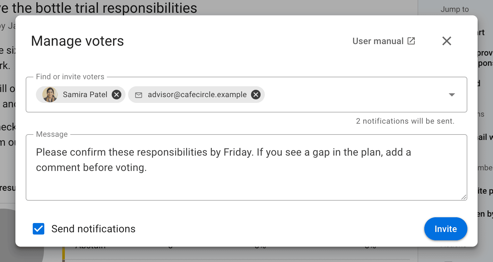
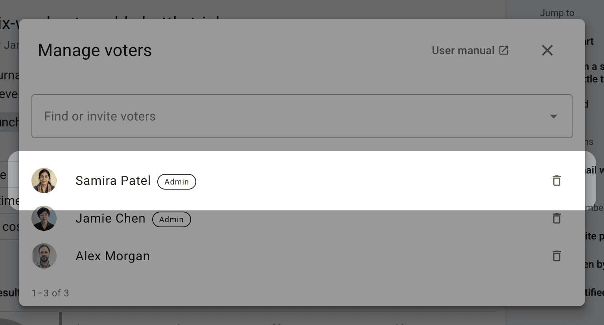
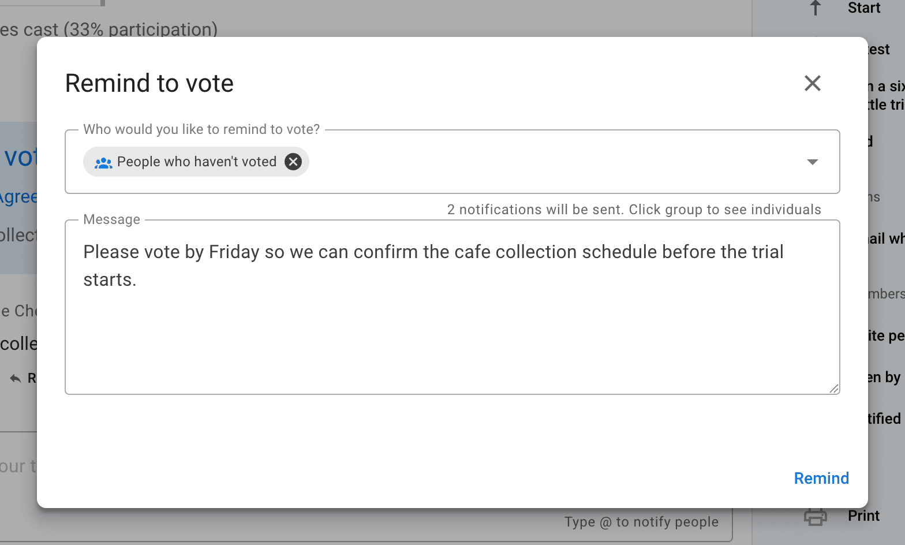
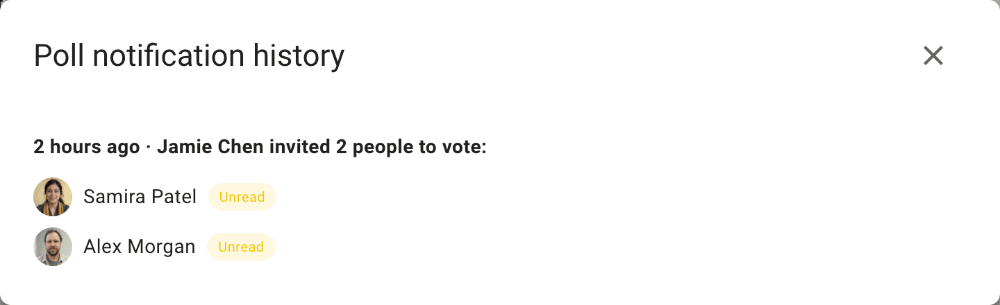

<!-- translation-section: introduction -->

# Manage voters

Use **Manage voters** to give people a vote and invite them to take part in a proposal or poll.

<!-- translation-section: invite-people-to-vote-in-a-poll -->

## Invite people to vote

After you start a poll with **Selected people only**, the **Manage voters** window opens. You can also open it by selecting **Manage voters** on the poll.

<!-- translation-section: choose-an-audience -->

### Choose an audience

Click the empty **Find or invite voters** field to see suggestions. They appear in this order:

- your group
- **Delegates of** your group, if your group has [delegated voters](/en/user_manual/groups/delegated_voters)
- connected chat rooms, such as Slack or Microsoft Teams
- subgroups and the parent group
- individual members

In a [direct thread](/en/user_manual/discussions/direct_discussions), the list offers **Everyone in the thread** instead of a group.

Select an audience to invite those people together. For example, selecting **Oatmilk Cooperative** includes the people in that group. You can also select a connected chat room to post the invitation there. Posting to a chat room does not add its members as voters.

<!-- translation-section: check-your-recipients -->

### Check who is included

After you select an audience, the field shows its name and how many people are included. Check this count before sending the invitation.

Click the audience name to expand it into individual people. You can then select the **×** beside a person to leave them out of this invitation. This does not remove them from the group.

<!-- translation-section: invite-guests-or-experts -->

### Add people by name or email

You can also type a person's name and select them from the suggestions, or enter an email address to invite someone new. You can add several people to the same invitation.

Guests receive access to this poll. If the poll is within a thread, they can also read that thread and its comments. The invitation does not give them permission to comment in the thread, vote in its other polls, or see other group threads.

<!-- translation-section: send-the-invitations -->

### Send the invitations

Add a message explaining what you are asking people to decide, then select **Invite**. Leave **Send notifications** checked to notify the people you are inviting. Uncheck it to add voters without sending a notification.

For a scheduled poll, select **Add voters**. People receive their invitation when voting opens.

<!-- translation-section: engage-people-while-a-poll-is-running -->

## After inviting people

<!-- translation-section: add-voters-to-the-poll -->

### Add more voters

You can reopen **Manage voters** to add people at any time, including before a scheduled poll opens. The window also lists existing voters, with the most recently added people first. Type a name to find someone, or use the page controls to browse a longer list.

<!-- translation-section: remove-people-from-the-poll -->

### Remove people from the poll

Select the trash button beside a person and confirm **Remove voter** to take away their vote in this poll. For example, someone setting up a board vote can remove themself if they are not entitled to vote.

People cannot be removed from an anonymous poll. In polls with [vote weights](/en/user_manual/polls/weighted_voting), thread admins can also review and edit weights here.

<!-- translation-section: remind-people-to-vote -->

### Remind people to vote

Select **Remind** on the poll, choose who should receive the reminder, add a message, and select **Remind** to send it. You can select **People who haven't voted** to reach the people whose responses are still needed.

<!-- translation-section: view-notification-history -->

### View notification history

Open the poll's three-dot menu (**⋯**) and select **Notification history** to see who has been invited, when each invitation was sent, and whether it has been read when that information is available.

<!-- translation-section: close-early -->

### Close early

Select **Close early** when everyone has voted or the poll no longer needs to stay open.

<!-- translation-section: reopen -->

### Reopen

Select **Reopen** on a closed poll and set a new closing date and time. Polls that hide results until voting closes, including anonymous polls, cannot be reopened; you can extend their closing time while they are still open.
