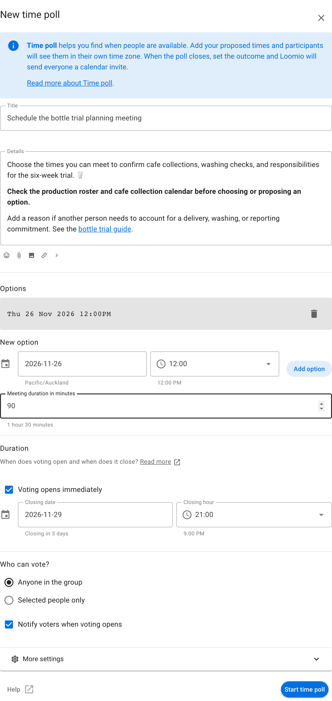
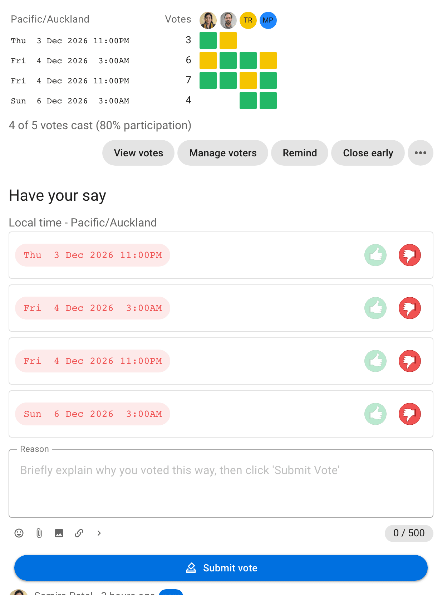
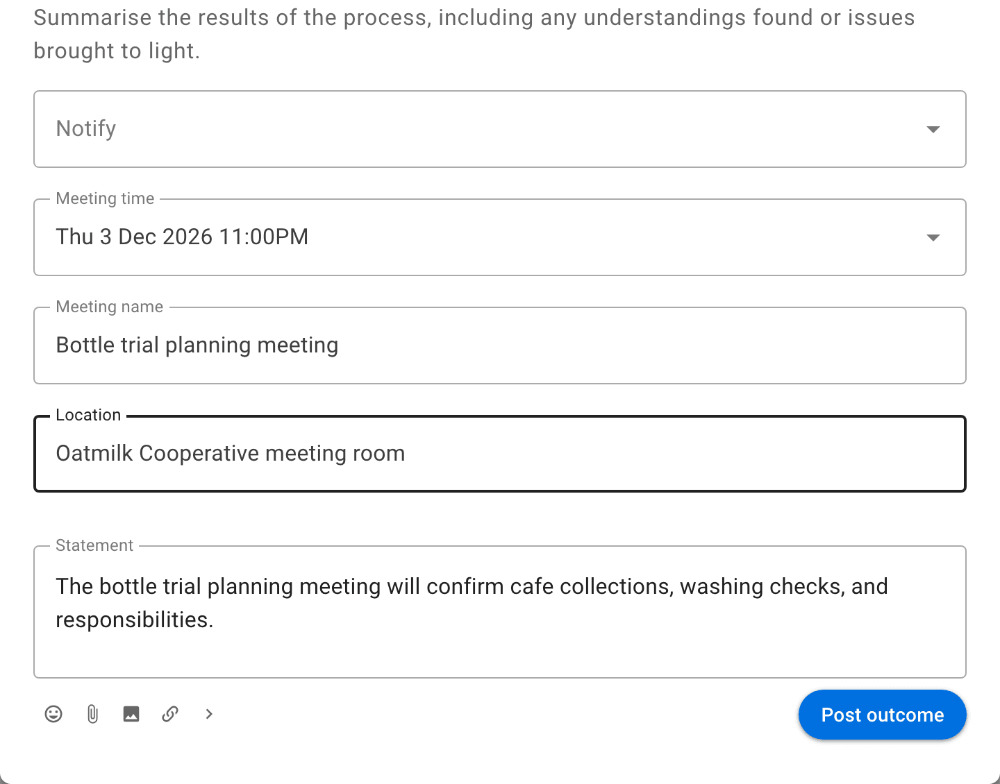

<!-- translation-section: introduction -->

# Time poll

Use a **Time poll** to find a time for a meeting or event alongside your group's other Loomio work. Each participant sees the date and time options in their own time zone.

<!-- translation-section: time-poll -->

## Set up the poll

Give your Time poll a title and details. Enter date and time options in your own time zone, and set a meeting duration.

When choosing options, consider people in other time zones so everyone has workable times.

<!-- translation-section: voting -->

### Voting

Participants mark each time option as available, available if needed, or unavailable. They can also add a vote reason to explain their availability or suggest other times. If none of the options work, you can edit the poll to add new times.

Results update as people vote, showing who is available for each time.

<!-- translation-section: outcome -->

### Share an outcome

When the Time poll closes, pick the best time and share an outcome. See [Share an outcome](/en/user_manual/polls/intro_to_decisions#5-share-an-outcome) for how outcomes work.

- **Notify**: Add the people you are inviting to the meeting or event.
- **Meeting time**: Select the time that works best. Options use the [time zone in your profile](/en/user_manual/users/user_profile#time-zone).
- **Meeting name**: Give your meeting a name. Loomio uses the Time poll title by default.
- **Location**: Add a physical address or an online meeting link.
- **Statement**: Summarize the decision and include any meeting instructions.

Loomio includes the selected time, meeting name, duration, location, and statement in the outcome notification and calendar invitation.
