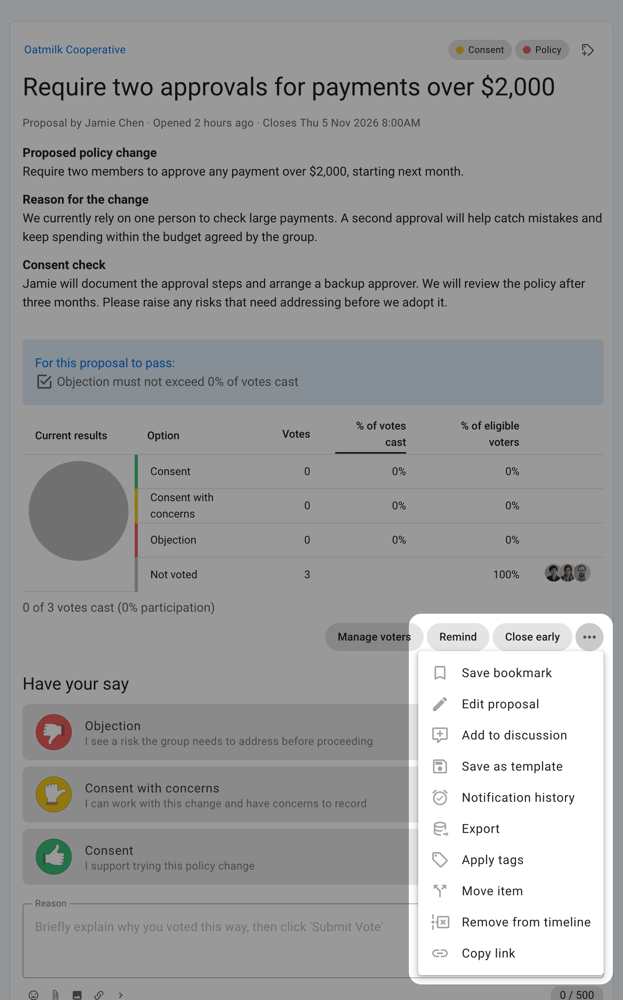
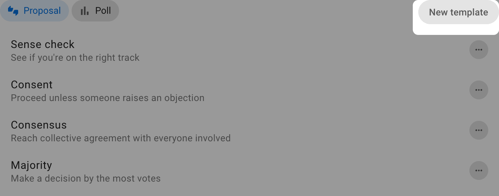
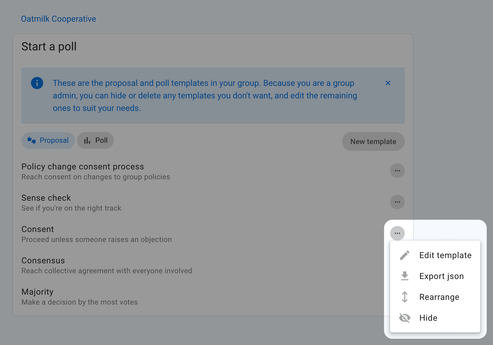
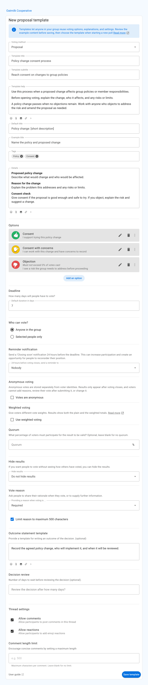
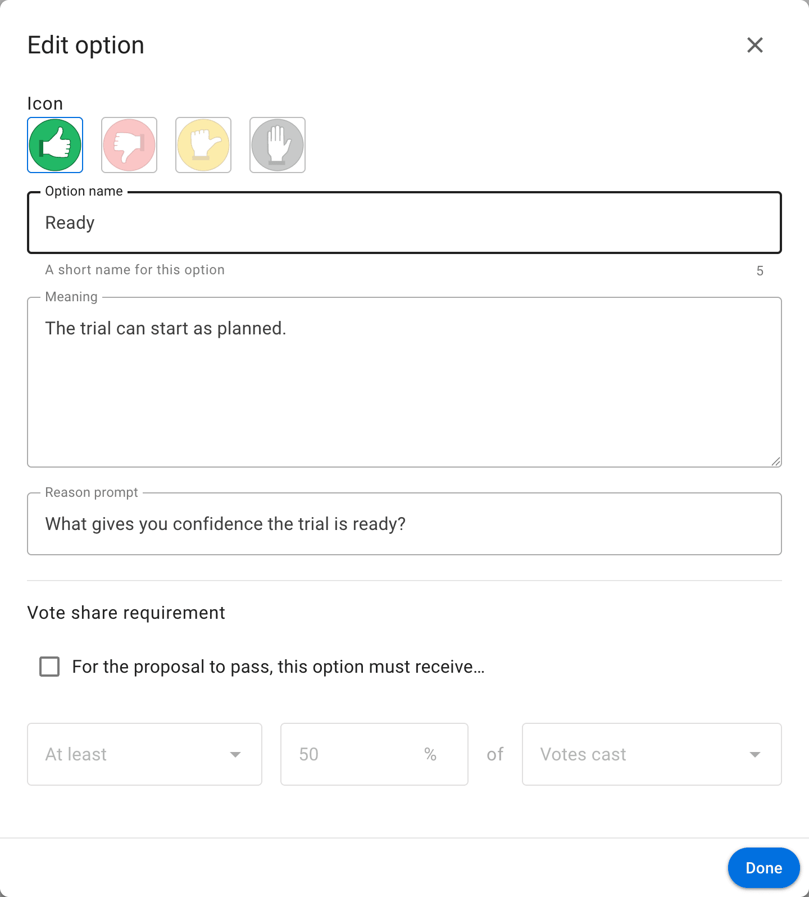
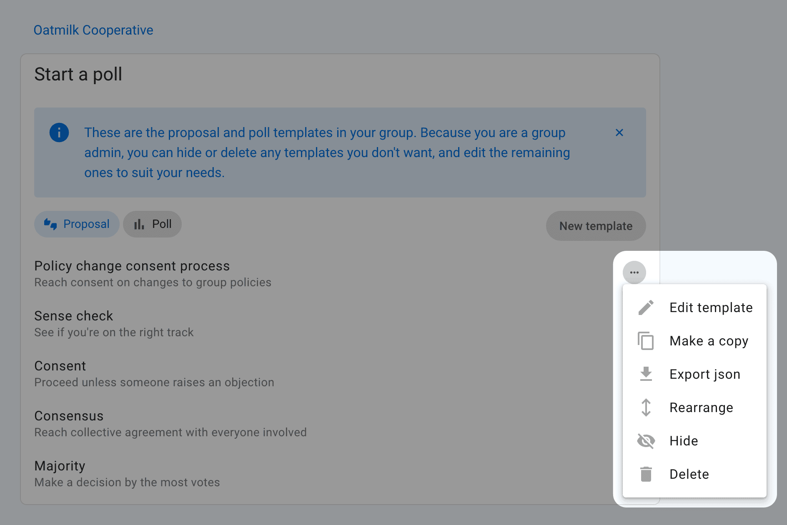

<!-- translation-section: introduction -->

# Poll templates

Poll templates are reusable starting points shown when someone selects **Start a vote** or **New poll**. A template combines a voting method with preset guidance, response options, and settings.

Use this page to configure which templates are available to a group or to create one for your own process. To choose a template for a particular vote, see [Proposals](../proposals/) or [Polls](../proposal_types/). To facilitate a complete decision process, see [Making decisions](/en/guides/making_decisions/).

When starting a vote, select the **Proposal** or **Poll** tab and choose one of the templates available to the group.

The template supplies an introduction, example content, options, and settings. Review and edit these for the particular decision before starting the vote. Editing the new vote does not change the reusable template.

<!-- translation-section: create-a-poll-template -->

## Create a poll template

<!-- translation-section: save-a-poll-as-a-template -->

### Save as template

To reuse an existing proposal or poll, open its action menu and select **Save as template**.

Voting dates, voters, votes, results, and the poll's outcome are not saved in the template.

<!-- translation-section: start-a-new-template -->

### Start a new template

Open the template list and select **New template**. Start with an example or a blank template, then choose the group that will use it.

<!-- translation-section: edit-a-default-template -->

### Edit a default template

To adapt a default template such as **Consent**, open its action menu and select **Edit template**. This option is available to group admins. Saving creates a custom template for your group and hides the default version from its template list.

<!-- translation-section: configure-the-template -->

## Template settings

Give the template a name and subtitle that describe when to use it. You can modify any of the other fields to make them more suitable for reuse. After you select **Save template**, the template will be listed when people start a new proposal or poll.

For standalone polls, **Only admins can add attachments** restricts new files and inline images to thread admins and group admins, including in responses and replies. Polls started inside an existing thread follow that thread's attachment setting. Changing the template affects future polls only.

<!-- translation-section: template-title-subtitle-and-help -->

### Template title, subtitle, and help

Use the title and subtitle to explain when to choose the template. Put process guidance, decision rules, and links to resources in **Template help**.

<!-- translation-section: voting-method -->

### Voting method

Choose what participants need to express and how the result should be calculated.

- **Proposal**: respond to a statement using defined positions;
- **Choose**: select one or more options;
- **Score**: evaluate every option on a scale;
- **Allocate**: distribute a limited budget of points;
- **Rank**: arrange options in preference order;
- **Time poll**: indicate availability; and
- **STV**: rank candidates in a proportional, multi-winner election.

Changing the voting method changes the fields and result calculation available to the template.

<!-- translation-section: example-title-details-and-tags -->

### Example title, details, and tags

Use prompts for the example title and details when each vote needs different content. Add default category tags only when they apply every time the template is used.

<!-- translation-section: response-options -->

### Response options

Methods such as Proposal and Choose let you configure response options. Select the pencil icon beside an option to edit:

- **Option name**: the short response label;
- **Icon**: its visual marker;
- **Meaning**: what selecting the option communicates; and
- **Reason prompt**: the question shown when someone explains their response.

Define options so participants can tell the difference between them without guessing. The meanings should match the decision rules your group actually uses.

<!-- translation-section: duration-and-settings -->

### Duration and settings

Set a default duration that is suitable for most uses of the template. The author can change the closing time for an individual vote.

Other defaults can control result visibility, anonymous voting, [weighted voting](../weighted_voting/), vote-reason requirements, reminders, quorum, and method-specific behaviour. See [Proposal and poll settings](../settings/) for their effects.

<!-- translation-section: manage-the-template-list -->

## Managing templates

Use the action menu beside a template to:

- **Edit** its reusable content and defaults;
- **Move** it to a different position in the list;
- **Hide** it from people starting votes; or
- **Delete** a custom template that is no longer needed.

Select **Show hidden templates** to review or restore hidden templates. Default templates can be hidden or adapted for the group, but cannot be deleted.

Changing a template does not alter proposals or polls that have already been started from it.

<!-- translation-section: who-can-manage-templates -->

### Who can manage templates

Group administrators can create and manage every poll template in their group. They can enable **Members can create templates** under **Group settings** → **Permissions**. When enabled, members can create templates and manage templates they authored.
