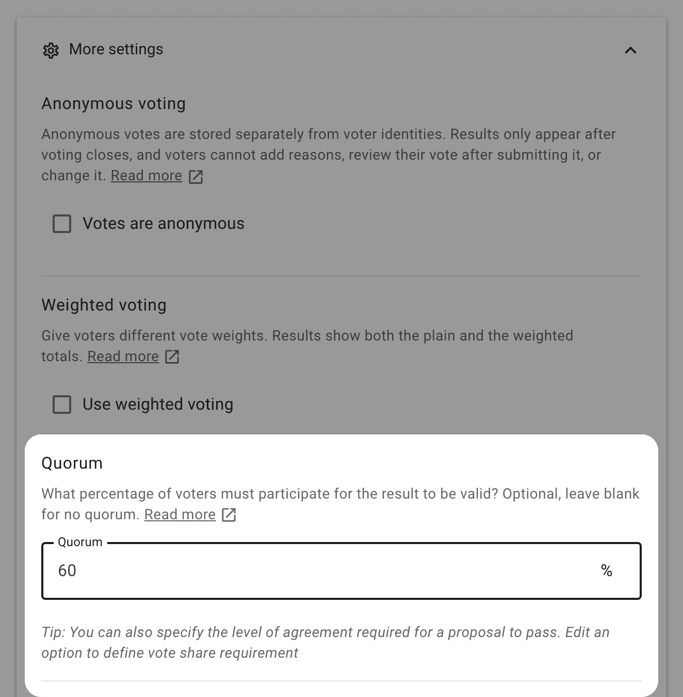
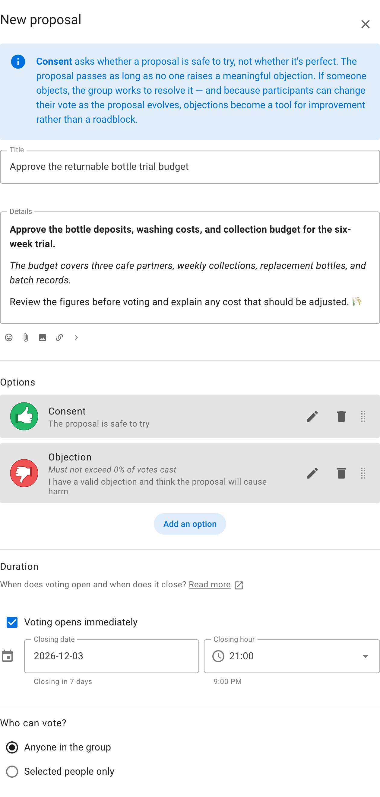
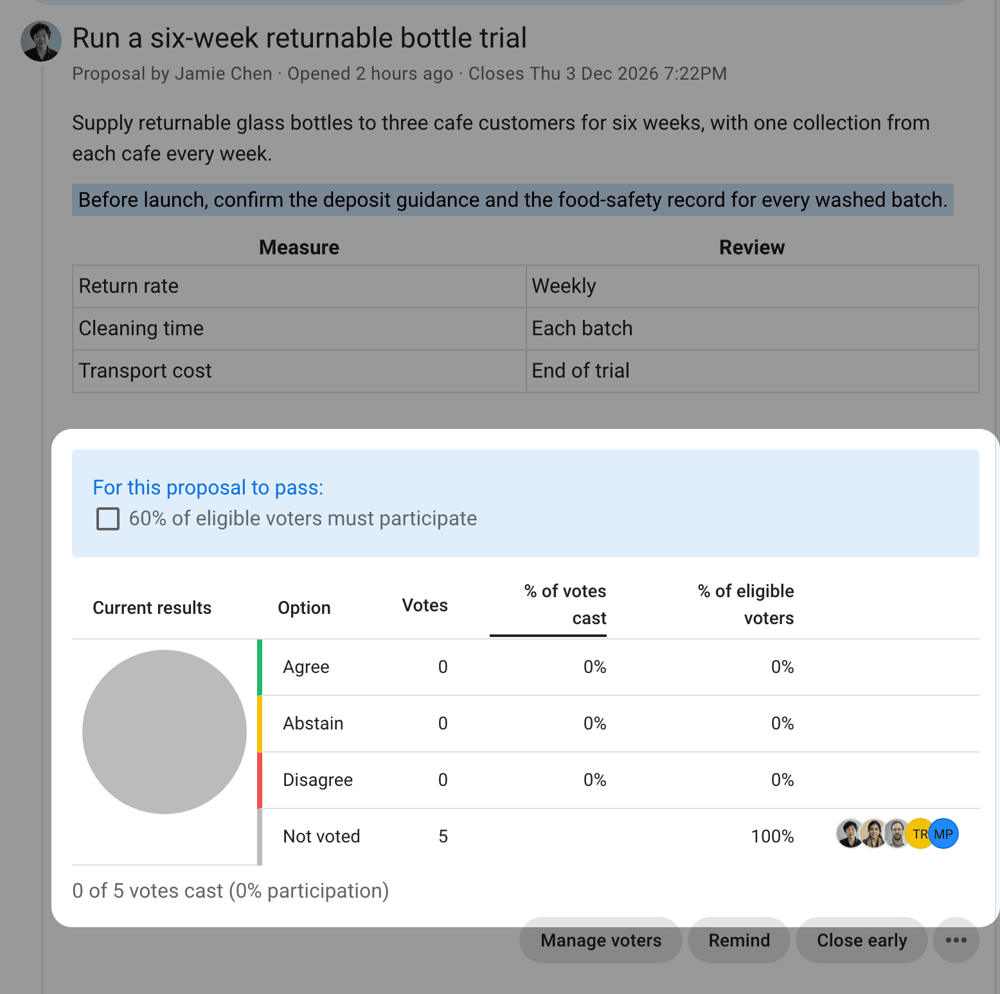
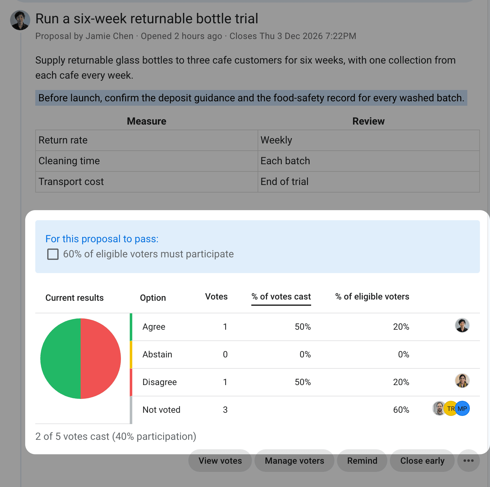
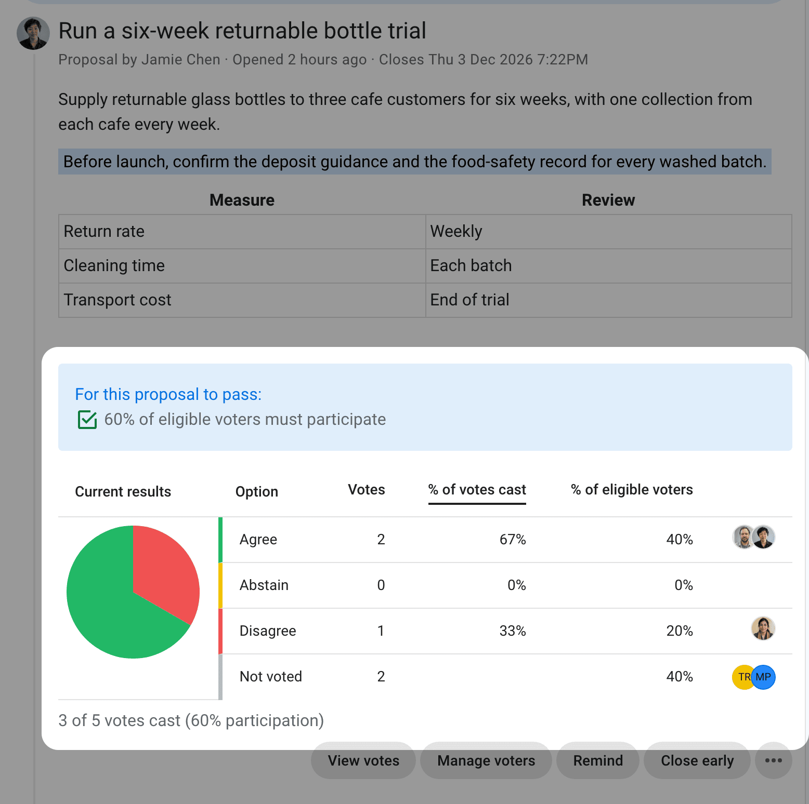

<!-- translation-section: introduction -->

# Quorum

A quorum is the minimum percentage of eligible voters who must participate for a poll to pass. Use it when your decision process requires a minimum level of turnout.

With [weighted voting](/en/user_manual/polls/weighted_voting), quorum uses vote weights. For example, Jamie has weight `2`, Samira has weight `1`, and Alex has weight `1`. If only Jamie votes, half the eligible vote weight has participated. If Samira also votes, participation reaches 75 percent, meeting a 60 percent quorum.

When creating a poll, open **More settings** and enter the required percentage in **Quorum**. Leave the field blank when no quorum is required.

You can also set a quorum in a [poll template](/en/user_manual/polls/poll_templates/) so polls created from that template use it by default.

If a poll closes without reaching quorum, Loomio shows that the quorum was not met. The poll does not automatically extend or cancel—a thread admin can reopen the poll (if allowed) or share an outcome explaining what happens next.

<!-- translation-section: example-scenario -->

## Example scenario

Oatmilk Cooperative is discussing a six-week returnable bottle trial and needs to approve the trial budget.

Jamie selects **Start a vote**, chooses a proposal template, and completes the title, details, options, duration, and voter settings.

Jamie limits the vote to the five people responsible for the trial budget. Because the cooperative requires 60 percent participation for significant decisions, Jamie enters **60** in **Quorum** and starts the proposal.

Before anyone votes, the results panel shows that the quorum has not been reached.

Jamie agrees and Samira disagrees. The chart updates, but two of five eligible voters is only 40 percent participation, so the quorum is still not reached.

Alex then agrees. Three of five eligible voters have participated, reaching the 60 percent quorum. The requirement now shows a green check mark. Jamie can close the poll early or wait for the remaining voters.

