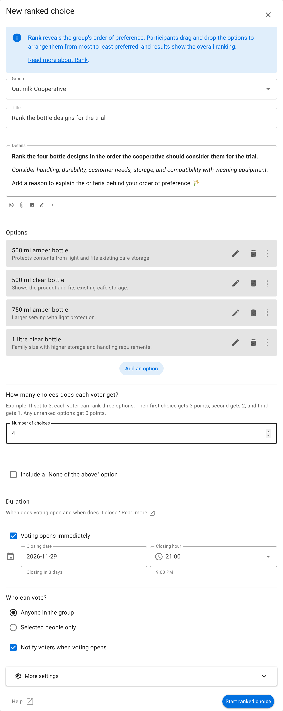
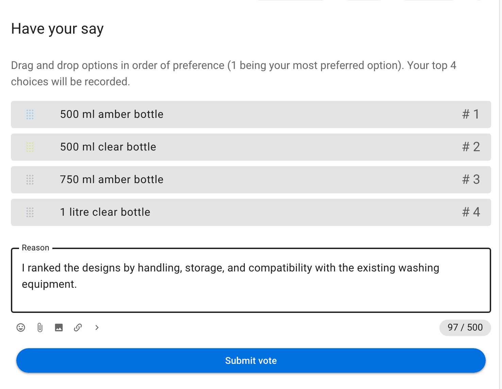
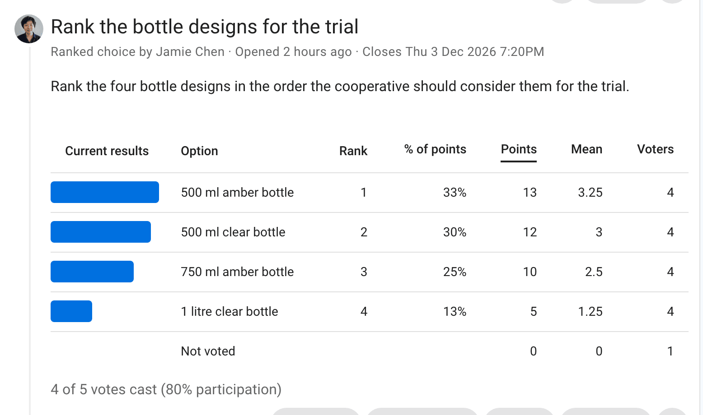
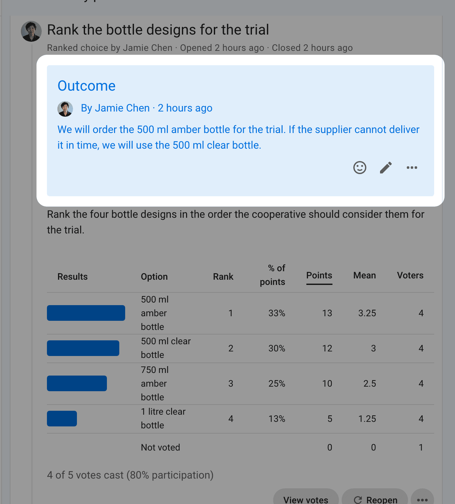

<!-- translation-section: introduction -->

# Rank

Rank finds the group's overall order of preference. Participants arrange options from most to least preferred, and Loomio gives more points to higher-ranked options.

<!-- translation-section: when-to-use-rank -->

## When to use Rank

Use Rank when preference order matters and you want one overall ordering. It works well for:

- selecting one candidate for a position;
- ordering projects for a work plan;
- prioritizing conference topics;
- choosing backup options alongside a first choice; or
- turning a long list into an ordered shortlist.

Rank uses points-based ordering, not proportional representation. To elect several people while representing different groups of voters, use an [STV Election](/en/user_manual/polls/stv/).

<!-- translation-section: example-rank-bottle-designs -->

## Example: rank bottle designs

Oatmilk Cooperative asks members to rank four bottle designs for its returnable-bottle trial. Participants consider handling, durability, customer needs, storage, and compatibility with the washing equipment.

<!-- translation-section: set-up-the-poll -->

## Set up the poll

State what the ranking will decide and add the options. Set **Number of choices** to control how many options each person can rank. For example, if voters can rank up to 3 options, their first choice gets 3 points, their second choice gets 2 points, their third choice gets 1 point, and unranked options get 0 points.

Require all options to be ranked when you need a complete order. Allow fewer choices when participants may not know enough to rank everything. Showing options in random order helps avoid giving an advantage to options listed first.

<!-- translation-section: vote -->

## Vote

Participants drag options into their preferred order, with number 1 as their first choice. They can add a vote reason explaining their ranking.

In this example, the voter puts the **500 ml amber bottle** first and the **500 ml clear bottle** second because both fit the existing cafe storage and washing equipment.

<!-- translation-section: read-the-results -->

## Read the results

The results combine all ballots into an overall points-based ranking. For each option, they show:

- **Rank**: its position in the combined result;
- **% of points**: its share of all ranking points;
- **Points**: the total points from all ballots;
- **Mean**: its average points per voter; and
- **Voters**: how many people ranked it.

In this example, the **500 ml amber bottle** ranks first, followed by the **500 ml clear bottle** and the **750 ml amber bottle**. The group can try the top design first and keep the rest in order as backup options.

Different voting patterns can produce the same point total. When options are close or the decision is important, review individual votes and vote reasons.

<!-- translation-section: share-an-outcome -->

## Share an outcome

When the poll closes, share an outcome. Say which option the group will pursue and what happens if it falls through. See [Share an outcome](/en/user_manual/polls/intro_to_decisions#5-share-an-outcome) for how outcomes work.

