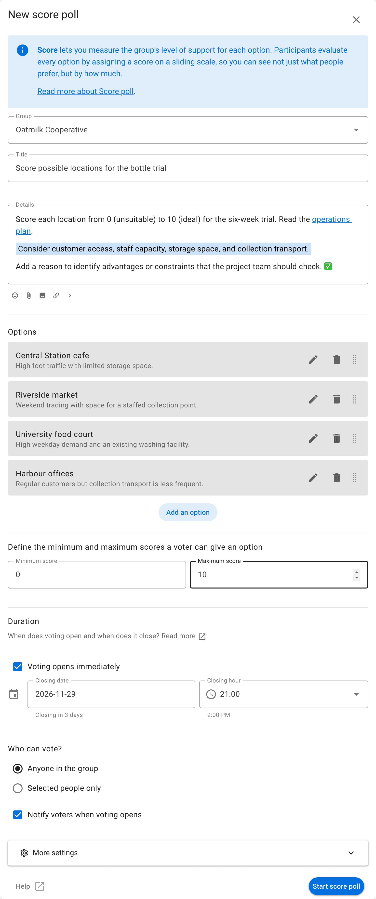
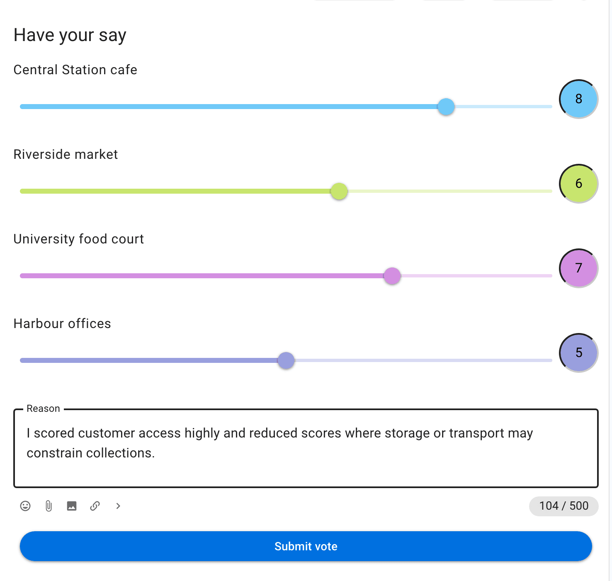
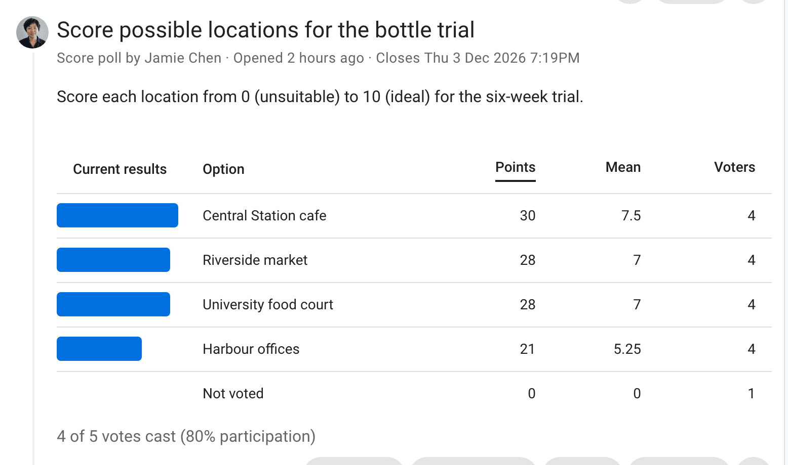
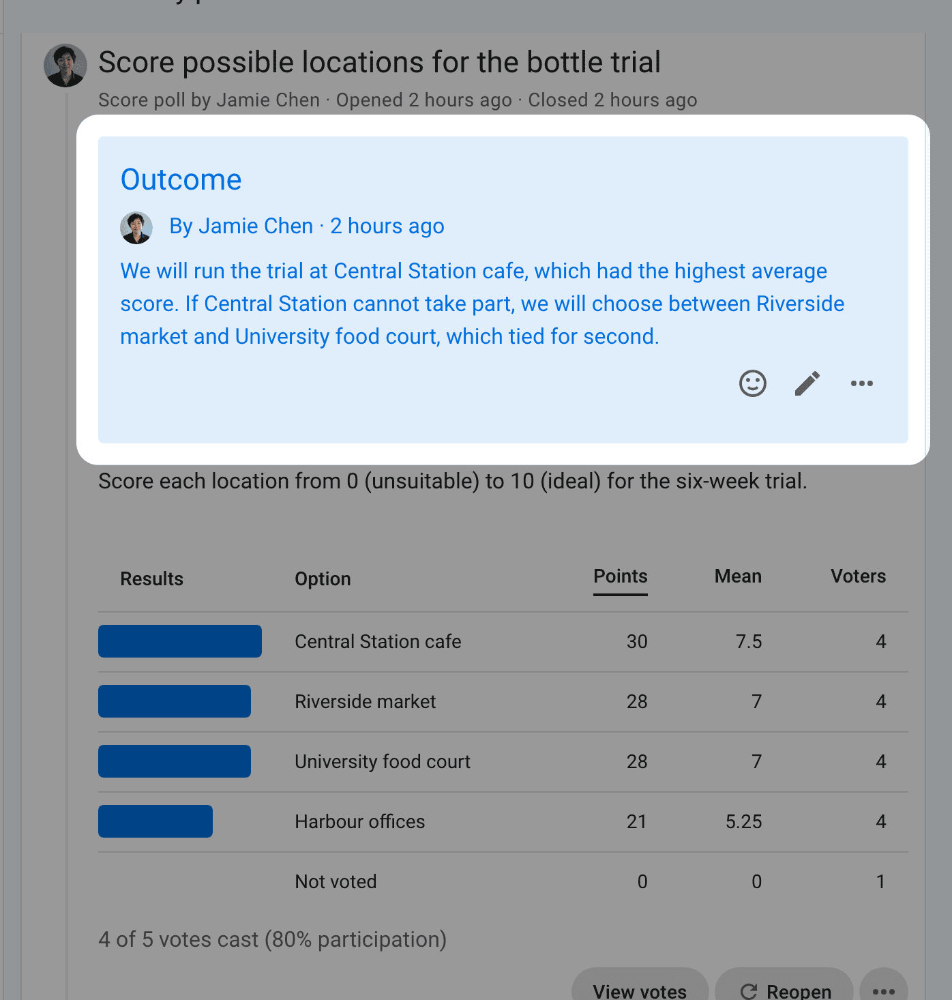

<!-- translation-section: introduction -->

# Score

Score measures how participants rate each option on a shared numeric scale. Unlike Choose, it asks people to respond to every option, showing both what people prefer and how strongly they prefer it.

<!-- translation-section: when-to-use-score -->

## When to use Score

Use Score when every option can be rated independently against the same question. It works well for:

- assessing how ready each part of a project is;
- rating the importance of several principles;
- measuring interest in possible meeting topics;
- evaluating grant applications against a common criterion; or
- comparing the suitability of several proposals.

Define what the bottom and top of the scale mean, so everyone interprets the numbers the same way. Use [Choose](/en/user_manual/polls/choose/) when you only need selections, or [Allocate](/en/user_manual/polls/allocate/) when participants must make trade-offs within a limited budget.

<!-- translation-section: example-score-possible-trial-locations -->

## Example: score possible trial locations

Oatmilk Cooperative is choosing locations for a returnable-bottle trial. It asks members to score four locations from 0 (**unsuitable**) to 10 (**ideal**), considering customer access, staff capacity, storage, and collection transport.

<!-- translation-section: set-up-the-poll -->

## Set up the poll

State one question that applies equally to every option. Add the items to be assessed, set the **Minimum score** and **Maximum score**, and explain the endpoints in the details. You can add an option meaning to clarify the scope of each item.

Choose a scale participants can apply consistently. A 0–5 scale is quick to use; a 0–10 scale allows finer distinctions. Use the shortest scale that fits your question—a wider range does not always give better results.

You can use anonymous voting or show options in random order to reduce peer influence and order bias.

<!-- translation-section: vote -->

## Vote

Participants move a slider to score every option. In this example, the voter scores Central Station cafe at 8, Riverside market at 6, the University food court at 7, and Harbour offices at 5.

A vote reason explains how the voter used the scale. This helps the group tell whether a low score reflects a real concern or missing information.

<!-- translation-section: read-the-results -->

## Read the results

For each option, the results show:

- **Points**: the sum of all scores;
- **Mean**: the average score; and
- **Voters**: how many people scored the option.

In this example, **Central Station cafe** has the highest mean at 7.5. **Harbour offices** has the lowest mean at 5.25, while Riverside market and the University food court are tied at 7. Four of five invited people have voted, so one response is still missing.

Compare means only when options have a similar number of voters. Read the vote reasons before treating a small difference as meaningful.

<!-- translation-section: share-an-outcome -->

## Share an outcome

When the poll closes, share an outcome. Say what action follows from the scores and how any ties are settled. See [Share an outcome](/en/user_manual/polls/intro_to_decisions#5-share-an-outcome) for how outcomes work.

