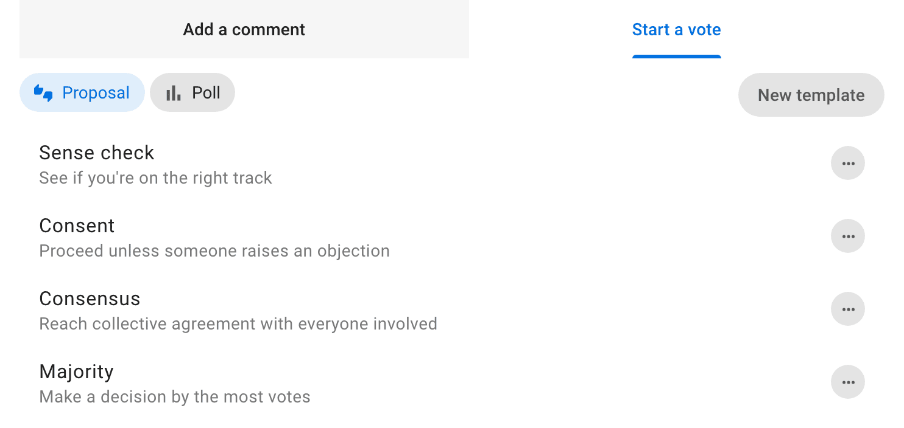
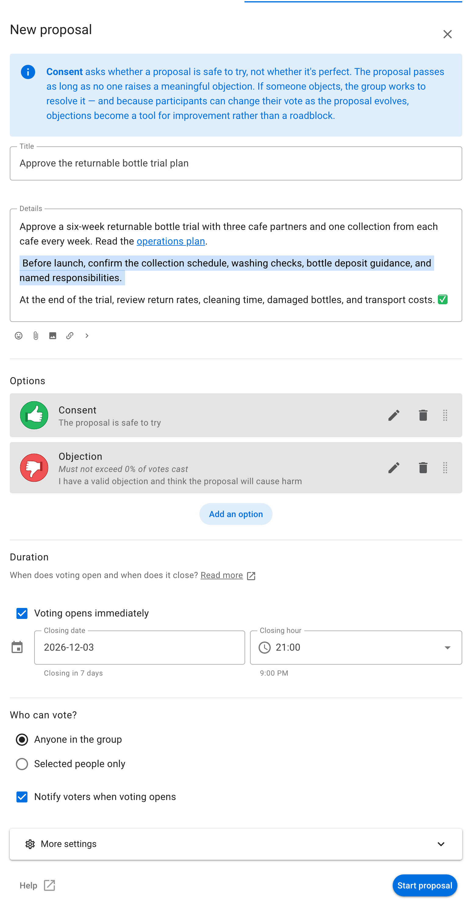
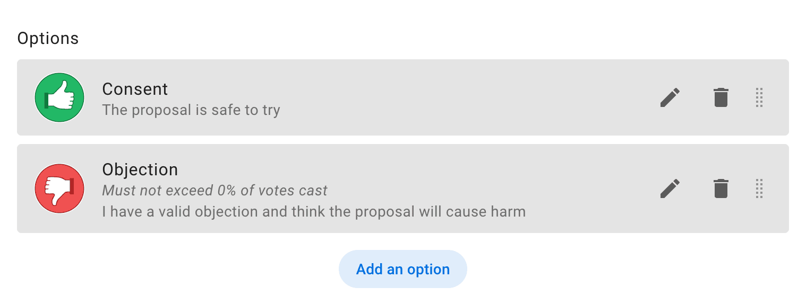
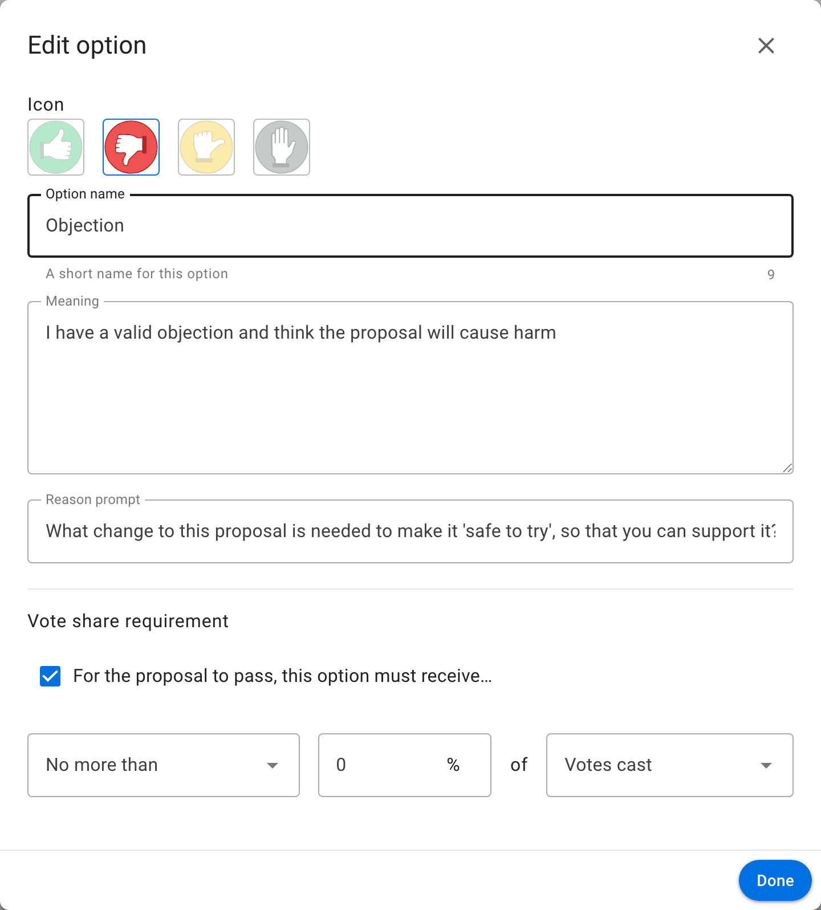
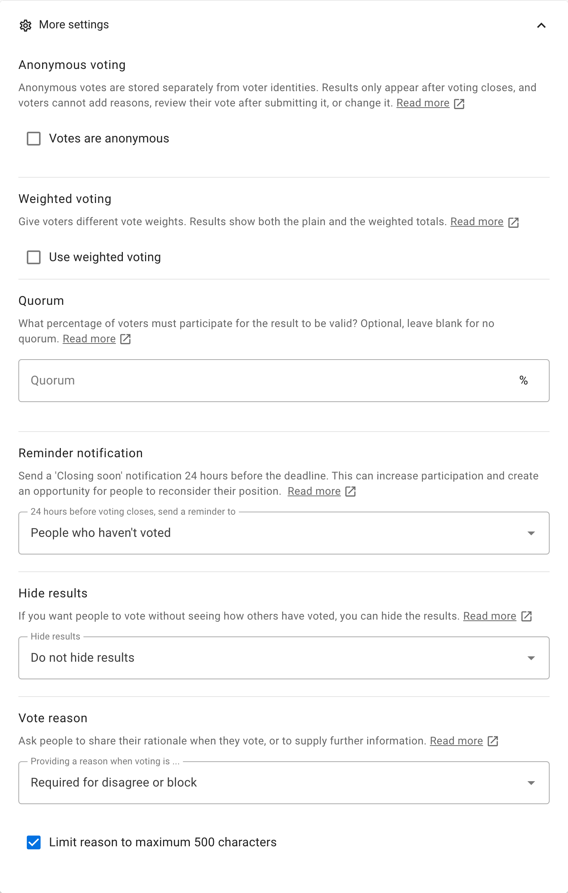
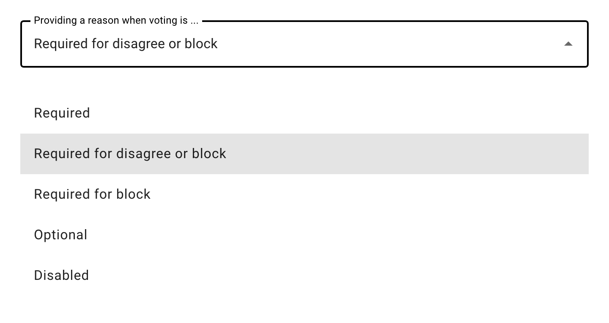
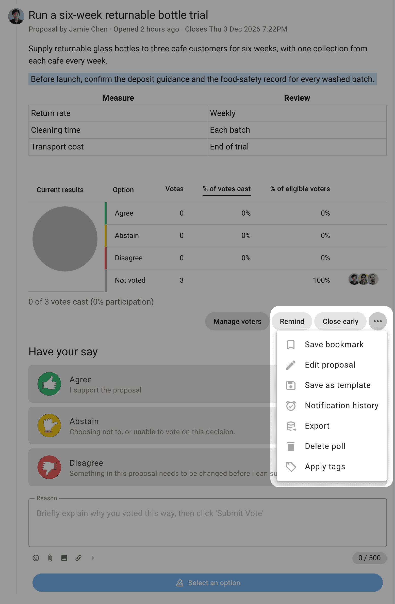
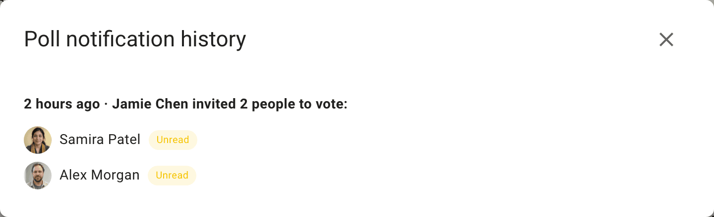
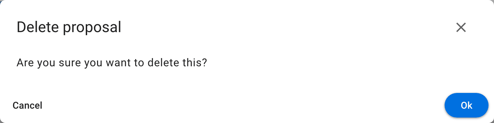

<!-- translation-section: introduction -->

# Proposal and poll settings

Configure how a proposal or poll works, who can vote, and how results appear. Most settings are available when you create or edit a poll.

<!-- translation-section: setting-up-a-proposal-or-poll -->

## Setting up a proposal or poll

<!-- translation-section: proposal-and-poll-templates -->

### Proposal and poll templates

Choose the proposal or poll template you want to use.

<!-- translation-section: add-content -->

### Title and details

- **Group:** Check that the right group is selected for your proposal or poll.
- **Title:** Give your proposal or poll a short, clear title.
- **Details:** Explain what you are asking people to decide and what happens if the proposal passes.

Templates include starter prompts that you can use or replace. You can attach files, insert images and tables, and add headings and lists with the [formatting tools](/en/user_manual/discussions/formatting) to share supporting information and keep longer proposals easy to read.

<!-- translation-section: voting-options -->

### Voting options

Each template provides default voting options. Depending on the template, you can edit, remove, reorder, or add options to match your decision process:

- Select the pencil icon to edit a voting option.
- Select the trash can icon to remove a voting option.
- Drag the handle to change the order of voting options.
- Select **Add option** to add a voting option when the template allows custom options.

<!-- translation-section: edit-voting-options -->

### Edit voting options

Select the pencil icon beside a voting option to edit it:

- **Option name:** A short name for the option.
- **Icon:** An icon for the option, such as thumbs up, thumbs down, abstain, or block.
- **Meaning:** A sentence explaining what choosing this option means.
- **Reason prompt:** A question prompting voters to explain their choice.

<!-- translation-section: opening-time -->

### Duration

By default, voting opens immediately when you start the poll. To schedule it for later, uncheck **Voting opens immediately** and choose an opening date and time.

Scheduling lets you give people time to discuss before voting opens, or prepare polls and add voters in advance. People can see a scheduled poll before it opens, but they cannot vote until the opening time. Voters are notified when voting opens, rather than when you add them.

To open a scheduled poll early, select **Edit poll**, check **Voting opens immediately**, and save.

- **Notify voters when poll opens:** Checked by default so all voters receive a notification when voting opens. Uncheck this to open voting without sending notifications.
- **Closing date and time:** Choose when voting closes. Allow enough time for people to vote—for example, closing before a meeting or avoiding weekends so reminders arrive at a useful time. You can close a poll early or extend its closing time while it is open.

<!-- translation-section: who-can-vote -->

### Who can vote?

Choose who can vote in the poll:

- **Anyone in the group** (or **Anyone in the thread**): Everyone with access to the poll can vote, including people who join later.
- **Selected people only:** Only the people you add can vote. Use this when only some members should vote, such as a board or committee.

After you start a **Selected people only** poll, **Manage voters** opens so you can add voters. You can add or remove voters later. See [Manage voters](/en/user_manual/polls/manage_voters).

<!-- translation-section: more-settings -->

## More settings

Open **More settings** to configure reminders, anonymous voting, vote reasons, result visibility, [quorum](/en/user_manual/polls/quorum/), [weighted voting](/en/user_manual/polls/weighted_voting/), and **Show options in random order** (available on Choose, Score, Allocate, and Rank polls to reduce order bias).

<!-- translation-section: reminder -->

### Reminder

Send a "Closing soon" notification 24 hours before the poll closes to encourage participation or give people a chance to review their vote.

Options:

- Nobody
- Author
- People who haven't voted (default)
- All voters

For an anonymous poll lasting at least 24 hours, Loomio automatically reminds eligible people who have not voted during the final 24 hours. This reminder cannot be changed in poll settings.

<!-- translation-section: anonymous-voting -->

### Anonymous voting

When enabled, Loomio stores votes separately from voter identities. Results stay hidden until voting closes, and voters cannot add vote reasons, review their submitted vote, or change it.

See [Anonymous voting](/en/user_manual/polls/anonymous_voting) for how identities are separated from votes, what is retained, and the limits of this protection.

> [!WARNING]
> Once voting opens, you cannot turn anonymous voting on or off. You cannot reopen an anonymous poll after it closes.

<!-- translation-section: vote-reason -->

### Vote reason

Prompt voters to explain why they voted the way they did. Available settings depend on the template:

- **Optional:** Voters can choose whether to give a vote reason.
- **Required for disagree or block:** Voters must give a reason when they choose an option with the Disagree or Block icon.
- **Required for block:** Voters must give a reason when they choose an option with the Block icon.
- **Required:** Every voter must give a reason.
- **Disabled:** Removes the vote-reason field.

The conditional settings follow the voting icon rather than the option name, so they still apply if you rename Disagree to Objection. The Consent template defaults to **Required for disagree or block**, the Consensus template defaults to **Required for block**, and other templates default to **Optional**. The poll author can change this setting for an individual poll.

**Limit reason to maximum 500 characters:** Checked by default to keep vote reasons concise. Uncheck this to allow longer reasons.

<!-- translation-section: hide-results -->

### Hide results

Hide poll results so people can vote without seeing how others voted:

- **Until a vote is cast:** People can see vote choices and vote reasons after submitting their own vote.
- **Until voting closes:** Results, replies to votes, and mentions in vote reasons stay hidden until the poll closes. You can extend the closing time while the poll is open, but you cannot reopen it after it closes.

<!-- translation-section: editing-settings-before-voting-opens -->

### Editing settings before voting opens

Before voting opens, anyone with permission to edit the poll can change its details and settings, including anonymous voting and result visibility. Once voting opens, anonymity is locked and results hidden until closing cannot be revealed early.

<!-- translation-section: managing-polls -->

## Managing polls

Open the three-dot menu at the bottom right of the poll.

<!-- translation-section: edit-poll -->

### Edit poll

Select **Edit poll** to change the poll's content or settings.

<!-- translation-section: save-as-template -->

### Save as template

Select **Save as template** to reuse the poll's content, voting options, explanations, and settings. Review the prefilled form, give the template a name and subtitle, and select **Save template**. People in the group can then choose it when starting a new poll.

Group admins can save templates. Members can also save them when **Members can create templates** is enabled in group permissions. See [Poll templates](/en/user_manual/polls/poll_templates) for details.

<!-- translation-section: notification-history -->

### Notification history

**Notification history** shows who was notified and whether each notification has been read.

<!-- translation-section: export-poll -->

### Export poll

Select **Export** to download poll status and results as a spreadsheet (.csv) file for analysis or archiving.

<!-- translation-section: print -->

### Print

Open the thread's three-dot menu and select **Print** to open a printable HTML view of the discussion and its polls. You can print it or save it as a PDF for publishing or archiving.

<!-- translation-section: delete -->

### Delete

Select **Delete** and confirm to permanently remove the poll. Deleted polls cannot be restored. An **Item removed** marker remains in the thread.

<!-- translation-section: save-bookmark -->

### Save bookmark

Select **Save bookmark** to add the poll to your bookmarks for quick access later.
