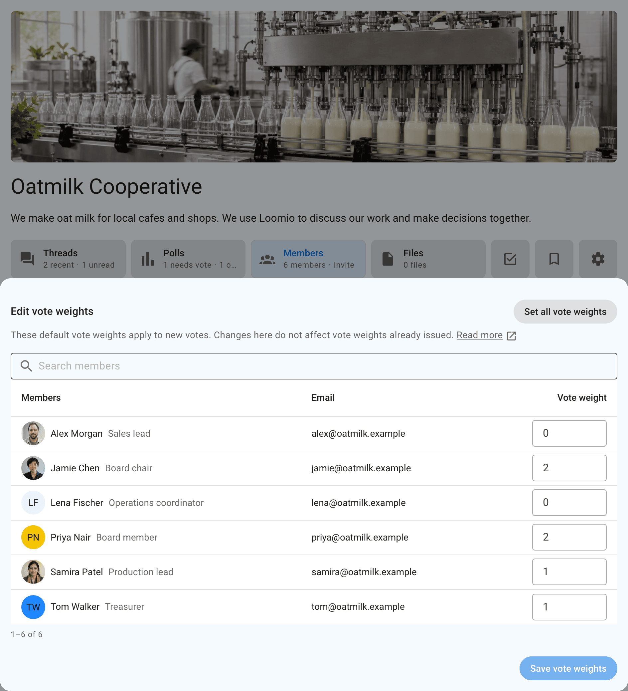
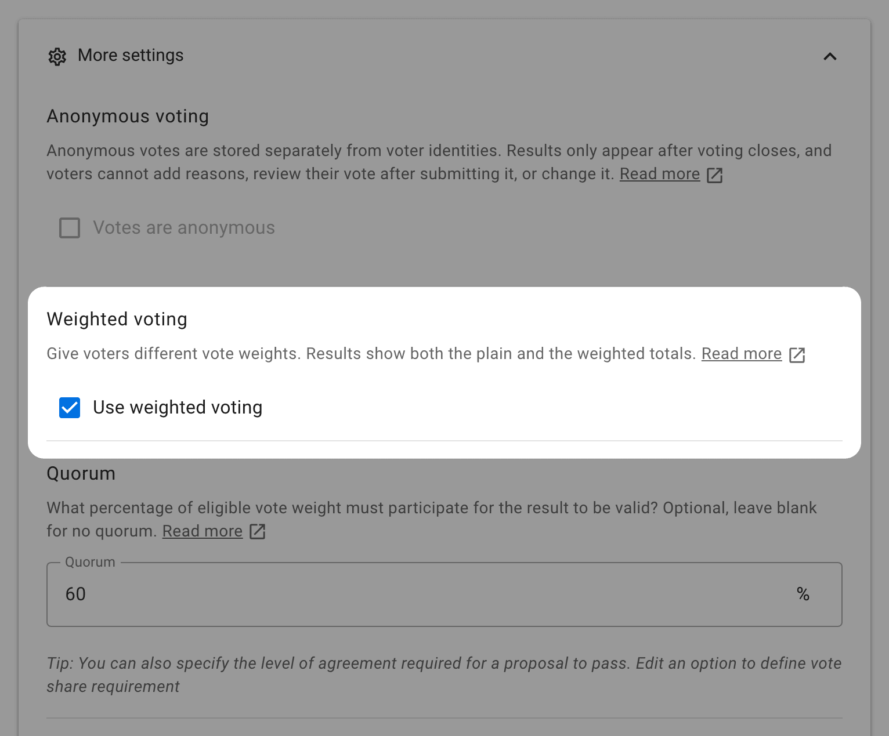
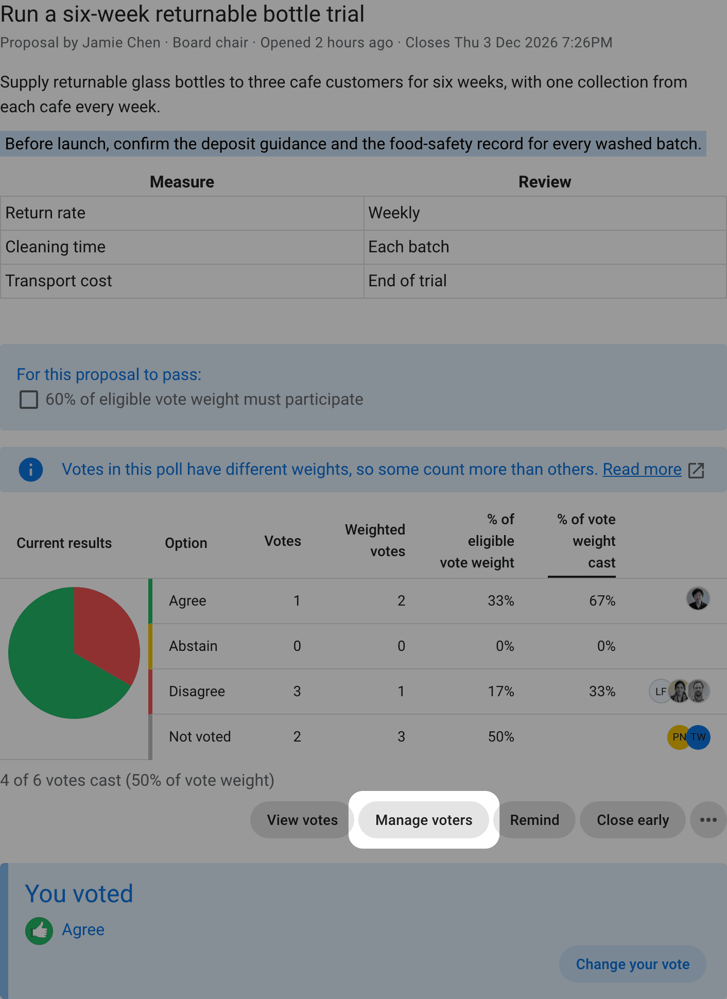
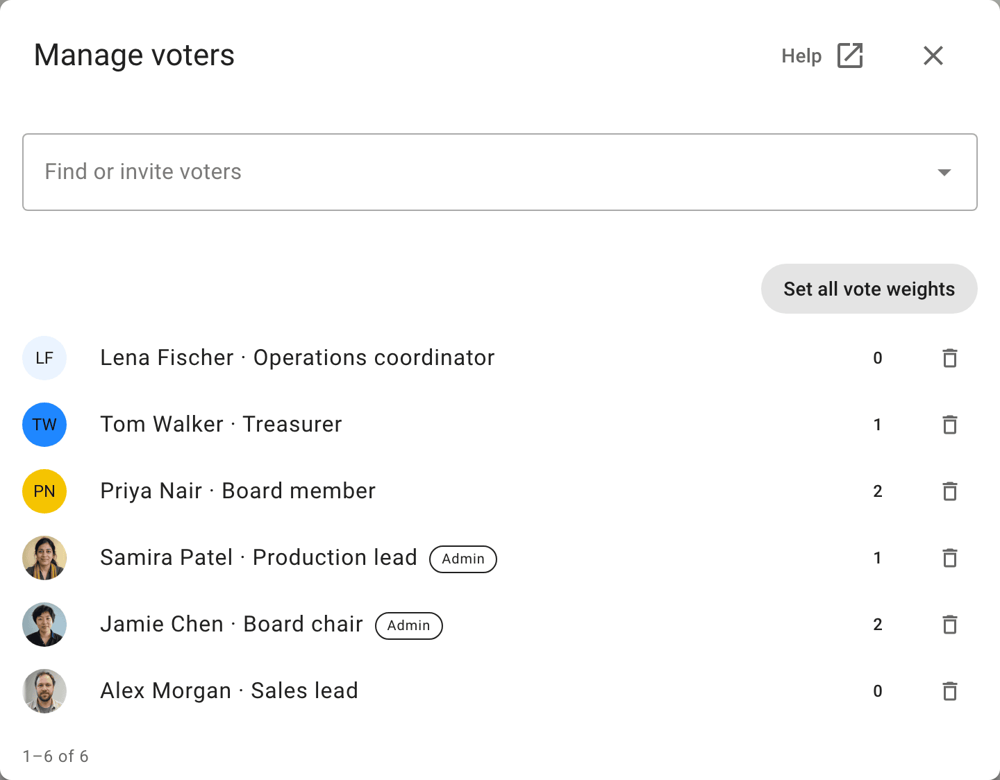
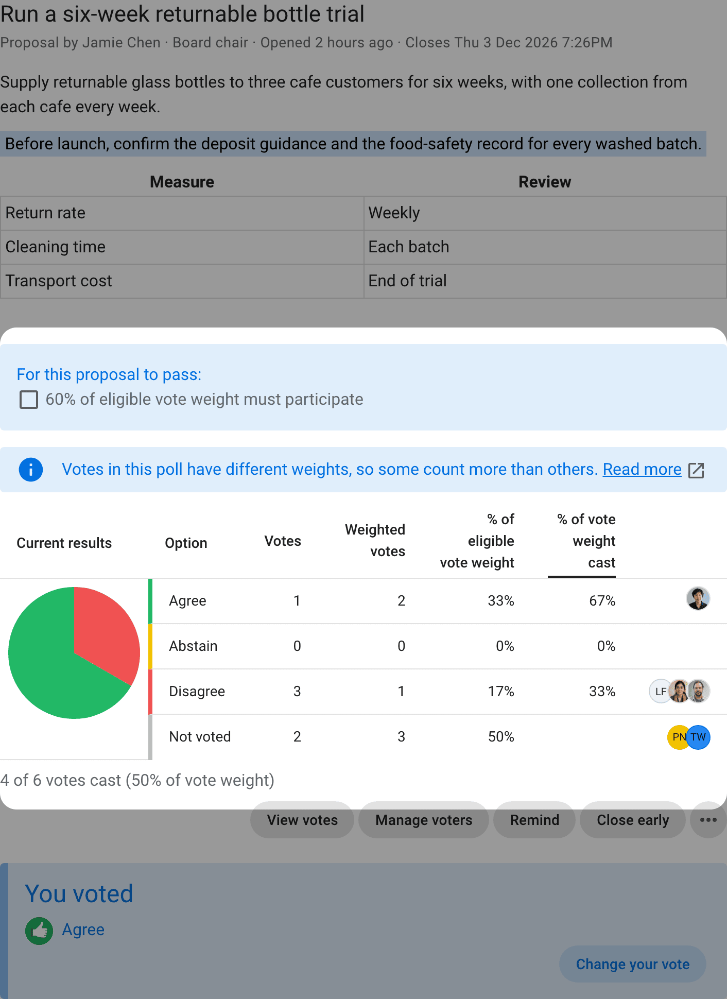

<!-- translation-section: introduction -->

# Weighted voting

Weighted voting lets some votes count more than others by assigning each voter a vote weight. For example:

- A housing community gives each property one vote. A member representing three properties has a vote weight of `3`.
- A worker cooperative grants voting rights after a set period of membership. Newer members receive a vote weight of `0`, so they can join the discussion and try voting without affecting the result.
- A company gives shareholders votes according to their ownership stake. Someone who owns 12.5% of the shares has a vote weight of `12.5`.

<!-- translation-section: set-members-vote-weights -->

## Set members' vote weights

A group admin can open the group's **Members** page and select **Edit vote weights**. Enter weights (`0` or higher, up to three decimal places) and select **Save vote weights**. You can search by name or email to find someone, or select **Set all vote weights** to give every member the same weight.

A member's vote weight is copied into each poll when they are added. Changing it later does not affect existing polls.

<!-- translation-section: use-weighted-voting-in-a-poll -->

## Use weighted voting in a poll

Open **More settings** in the poll form and select **Use weighted voting**. You can turn weighted voting on or off after voting opens. Turning it off resets every vote weight in the poll to `1`, and any custom weights for that poll are lost.

If your group uses weighted voting for a regular process, enable **Use weighted voting** in a [poll template](/en/user_manual/polls/poll_templates). Polls started from that template will use weighted voting by default.

Weighted voting works with these poll types: [Proposal](/en/user_manual/polls/proposals), [Choose](/en/user_manual/polls/choose), [Score](/en/user_manual/polls/score), [Allocate](/en/user_manual/polls/allocate), and [Rank](/en/user_manual/polls/rank).

You cannot use weighted voting and [anonymous voting](/en/user_manual/polls/anonymous_voting) in the same poll.

To change one voter's weight, select **Manage voters**, then select the weight beside their name. To change everyone's, select **Set all vote weights**. You can copy each member's weight from the group or give everyone the same value. Voters who are not group members receive a weight of `1`.

<!-- translation-section: results -->

## Results

Results show plain totals and weighted totals side by side:

- Proposal and Choose polls show **Votes** and **Weighted votes**.
- Score, Allocate, and Rank polls show **Points** and **Weighted points**.

The chart displays the weighted result. Select a column heading to chart that column instead. Anyone who can see the votes can see each voter's weight.

For Proposal and Choose polls, **Not voted** shows the remaining voter count under **Votes** and the remaining weight under **Weighted votes**. Those columns and **% of eligible vote weight** include people who have not voted in the chart. **% of vote weight cast** leaves **Not voted** blank and excludes it from the chart.

Vote weights also apply to [quorum](/en/user_manual/polls/quorum) and [vote share requirements](/en/user_manual/polls/vote_share_requirements).

In the example below, Jamie votes **Agree** with weight `2`. Three people vote **Disagree**, with weights `1`, `0`, and `0`. Two people, with weights `2` and `1`, have not voted.

Agree has one of the four votes cast, but two-thirds of the vote weight cast. Half the eligible vote weight has participated, so the 60 percent quorum has not been reached.

