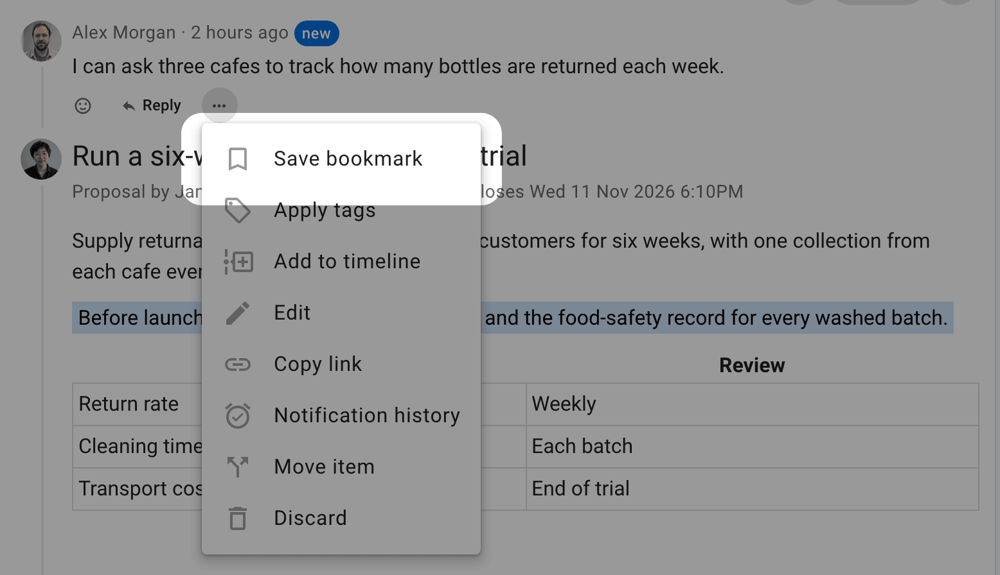
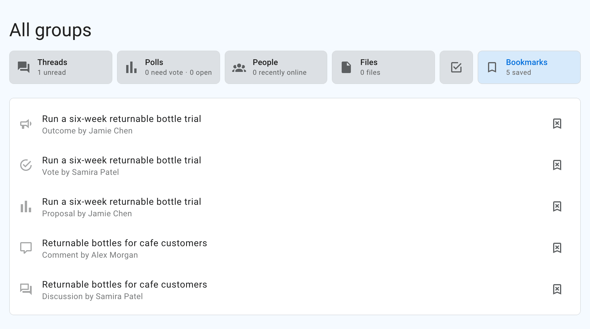

<!-- translation-section: introduction -->

# Bookmarks

Bookmarks are a personal list of Loomio items you want to return to. Your bookmarks are visible only to you, and saving an item does not notify anyone else.

You can bookmark:

- discussions
- comments
- proposals and polls
- votes
- outcomes

<!-- translation-section: save-a-bookmark -->

## Save a bookmark

Open the action menu for the item and select **Save bookmark**. The action menu is usually shown as three dots. For a discussion, use the action menu near the discussion title; for a comment, vote, proposal, poll, or outcome, use the menu on that item.

<!-- translation-section: view-your-bookmarks -->

## View your bookmarks

Open **Bookmarks** on **All groups** to see everything you have saved across your groups, or open **Bookmarks** on a group page to see bookmarks in that group (with a **Subgroups** filter on parent groups).

The Bookmarks page lists your most recently saved items first. Each row shows the kind of item and its author. Select a row to return to the bookmarked item.

<!-- translation-section: remove-a-bookmark -->

## Remove a bookmark

On the Bookmarks page, select the remove-bookmark button at the end of a row. You can also open the bookmarked item's action menu and select **Remove bookmark**.

Removing a bookmark affects only your personal list. You can save the item again later.
