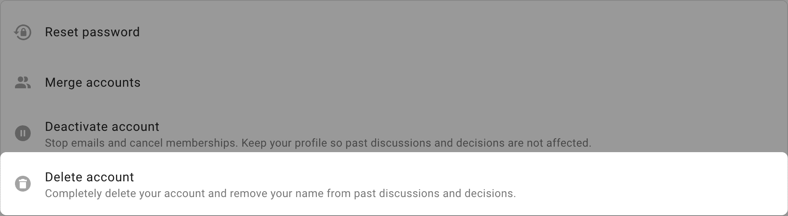

<!-- translation-section: introduction -->

# Deleting your Loomio account

<!-- translation-section: what-does-delete-account-mean -->

## What does delete account mean?

Deleting your account is permanent and cannot be undone. When you delete your account:

- Loomio deletes your account, including your name, email address, and other personal details. You can no longer sign in with this account.
- Your comments, proposals, and discussions remain, with your name removed, so group threads stay intact.
- You are removed as a member of all groups.
- You stop receiving notification emails.

Copies of your activity may already have been emailed to group members. Loomio cannot delete emails that have already been sent.

Deleting your account does not cancel a paid subscription. To stop payments, see [Subscriptions](/policy/subscriptions/management/#cancel-your-plan).

For details on how Loomio handles your data, see our [privacy policy](/policy/privacy/) or [contact us](/contact). If you need a copy of a group's records first, a group admin can [export the group's data](/en/user_manual/groups/data_export).

<!-- translation-section: to-delete-your-account-entirely -->

## To delete your account entirely

1. Sign in to Loomio.
2. Open your user menu by selecting your name in the sidebar, then select **Edit profile**. If the sidebar is closed, open it with the menu button (**☰**).

3. Scroll to the bottom of the page and select **Delete account**.

4. Confirm that you want to permanently delete your account.

