<!-- translation-section: introduction -->

# Notifications

Notifications help groups keep momentum by drawing your attention to discussions and decisions that need a response.

Notifications let you know when:

- someone mentions you or replies to something you wrote
- a new discussion is shared with you
- you are invited or reminded to vote
- a poll is closing soon
- an outcome is announced

Notification settings let you choose how closely to follow each group or thread. Notifications stay available in Loomio so you can review them whenever you are ready.

<!-- translation-section: two-ways-to-begin -->

## Two ways to begin

Most people start with one of two approaches:

- **When notified** — receive an email when someone asks for your attention, and get everything else in your daily catch-up. Start here if you are still learning how your group uses Loomio.
- **Once per day** — set Email to **Catch-up only** and keep your catch-up set to **Every day**. Loomio delivers your notifications and unread activity together in one email.

New accounts start with **When notified** and a daily catch-up. This alerts you right away when you are notified without sending an immediate email for every comment or vote.

If you prefer to receive all Loomio updates together, switch to the once-per-day approach. You can change this at any time.

To follow a group or thread more closely, choose **All activity** to receive every update as it happens.

These defaults apply when you join a group. Threads inherit their group's settings at first, and you can adjust notifications for an individual thread without changing the rest of the group.

<!-- translation-section: notifications-in-loomio -->

## Notifications in Loomio

Select the bell icon in the top-right to open your notifications in Loomio. The number on the icon shows how many unread notifications you have.

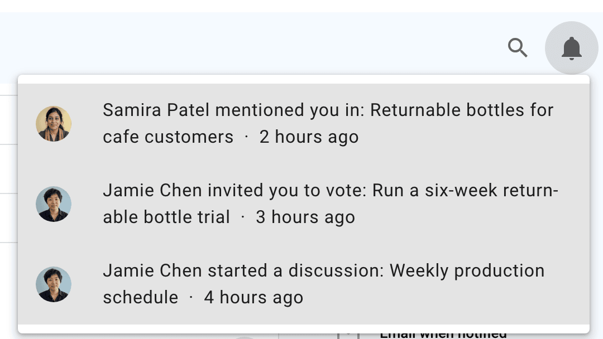

Select a notification to open the related discussion or poll.

<!-- translation-section: catch-up -->

## Catch-up

The catch-up gives you a regular overview of activity without requiring you to check each group during the day.

It shows your unseen notifications first, followed by unread discussions and standalone polls organized by group. Notifications link directly to activity that needs your attention, while the unread section includes recent discussions, polls, comments, votes, and edits. Direct discussions and threads you joined as a guest also appear when they have unread activity.

You can turn on **Follow updates** on an open group you have not joined. Its unread discussions and polls then appear in your catch-up on your usual schedule, and reading them or marking the catch-up as read updates their read status just like your own groups. Turn off **Follow updates** on the group page to stop including them.

Loomio does not send a catch-up when there are no unseen notifications or unread threads for that period.

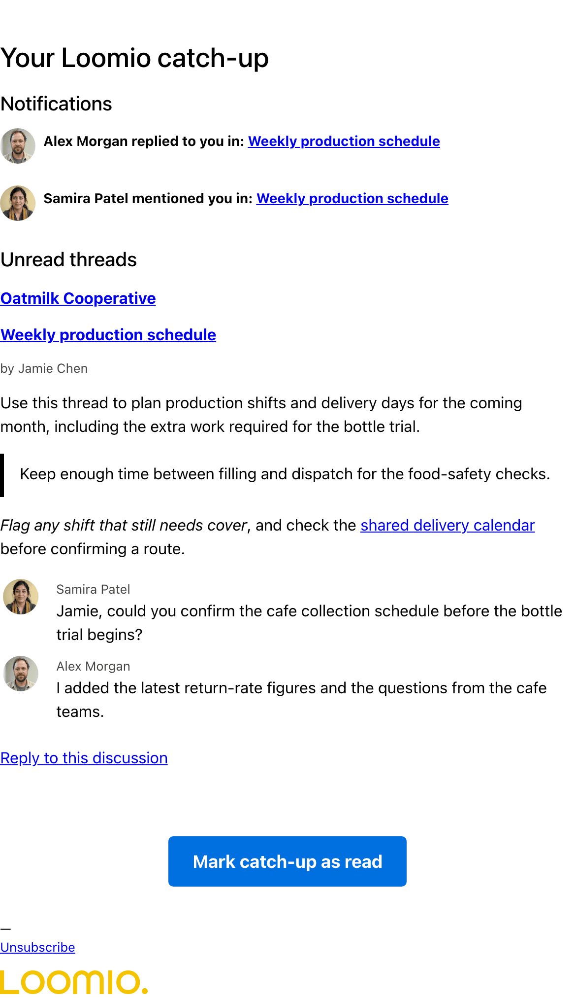

<!-- translation-section: choose-your-catch-up-schedule -->

### Choose your catch-up schedule

Open **Notification settings** from your user menu to choose how often you receive a catch-up.

The **Unsubscribe** link in a catch-up email lets you change or stop catch-up emails without signing in. Sign in to Loomio to open the full **Notification settings** page.

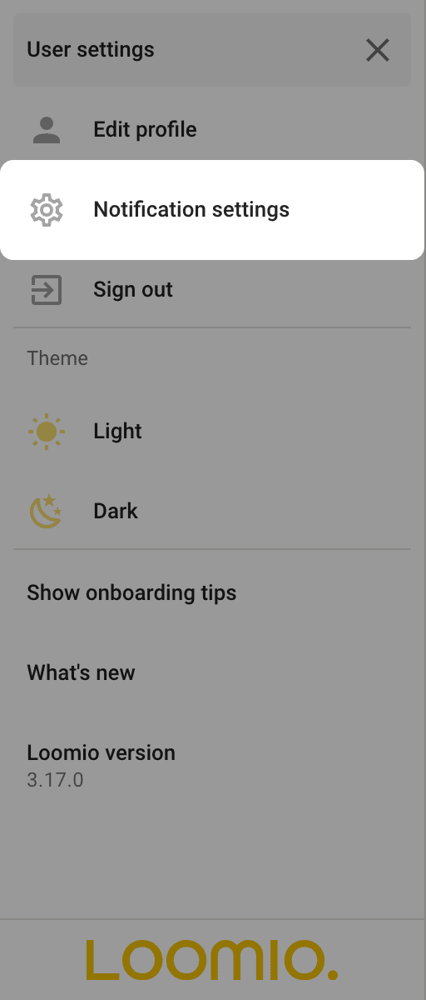

New accounts start with a daily catch-up. The available schedules are:

- **Never** to turn off the catch-up
- **Every day** for activity from about the previous 24 hours
- **Every second day** for activity from about the previous two days
- a weekday to receive a weekly catch-up on that day

Loomio sends the catch-up in the morning according to the time zone in your profile.

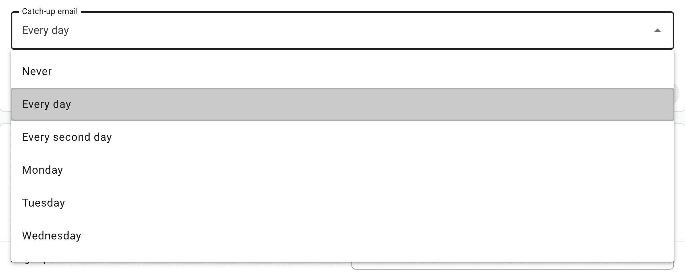

<!-- translation-section: mark-a-catch-up-as-read -->

### Mark a catch-up as read

Select **Mark catch-up as read** to mark its notifications and topic activity as read in Loomio. Opening or previewing the catch-up does not mark anything as read.

A catch-up covers multiple discussions, so do not reply to it. Open a discussion or poll from the catch-up before commenting or replying.

<!-- translation-section: group-and-thread-notification-settings -->

## Group and thread notification settings

You choose how closely to follow each group and thread. These settings belong to you; group admins cannot change them.

Change your defaults for new groups from **Notification settings** in your user menu. You can also override the default for any group or thread. A thread override applies only to that thread and does not affect the rest of its group.

<!-- translation-section: group-notification-settings -->

### Group notification settings

To change the notification setting for a group:

1. Open the group page.
2. Open the notification settings for the group.

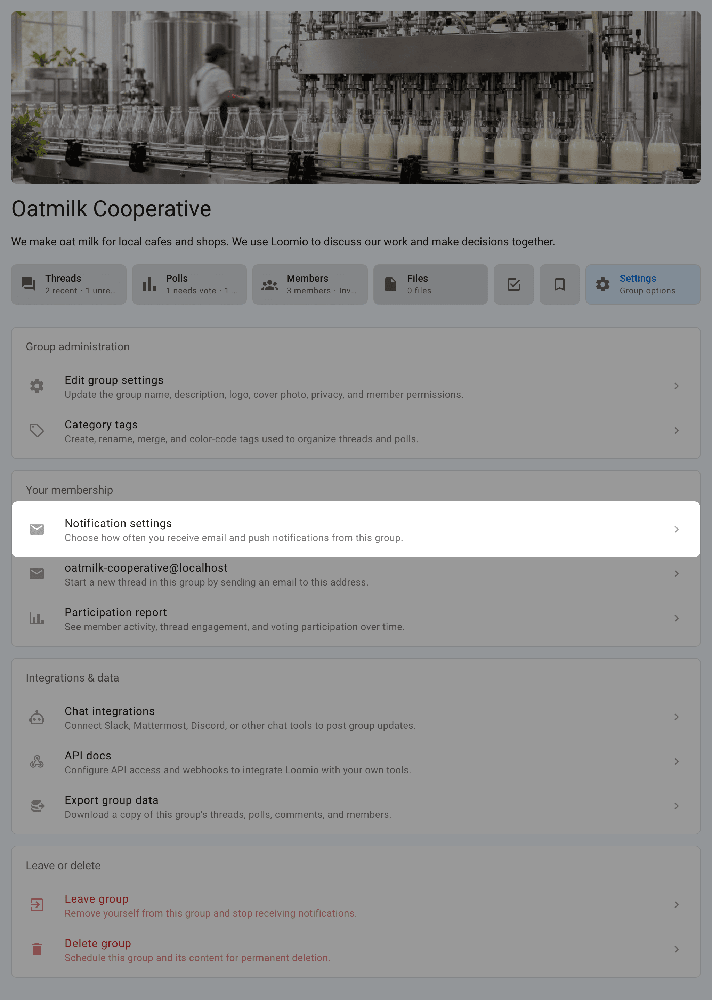

Choose **Catch-up only**, **When notified**, or **All activity**. If your catch-up is set to **Never**, **Catch-up only** is replaced by **No email updates** or **No push updates**.

Select **Apply to all groups** to use the same setting for all of your groups.

<!-- translation-section: thread-notification-settings -->

### Thread notification settings

To change notification settings for an individual thread, open the notification control in the thread sidebar.

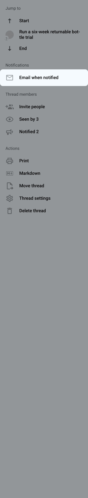

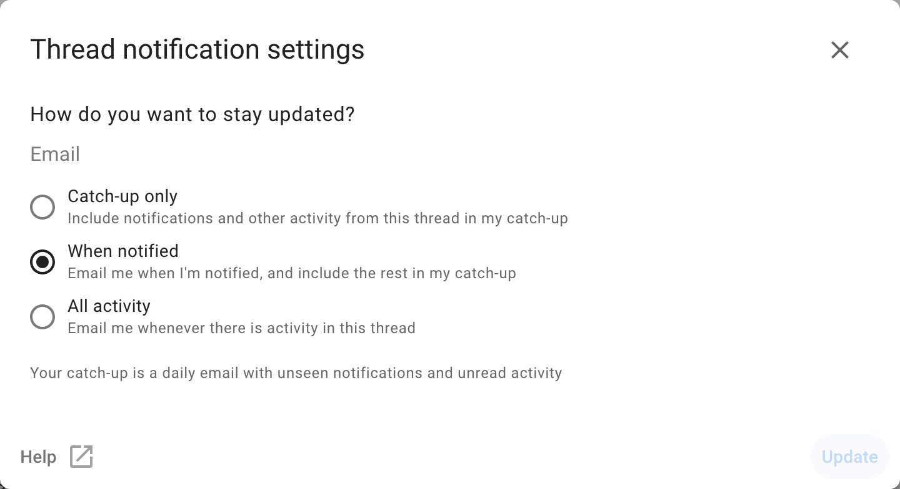

Thread notification settings use the same **Catch-up only**, **When notified**, and **All activity** choices. A thread setting overrides the group setting for that thread.

> [!NOTE]
> Changes in **Thread notification settings** apply only to the thread you have open. Select **Change notifications for group** to change the setting inherited by the group's other threads.

<!-- translation-section: email-delivery -->

## Email delivery

By default, Loomio sends an email when someone asks for your attention. Choose **All activity** to also receive emails for every new comment, vote, thread, poll, and outcome.

The **Unsubscribe** link in a notification email opens settings for that thread or group, including emails sent for mentions or replies. Choose **Catch-up only** to stop immediate emails while keeping activity in your catch-up.

You can also change your catch-up schedule on the same page under **Catch-up emails (all groups)**, and save it separately from the thread or group settings. These email links only open their settings form and do not sign you in to Loomio.

When a discussion email says replies are accepted, you can reply directly from your email and Loomio will post your message to the discussion.

Poll invitation emails show the poll and its options. Selecting an option opens Loomio in your browser to finish voting, where you may need to sign in or confirm your account. You cannot reply to a catch-up email; open the linked discussion or poll first.

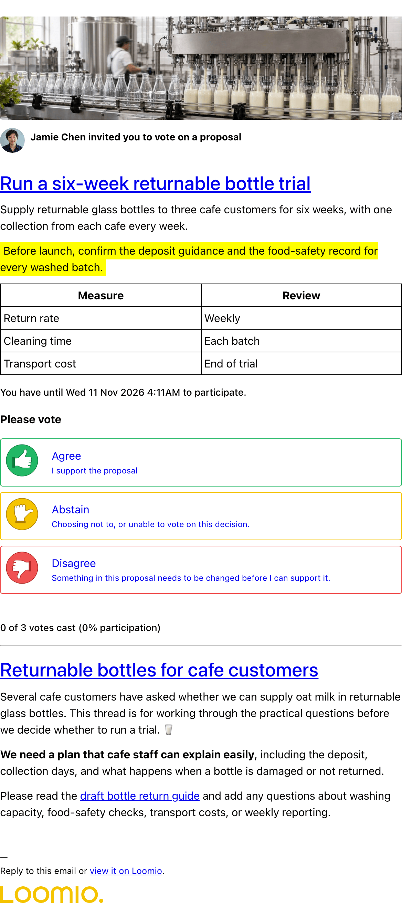

<!-- translation-section: enable-mobile-notifications-with-web-push -->

## Enable mobile notifications with web push

Web push is how Loomio delivers mobile notifications. It notifies you about Loomio activity on your phone even when Loomio is closed.

On Android, open **Notification settings** in a supported browser and enable push.

On an iPhone or iPad:

1. Open Loomio in Safari.
2. Select **Share**, then **Add to Home Screen**.
3. Open Loomio from the new Home Screen icon and enable push in **Notification settings**.

Select **Test connection** to verify delivery to every browser listed under **Enabled browsers**.

Web push also works in supported desktop browsers if you want Loomio notifications on your computer.

Once push is enabled in at least one browser, group and thread notification forms let you choose **Email**, **Push**, or **Email and push**. Email and push can use different settings. Push delivery can be delayed by your browser, operating system, or network connection.

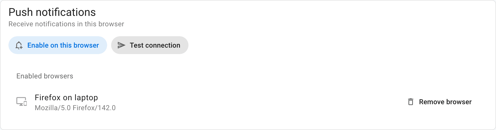

<!-- translation-section: turn-off-external-notifications -->

## Turn off external notifications

To stop email and push notifications for group and thread activity, open **Notification settings** from your user menu. Set the catch-up to **Never**, then choose **No email updates** and **No push updates**. Notifications and activity remain available whenever you open Loomio.

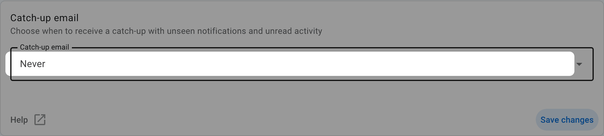

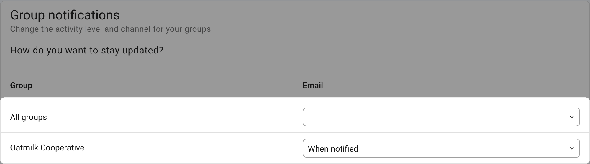
